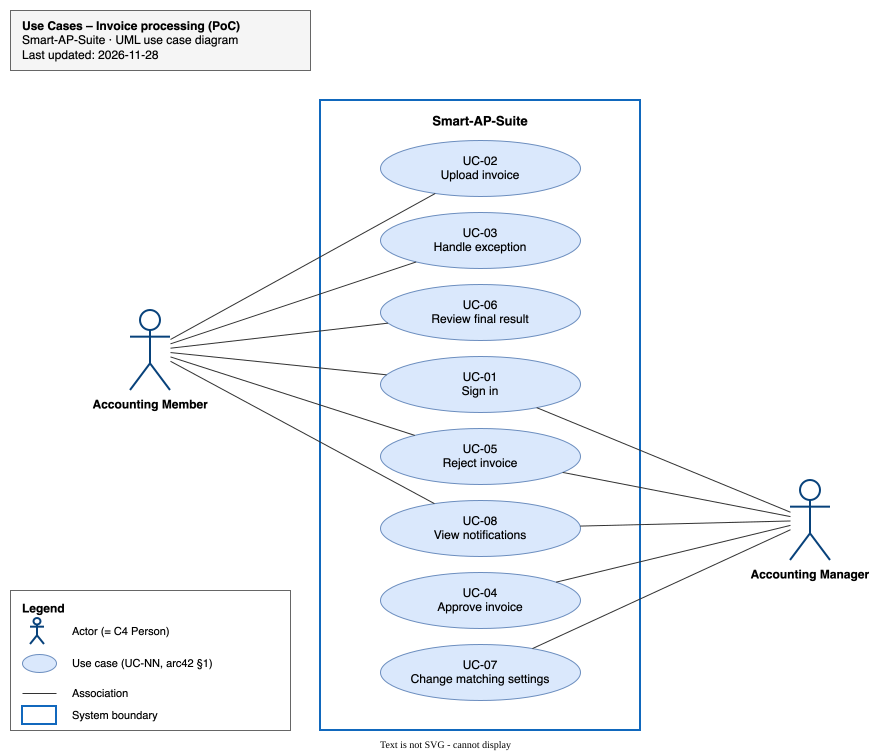

# §1 Introduction and Goals

## 1.1 Requirements Overview
Smart-AP-Suite automates the customer's Accounts Payable flow. An Accounting Member uploads an invoice; the system
extracts its data, derives the invoice type from the PO number and matches it line by line against purchase orders
and goods receipts. Exceptions go to a shared queue for manual review, invoices above the approval threshold go to
the Accounting Manager, and an Accounting Member confirms the final result.
The first phase is a locally run Proof of Concept with dummy extraction and ERP data ([DEC-003](../../01-requirements/decision-log.md#dec-003)).

Scope: see [Scope Statement](../../01-requirements/scope.md).

### Use Cases

| ID | Use case | Primary actor | Scope item | Backlog |
|---|---|---|---|---|
| UC-01 | Sign in | Accounting Member, Accounting Manager | SCP-IN-12, SCP-IN-18 | [SAPS-27](https://linear.app/jiringuyen/issue/SAPS-27), [SAPS-44](https://linear.app/jiringuyen/issue/SAPS-44) |
| UC-02 | Upload invoice | Accounting Member | SCP-IN-01, SCP-IN-02 | [SAPS-17](https://linear.app/jiringuyen/issue/SAPS-17) |
| UC-03 | Handle exception | Accounting Member | SCP-IN-04 | [SAPS-20](https://linear.app/jiringuyen/issue/SAPS-20) |
| UC-04 | Approve invoice | Accounting Manager | SCP-IN-06 | [SAPS-22](https://linear.app/jiringuyen/issue/SAPS-22) |
| UC-05 | Reject invoice | Accounting Member, Accounting Manager | SCP-IN-14 | [SAPS-29](https://linear.app/jiringuyen/issue/SAPS-29) |
| UC-06 | Review final result | Accounting Member | SCP-IN-05 | [SAPS-21](https://linear.app/jiringuyen/issue/SAPS-21) |
| UC-07 | Change matching settings | Accounting Manager | SCP-IN-13 | [SAPS-28](https://linear.app/jiringuyen/issue/SAPS-28) |
| UC-08 | View notifications | Accounting Member, Accounting Manager | SCP-IN-08 | [SAPS-24](https://linear.app/jiringuyen/issue/SAPS-24) |
| UC-09 | Search invoices | Accounting Member, Accounting Manager | SCP-IN-22 | [SAPS-46](https://linear.app/jiringuyen/issue/SAPS-46) |

Matching (SCP-IN-03) and duplicate detection (SCP-IN-07) run inside UC-02 and UC-03; they have no actor of their own.

## 1.2 Quality Goals
| Priority | Quality goal | Motivation | NFRs |
|---|---|---|---|
| 1 | Scalability | The design must grow beyond the PoC without a redesign | [NFR-SCAL-001](../../01-requirements/nfr.md#nfr-scal-001) |
| 2 | Modifiability | Dummy extraction and ERP data are replaced later by real services and SAP through MuleSoft ([CON-03](02-constraints.md), [ADR-0001](../adr/0001-isolate-extraction-and-erp-behind-ports.md)) | — |

## 1.3 Stakeholders
| Role | Name / organization | Expectations from the architecture |
|---|---|---|
| Product Owner (sponsor, decision maker, sign-off) | TBD (Customer) | All PoC flows run successfully in the demo on 2027-02-22; a path to production later |
| Accounting Member (user) | Customer | Fast upload, clear exception queue, correct matching |
| Accounting Manager (user) | Customer | Clear approval list; control of tolerance and threshold settings |
| Solution Architect | TBD (our company) | Architecture that survives the move from dummy data to real services |
| Tech Lead / developers | TBD (our company) | Simple local setup; clear ports between domain logic and data sources |
