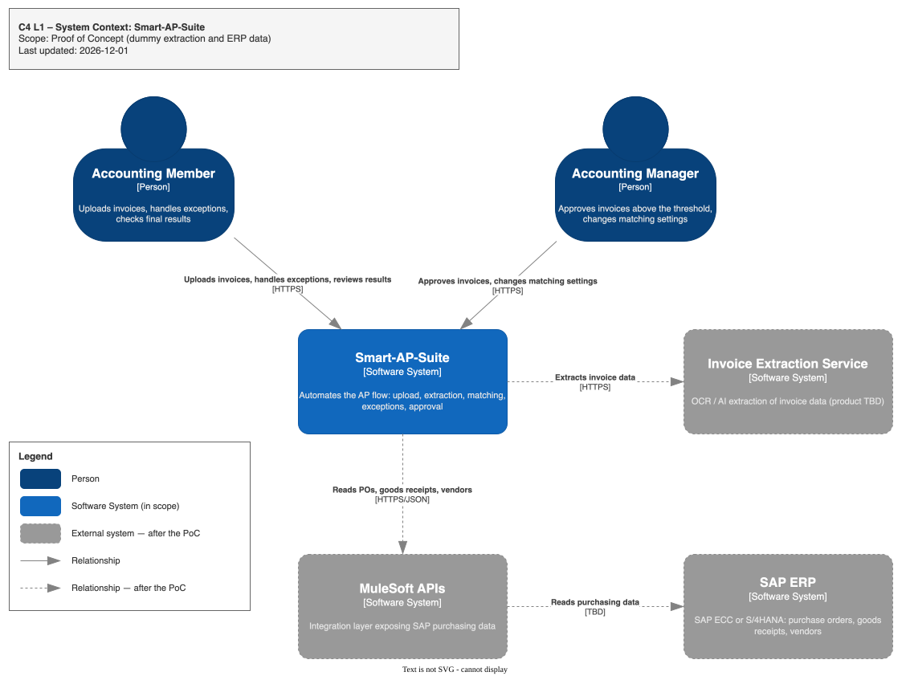

# §3 Context and Scope

## 3.1 Business Context

In the PoC, Smart-AP-Suite has **no live external interfaces**: extraction results and ERP data are dummy data inside
the system ([DEC-004](../../01-requirements/decision-log.md#dec-004), [ADR-0001](../adr/0001-isolate-extraction-and-erp-behind-ports.md)).
The grey external systems show the context after the PoC ([SCP-OUT-01, SCP-OUT-02](../../01-requirements/scope.md#4-out-of-scope)).

| Partner | Type | Receives from our system | Sends to our system | Owner |
|---|---|---|---|---|
| Accounting Member | Person | Exception, review and status notifications; matching results | Invoice files; corrections; confirmations and rejections | Customer |
| Accounting Manager | Person | Approval requests | Approvals and rejections; matching settings | Customer |
| Invoice Extraction Service | External system (after the PoC) | Invoice files | Extracted invoice data | TBD (product TBD) |
| MuleSoft APIs | External system (after the PoC) | Queries for POs, goods receipts, vendors | Purchase orders, goods receipts, vendors | Customer IT (TBD) |
| SAP ERP | External system (after the PoC, through MuleSoft APIs) | — (read only, through MuleSoft APIs) | Purchasing data | Customer IT (TBD) |

## 3.2 Technical Context
| Interface | Partner | Direction | Protocol / format | Auth | Frequency / volume | Spec |
|---|---|---|---|---|---|---|
| SAPS Web App (UI) | Accounting Member, Accounting Manager | In | HTTPS, browser | Simple user accounts ([NFR-SEC-001](../../01-requirements/nfr.md#nfr-sec-001)) | TBD (MTG-20261114 Q5) | `saps-api.openapi.yaml` (TBD) |
| Extraction API | Invoice Extraction Service | Out | HTTPS, format TBD | TBD | after the PoC | TBD |
| ERP data API | MuleSoft APIs | Out | HTTPS/JSON or MuleSoft MCP Tools ([CON-03](02-constraints.md)) | TBD | after the PoC | TBD |

## 3.3 Out of Context
- Payment of invoices — see [SCP-OUT-03](../../01-requirements/scope.md#4-out-of-scope)
- Posting results to the ERP or exporting them — see [SCP-OUT-08](../../01-requirements/scope.md#4-out-of-scope)
- Tax / VAT validation — see [SCP-OUT-04](../../01-requirements/scope.md#4-out-of-scope)
