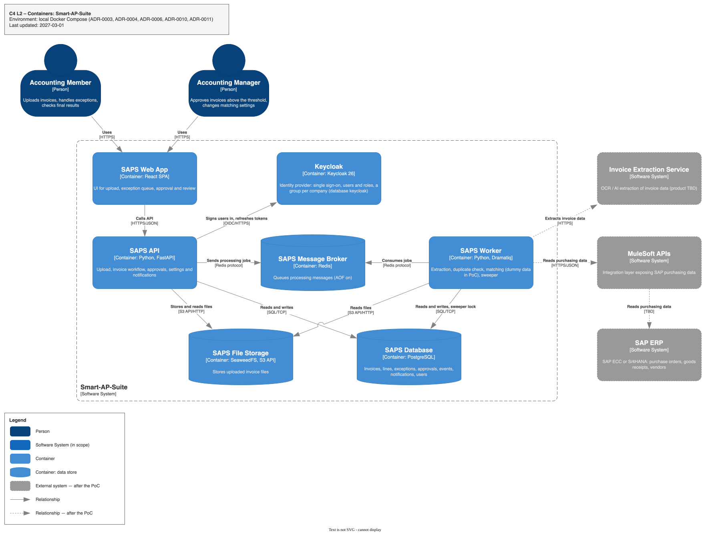

# §5 Building Block View

## 5.1 Level 1 – Containers

All containers run locally with Docker Compose in the PoC and in the Phase 2 demo ([CON-01](02-constraints.md), [DEC-053](../../01-requirements/decision-log.md#dec-053), [ADR-0003](../adr/0003-use-postgresql-and-docker-compose.md)).
SAPS API and SAPS Worker share one Python codebase ([ADR-0004](../adr/0004-process-invoices-in-background-worker.md)).

| Container | Type | Technology | Responsibility | Repository | API |
|---|---|---|---|---|---|
| SAPS Web App | Web app | React SPA ([ADR-0002](../adr/0002-use-python-fastapi-and-react.md)) | UI for upload, exception queue, approval and review | TBD | — |
| SAPS API | API | Python, FastAPI, SQLAlchemy async ([ADR-0002](../adr/0002-use-python-fastapi-and-react.md), [ADR-0005](../adr/0005-use-sqlalchemy-and-alembic.md)) | Upload, invoice workflow, approvals, settings and notifications | TBD | [saps-api.openapi.yaml](../api/saps-api.openapi.yaml) |
| SAPS Worker | Worker | Python, Dramatiq with AsyncIO middleware, APScheduler ([ADR-0004](../adr/0004-process-invoices-in-background-worker.md)) | Extraction, duplicate check, matching; sweeper for stuck invoices | TBD (same as SAPS API) | — |
| SAPS Message Broker | Queue | Redis, AOF persistence ([ADR-0004](../adr/0004-process-invoices-in-background-worker.md)) | Queues processing messages | — | — |
| SAPS File Storage | Object storage | SeaweedFS 4.53, S3 API ([ADR-0006](../adr/0006-store-invoice-files-in-seaweedfs.md)) | Stores uploaded invoice files | — | S3 API |
| SAPS Database | Database | PostgreSQL ([ADR-0003](../adr/0003-use-postgresql-and-docker-compose.md)) | Invoices, workflow state, approvals, events, notifications, users ([data model](../data-model.md)) | — | — |
| Keycloak | Identity provider | Keycloak 26, data in the database `keycloak` of the SAPS Database container ([ADR-0010](../adr/0010-use-one-keycloak-realm-with-company-groups.md), [ADR-0011](../adr/0011-sign-in-through-keycloak-with-a-server-side-session.md)) | Single sign-on: realm `saps`, a group per company, roles Accounting Member and Accounting Manager, client `saps-web` of the SAPS API ([SAPS-43](https://linear.app/jiringuyen/issue/SAPS-43)) | `deploy/keycloak/` | OpenID Connect |

## 5.2 Level 2 – Components

### 5.2.1 SAPS API and SAPS Worker (shared codebase)
A C4 L3 diagram is drawn when the codebase structure is set up. The ports below are fixed by ADRs.

| Component | Responsibility | Depends on |
|---|---|---|
| Extraction Port | Provides extracted invoice data for a file | Dummy Extraction Adapter (PoC); Invoice Extraction Service (later) — [ADR-0001](../adr/0001-isolate-extraction-and-erp-behind-ports.md) |
| ERP Data Port | Provides POs, goods receipts, vendors | Dummy ERP Adapter (PoC); MuleSoft APIs (later) — [ADR-0001](../adr/0001-isolate-extraction-and-erp-behind-ports.md) |
| Job Queue Port | Sends and receives processing jobs | SAPS Message Broker — [ADR-0004](../adr/0004-process-invoices-in-background-worker.md) |
| File Storage Port | Stores and reads invoice files | SAPS File Storage — [ADR-0006](../adr/0006-store-invoice-files-in-seaweedfs.md) |
