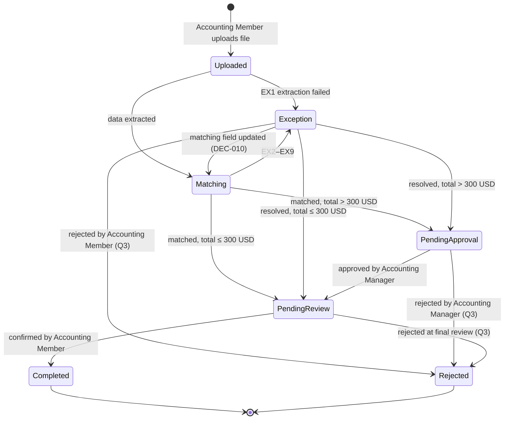

# §6 Runtime View

> **Draft for review at MTG-20261128** ([MTG-20261121](../../01-requirements/meetings/2026-11-21-requirements-workshop.md) A2).
> Steps marked **(proposal)** depend on open questions Q1–Q4 of MTG-20261121 and may change.

## 6.1 Scenario Index
| # | Scenario | Use cases | Feature specs |
|---|---|---|---|
| 6.2 | Invoice processing end to end (PoC) | — (TBD) | — |

## 6.2 Invoice processing end to end (PoC)
**Trigger:** An Accounting Member uploads an invoice file in the AP Web App.
**Preconditions:** The user is signed in ([NFR-SEC-001](../../01-requirements/nfr.md#nfr-sec-001)).
Dummy extraction data and dummy ERP data are loaded ([ADR-0001](../adr/0001-isolate-extraction-and-erp-behind-ports.md)).

```mermaid
sequenceDiagram
    autonumber
    actor Member as Accounting Member
    actor Manager as Accounting Manager
    participant Web as AP Web App
    participant API as AP API
    participant DB as AP Database

    Member->>Web: Upload invoice file (PDF / image)
    Web->>API: Upload invoice [HTTPS/JSON, multipart]
    API->>API: Get extracted data via Extraction Port (dummy, proposal Q1)
    API->>DB: Save invoice, status Uploaded
    alt Extraction failed (EX1)
        API->>DB: Status Exception
    else Data extracted
        API->>DB: Duplicate check: same vendor + invoice number (DEC-008)
        API->>API: Derive invoice type from PO number (DEC-005)
        API->>API: Get POs, goods receipts, vendors via ERP Data Port (dummy)
        API->>API: Line-level 2-way / 3-way matching (DEC-006, DEC-007)
        API->>DB: Save matching result and status
    end
    API-->>Web: Invoice status

    opt Status Exception (EX1–EX9)
        API-->>Web: In-app notification to Accounting Member
        Member->>Web: Review exception, update invoice
        Web->>API: Update invoice [HTTPS/JSON]
        alt A matching field changed (DEC-010)
            API->>API: Re-run matching
        else Only other fields changed, or non-PO invoice reviewed
            API->>DB: Mark exception resolved
        end
    end

    opt Total amount incl. tax > 300 USD (DEC-009; non-PO: Q4)
        API->>DB: Status PendingApproval
        API-->>Web: In-app notification to Accounting Manager
        Manager->>Web: Approve or reject
        Web->>API: Approval decision [HTTPS/JSON]
        alt Rejected (proposal, Q3)
            API->>DB: Status Rejected
        end
    end

    API->>DB: Status PendingReview (proposal, Q2)
    API-->>Web: In-app notification to Accounting Member
    Member->>Web: Check final result
    Web->>API: Confirm result [HTTPS/JSON]
    API->>DB: Status Completed
```

**Notes:**
- The matching result is only displayed; nothing is posted to an ERP ([SCP-OUT-08](../../01-requirements/scope.md)).
- Processing runs inside the AP API request in the PoC; asynchronous processing is a decision for later phases.
- How in-app notifications reach the AP Web App (polling or push) is decided in the feature spec.

**Related:** [DEC-003](../../01-requirements/decision-log.md#dec-003) to
[DEC-010](../../01-requirements/decision-log.md#dec-010), [ADR-0001](../adr/0001-isolate-extraction-and-erp-behind-ports.md),
[ADR-0002](../adr/0002-use-python-fastapi-and-react.md).

### 6.2.1 Invoice lifecycle (proposal)
This diagram moves to `data-model.md` §5 when the data model is created.



| State | Meaning | Waiting for |
|---|---|---|
| Uploaded | File received; extraction in progress | System |
| Matching | Duplicate check, type derivation and matching in progress | System |
| Exception | Automatic processing stopped (EX1–EX9) | Accounting Member |
| PendingApproval | Total amount above the approval threshold | Accounting Manager |
| PendingReview | Ready for the final check | Accounting Member |
| Completed | Final result confirmed | — |
| Rejected | Invoice rejected (proposal, Q3) | — |
