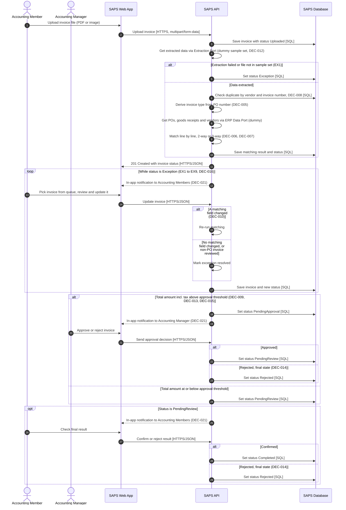
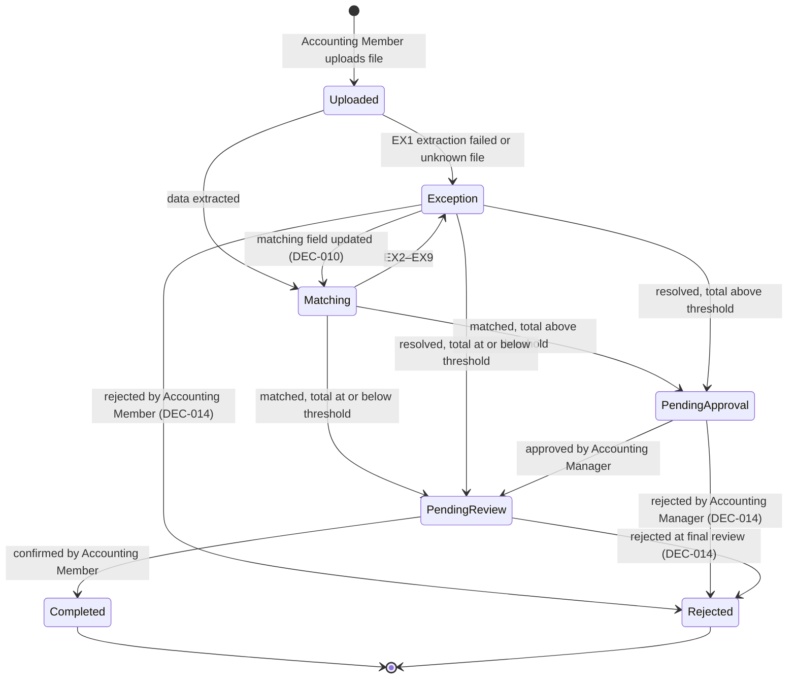

# §6 Runtime View

The end-to-end flow was approved by the Product Owner in
[MTG-20261128](../../01-requirements/meetings/2026-11-28-poc-flow-review.md) R2.

## 6.1 Scenario Index
| # | Scenario | Use cases | Feature specs |
|---|---|---|---|
| 6.2 | Invoice processing end to end (PoC) | UC-02 to UC-06, UC-08 ([§1](01-introduction-and-goals.md#use-cases)) | — |

## 6.2 Invoice processing end to end (PoC)
**Trigger:** An Accounting Member uploads an invoice file in the SAPS Web App.
**Preconditions:** The user is signed in ([NFR-SEC-001](../../01-requirements/nfr.md#nfr-sec-001)).
Dummy extraction data and dummy ERP data are loaded ([ADR-0001](../adr/0001-isolate-extraction-and-erp-behind-ports.md)).

**Notes:**
- The matching result is only displayed; nothing is posted to an ERP ([SCP-OUT-08](../../01-requirements/scope.md)).
- Processing runs inside the SAPS API request in this draft; the processing model is decided in an ADR ([SAPS-33](https://linear.app/jiringuyen/issue/SAPS-33), driven by [NFR-SCAL-001](../../01-requirements/nfr.md#nfr-scal-001)).
- During exception handling an Accounting Member can also reject the invoice (DEC-014); see the lifecycle below.
- How in-app notifications reach the SAPS Web App (polling or push) is decided in the feature spec.

**Related:** [DEC-003](../../01-requirements/decision-log.md#dec-003) to
[DEC-010](../../01-requirements/decision-log.md#dec-010), [ADR-0001](../adr/0001-isolate-extraction-and-erp-behind-ports.md),
[ADR-0002](../adr/0002-use-python-fastapi-and-react.md), [ADR-0003](../adr/0003-use-postgresql-and-docker-compose.md).

### 6.2.1 Invoice lifecycle
This diagram moves to `data-model.md` §5 when the data model is created ([SAPS-31](https://linear.app/jiringuyen/issue/SAPS-31)).

| State | Meaning | Waiting for |
|---|---|---|
| Uploaded | File received; extraction in progress | System |
| Matching | Duplicate check, type derivation and matching in progress | System |
| Exception | Automatic processing stopped (EX1–EX9) | Accounting Member |
| PendingApproval | Total amount above the approval threshold | Accounting Manager |
| PendingReview | Ready for the final check | Accounting Member |
| Completed | Final result confirmed | — |
| Rejected | Invoice rejected; final state (DEC-014) | — |
