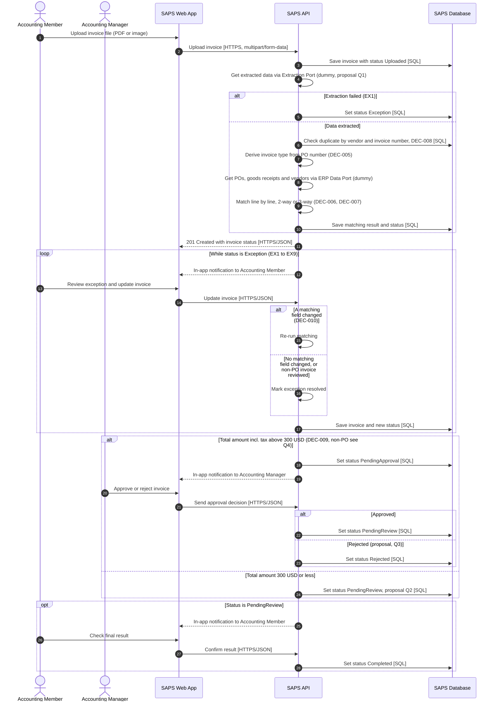
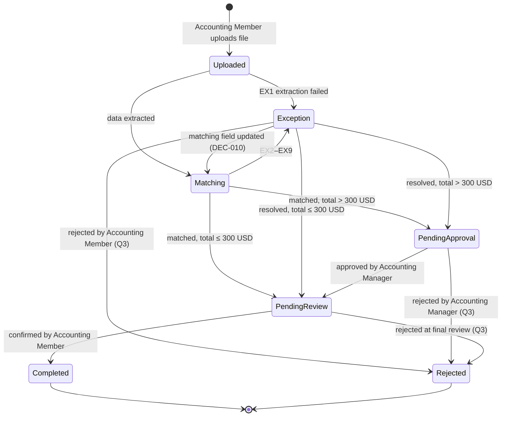

# §6 Runtime View

> **Draft for review at MTG-20261128** ([MTG-20261121](../../01-requirements/meetings/2026-11-21-requirements-workshop.md) A2).
> Steps marked **(proposal)** depend on open questions Q1–Q4 of MTG-20261121 and may change.

## 6.1 Scenario Index
| # | Scenario | Use cases | Feature specs |
|---|---|---|---|
| 6.2 | Invoice processing end to end (PoC) | — (TBD) | — |

## 6.2 Invoice processing end to end (PoC)
**Trigger:** An Accounting Member uploads an invoice file in the SAPS Web App.
**Preconditions:** The user is signed in ([NFR-SEC-001](../../01-requirements/nfr.md#nfr-sec-001)).
Dummy extraction data and dummy ERP data are loaded ([ADR-0001](../adr/0001-isolate-extraction-and-erp-behind-ports.md)).

**Notes:**
- The matching result is only displayed; nothing is posted to an ERP ([SCP-OUT-08](../../01-requirements/scope.md)).
- Processing runs inside the SAPS API request in the PoC; asynchronous processing is a decision for later phases.
- How in-app notifications reach the SAPS Web App (polling or push) is decided in the feature spec.

**Related:** [DEC-003](../../01-requirements/decision-log.md#dec-003) to
[DEC-010](../../01-requirements/decision-log.md#dec-010), [ADR-0001](../adr/0001-isolate-extraction-and-erp-behind-ports.md),
[ADR-0002](../adr/0002-use-python-fastapi-and-react.md), [ADR-0003](../adr/0003-use-postgresql-and-docker-compose.md).

### 6.2.1 Invoice lifecycle (proposal)
This diagram moves to `data-model.md` §5 when the data model is created.

| State | Meaning | Waiting for |
|---|---|---|
| Uploaded | File received; extraction in progress | System |
| Matching | Duplicate check, type derivation and matching in progress | System |
| Exception | Automatic processing stopped (EX1–EX9) | Accounting Member |
| PendingApproval | Total amount above the approval threshold | Accounting Manager |
| PendingReview | Ready for the final check | Accounting Member |
| Completed | Final result confirmed | — |
| Rejected | Invoice rejected (proposal, Q3) | — |
