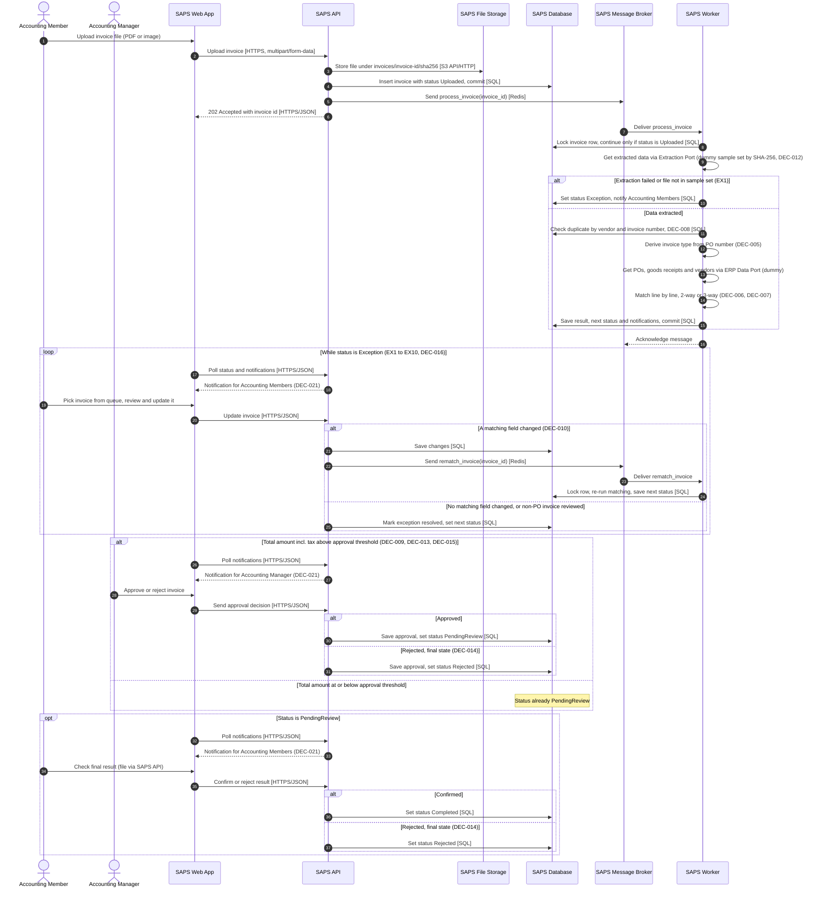
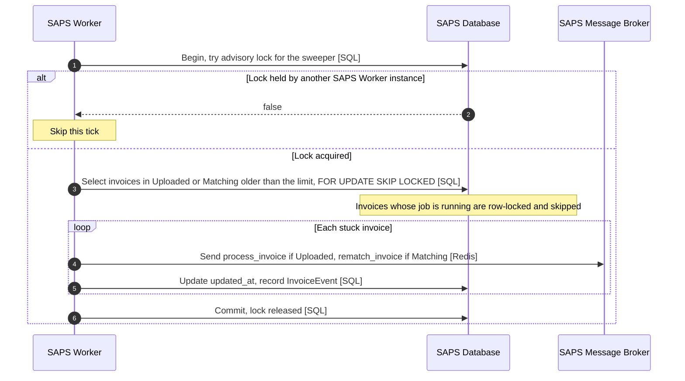

# §6 Runtime View

The business flow was approved by the Product Owner in
[MTG-20261128](../../01-requirements/meetings/2026-11-28-poc-flow-review.md) R2. Processing is asynchronous
([ADR-0004](../adr/0004-process-invoices-in-background-worker.md)); files are stored in SAPS File Storage
([ADR-0006](../adr/0006-store-invoice-files-in-seaweedfs.md)).

## 6.1 Scenario Index
| # | Scenario | Use cases | Feature specs |
|---|---|---|---|
| 6.2 | Invoice processing end to end (PoC) | UC-02 to UC-06, UC-08 ([§1](01-introduction-and-goals.md#use-cases)) | — |
| 6.3 | Recovery of stuck invoices (sweeper) | — (system) | — |

## 6.2 Invoice processing end to end (PoC)
**Trigger:** An Accounting Member uploads an invoice file in the SAPS Web App.
**Preconditions:** The user is signed in ([NFR-SEC-001](../../01-requirements/nfr.md#nfr-sec-001)).
Dummy extraction data and dummy ERP data are loaded ([ADR-0001](../adr/0001-isolate-extraction-and-erp-behind-ports.md)).

**Notes:**
- The matching result is only displayed; nothing is posted to an ERP ([SCP-OUT-08](../../01-requirements/scope.md)).
- Worker actors are idempotent: they lock the invoice row and do nothing if the status is no longer the expected one
  ([ADR-0004](../adr/0004-process-invoices-in-background-worker.md) S2).
- The SAPS Web App polls for status and notifications; push (e.g. WebSocket) can be decided in the feature spec.
- During exception handling an Accounting Member can also reject the invoice ([DEC-014](../../01-requirements/decision-log.md#dec-014)); see the lifecycle.
- The invoice lifecycle (states and transitions) is in [data-model.md §5](../data-model.md#invoice-lifecycle).

## 6.3 Recovery of stuck invoices (sweeper)
**Trigger:** Timer in the SAPS Worker (APScheduler), every few seconds.
**Purpose:** Recover invoices whose message was lost (crash between commit and send, Redis restart) or whose worker
crashed mid-job ([ADR-0004](../adr/0004-process-invoices-in-background-worker.md) S1, verified in spike
[SAPS-34](https://linear.app/jiringuyen/issue/SAPS-34)).

**Related:** [DEC-003](../../01-requirements/decision-log.md#dec-003) to
[DEC-021](../../01-requirements/decision-log.md#dec-021), [ADR-0001](../adr/0001-isolate-extraction-and-erp-behind-ports.md),
[ADR-0004](../adr/0004-process-invoices-in-background-worker.md), [ADR-0006](../adr/0006-store-invoice-files-in-seaweedfs.md).
