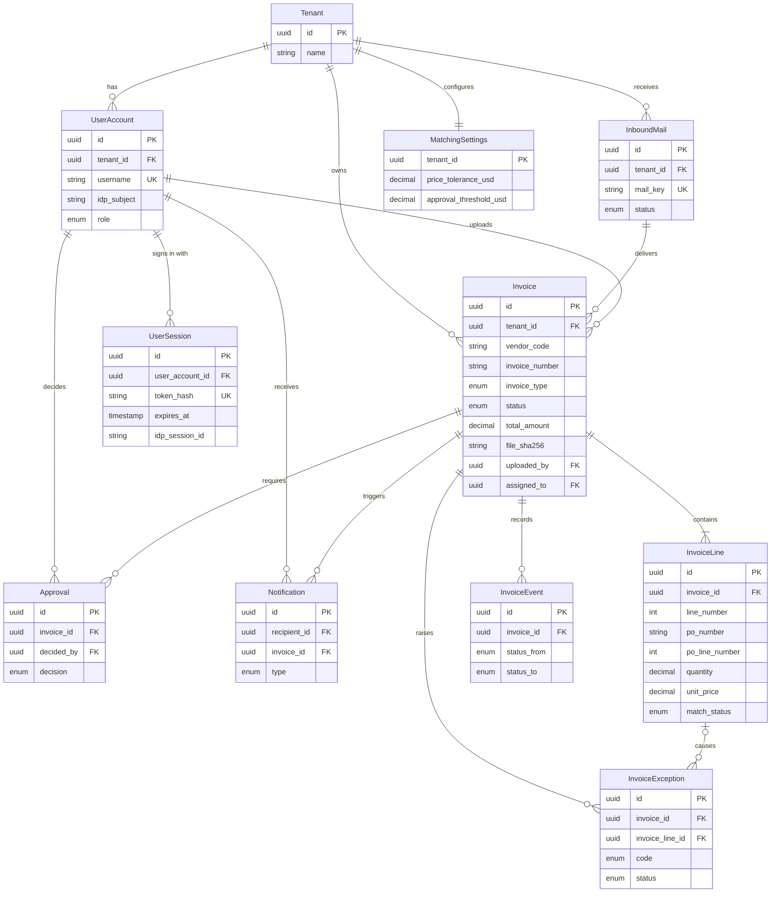
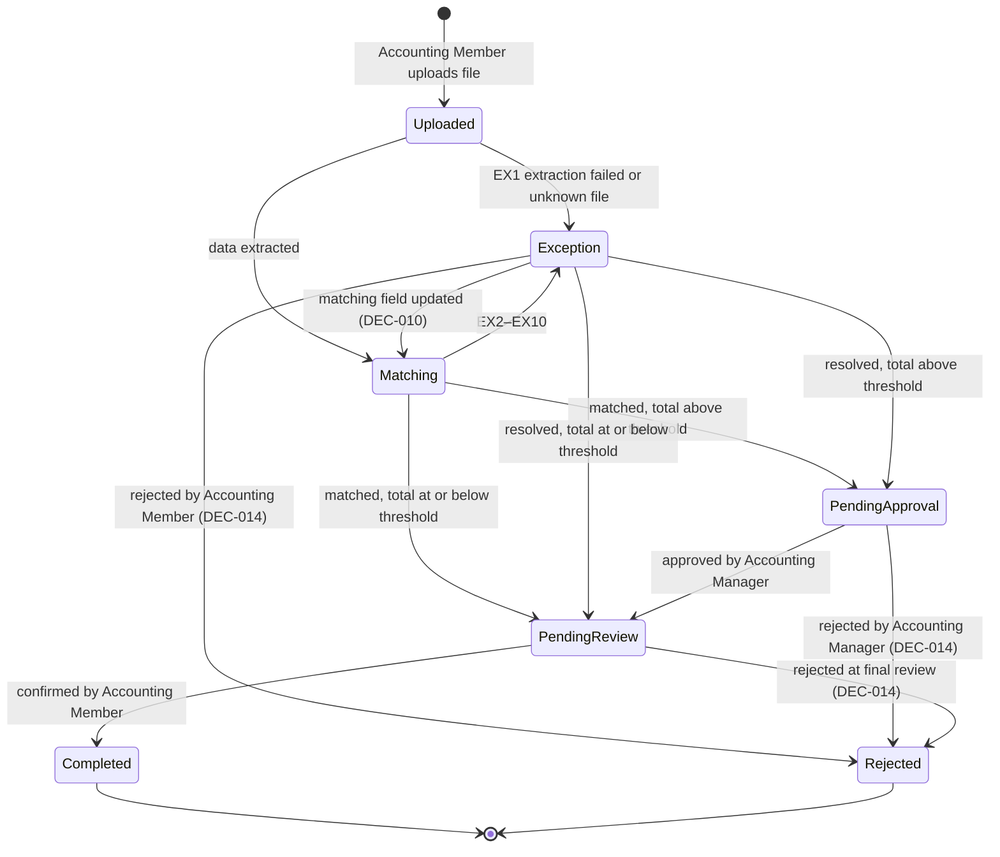

# Data Model

Scope: Proof of Concept ([DEC-003](../01-requirements/decision-log.md#dec-003)). Linear: [SAPS-31](https://linear.app/jiringuyen/issue/SAPS-31).

Containers and stores: [ADR-0003](adr/0003-use-postgresql-and-docker-compose.md), [ADR-0004](adr/0004-process-invoices-in-background-worker.md), [ADR-0006](adr/0006-store-invoice-files-in-seaweedfs.md).

## 1. Overview
| Data store | Technology | Owning container | Entities | ADR |
|---|---|---|---|---|
| SAPS Database | PostgreSQL (version in the Developer Guide) | SAPS API (the SAPS Worker shares the codebase and schema) | Tenant, UserAccount, UserSession, Invoice, InvoiceLine, InvoiceException, Approval, InvoiceEvent, Notification, MatchingSettings | [ADR-0003](adr/0003-use-postgresql-and-docker-compose.md), [ADR-0004](adr/0004-process-invoices-in-background-worker.md) |
| SAPS Message Broker | Redis, persistence on (AOF) | SAPS API (sends), SAPS Worker (consumes) | Transient processing messages only (invoice ID + job type); no business data; never the source of truth | [ADR-0004](adr/0004-process-invoices-in-background-worker.md) |
| SAPS File Storage | SeaweedFS (S3 API) | SAPS API (writes), SAPS Worker (reads) | Uploaded invoice files, key `invoices/{invoice_id}/{file_sha256}` in `Invoice.file_storage_key` | [ADR-0006](adr/0006-store-invoice-files-in-seaweedfs.md) |
| Dummy sample set | JSON fixture files | Dummy Extraction Adapter | ExtractedInvoice (§4.2) | [ADR-0001](adr/0001-isolate-extraction-and-erp-behind-ports.md), [DEC-012](../01-requirements/decision-log.md#dec-012) |
| Dummy ERP data | JSON fixture files | Dummy ERP Adapter | Vendor, PurchaseOrder, PurchaseOrderLine, GoodsReceipt, GoodsReceiptLine (§4.2) | [ADR-0001](adr/0001-isolate-extraction-and-erp-behind-ports.md) |

ERP data and extraction results are **not** stored in the SAPS Database: they are read through the ERP Data Port and
the Extraction Port, so the real sources can replace the fixtures later ([CON-03](arc42/02-constraints.md)).

## 2. Entity Relationship Diagram
All tenant-owned tables carry `tenant_id` ([ADR-0007](adr/0007-prepare-data-model-for-tenants.md)); the diagram shows it only on UserAccount, Invoice and MatchingSettings.

## 3. Data Classification
| Level | Meaning | Handling |
|---|---|---|
| Public | Can be published | No restriction |
| Internal | Business data, not sensitive | Authenticated access only |
| Confidential | Financial or commercial data | Role-based access, encrypted at rest, audit reads of bulk exports |
| Restricted | Personal data (PII), credentials, bank details | Need-to-know access, masked in logs and non-prod, encrypted, access audited |

The PoC uses only synthetic data ([DEC-004](../01-requirements/decision-log.md#dec-004)); the classification applies from the first phase with real data.

## 4. Entities

### 4.1 Entities in the SAPS Database
Conventions:
- Every tenant-owned table (all tables below except Tenant) has `tenant_id` (uuid, Not null, FK → Tenant, class Internal)
  ([ADR-0007](adr/0007-prepare-data-model-for-tenants.md)). The PoC has one tenant; `tenant_id` is not an isolation boundary yet. It is not repeated below.
- Every table also has the audit columns `created_at` (timestamp UTC), `created_by` (string(100)),
  `updated_at` (timestamp UTC) and `updated_by` (string(100)), all Not null, class Internal. They are not repeated below.
- Matching fields ([DEC-024](../01-requirements/decision-log.md#dec-024)): `Invoice.vendor_code`, `Invoice.invoice_number`, `InvoiceLine.po_number`,
  `InvoiceLine.po_line_number`, `InvoiceLine.quantity`, `InvoiceLine.unit_price`. A manual change to one of them sends `rematch_invoice`.
- Amounts are in USD only in the PoC ([DEC-006](../01-requirements/decision-log.md#dec-006)).
- Retention: TBD (MTG-20261114 Q30). In the PoC, demo data is reset by recreating the containers.
- Expected volume: demo scale in the PoC (tens of invoices); production volume TBD (MTG-20261114 Q5).

### Tenant
A customer company (in Phase 2: a subsidiary of the group, [DEC-060](../01-requirements/decision-log.md#dec-060)) served by Smart-AP-Suite ([ADR-0007](adr/0007-prepare-data-model-for-tenants.md)). The seed creates the demo companies of `fixtures/companies.json` ([SAPS-42](../03-features/SAPS-42-companies-and-demo-data.md)).

| Property | Value |
|---|---|
| Data store / table | SAPS Database / `tenant` |
| Owning container | SAPS API |
| Lifecycle | seeded for the demo companies; created or updated at each sign-in (SAPS-44 BR-03) |
| Retention | TBD (Q2) |
| Expected volume | 3 in the Phase 2 demo; more subsidiaries later ([DEC-026](../01-requirements/decision-log.md#dec-026), [DEC-060](../01-requirements/decision-log.md#dec-060)) |

| Attribute | Type | Null | Key | Class. | Description |
|---|---|---|---|---|---|
| id | uuid | No | PK | Internal | Surrogate key |
| name | string(200) | No | UK | Confidential | Customer company name |
| is_active | boolean | No | — | Internal | Inactive tenants cannot sign in |
| code | string(20) | No | UK | Internal | Short company code (`vn`, `sg`, `my`); selects the company's ERP data ([SAPS-42](../03-features/SAPS-42-companies-and-demo-data.md)) |
| email_domain | string(255) | Yes | UK | Internal | E-mail domain of the company's users ([DEC-061](../01-requirements/decision-log.md#dec-061)) |
| keycloak_group | string(255) | Yes | UK | Internal | Keycloak group of the company, e.g. `/companies/vn` ([ADR-0010](adr/0010-use-one-keycloak-realm-with-company-groups.md)) |
| mailbox_address | string(320) | Yes | UK | Internal | Mailbox whose invoices belong to the company ([DEC-055](../01-requirements/decision-log.md#dec-055)) |
| time_zone | string(64) | No | — | Internal | IANA time zone, default `UTC` (processing calendar, [DEC-062](../01-requirements/decision-log.md#dec-062)) |

### UserAccount
A person who signs in through Keycloak: an Accounting Member or an Accounting Manager
([NFR-SEC-001](../01-requirements/nfr.md#nfr-sec-001), [SAPS-44](../03-features/SAPS-44-single-sign-on.md)). The SAPS
Database keeps no password; name, e-mail, company and role are copied from the Identity Provider at each sign-in.

| Property | Value |
|---|---|
| Data store / table | SAPS Database / `user_account` |
| Owning container | SAPS API |
| Lifecycle | seeded for the demo companies; created or updated at each sign-in (SAPS-44 BR-03) |
| Retention | TBD (Q2) |
| Expected volume | a few demo users |

| Attribute | Type | Null | Key | Class. | Description |
|---|---|---|---|---|---|
| id | uuid | No | PK | Internal | Surrogate key |
| username | string(100) | No | UK | Internal | The e-mail address; unique across tenants |
| display_name | string(200) | No | — | Restricted | Name shown in the UI (`name` claim) |
| email | string(320) | Yes | — | Restricted | E-mail address (`email` claim); a seeded account is linked by it at the first sign-in |
| idp_issuer | string(255) | Yes | UK (with `idp_subject`) | Internal | Issuer of the Identity Provider; empty until the first sign-in |
| idp_subject | string(255) | Yes | UK (with `idp_issuer`) | Internal | Subject (`sub`) of the user in the Identity Provider |
| role | enum | No | — | Internal | `ACCOUNTING_MEMBER`, `ACCOUNTING_MANAGER` |
| is_active | boolean | No | — | Internal | Inactive users cannot sign in (users are normally disabled in Keycloak) |

### UserSession
A signed-in browser session ([ADR-0011](adr/0011-sign-in-through-keycloak-with-a-server-side-session.md)). The cookie
holds a random value; only its hash is stored. The session keeps the Keycloak tokens, encrypted, so the SAPS API can
refresh them (SAPS-44 BR-05).

| Property | Value |
|---|---|
| Data store / table | SAPS Database / `user_session` |
| Owning container | SAPS API |
| Lifecycle | created at sign-in; ends at sign-out (`revoked_at`), back-channel logout, refused refresh, idle timeout or absolute timeout |
| Retention | delete expired and revoked sessions after TBD days |
| Expected volume | a few per user |

| Attribute | Type | Null | Key | Class. | Description |
|---|---|---|---|---|---|
| id | uuid | No | PK | Internal | Surrogate key |
| user_account_id | uuid | No | FK → UserAccount | Internal | Signed-in user; the tenant comes from this user |
| token_hash | string(64) | No | UK | Restricted | SHA-256 of the cookie value; the cookie value itself is never stored or logged |
| expires_at | timestamp UTC | No | — | Internal | Absolute timeout |
| last_seen_at | timestamp UTC | No | — | Internal | Used for the idle timeout |
| revoked_at | timestamp UTC | Yes | — | Internal | Set at sign-out, back-channel logout or a refused refresh |
| idp_session_id | string(255) | Yes | IX | Internal | Keycloak session (`sid`); back-channel logout ends the sessions with this value |
| refresh_token_encrypted | text | Yes | — | Restricted | Refresh token, encrypted (Fernet, `SESSION_ENCRYPTION_KEY`); never logged |
| id_token_encrypted | text | Yes | — | Restricted | ID token, encrypted; sent as `id_token_hint` at sign-out |
| access_token_expires_at | timestamp UTC | Yes | — | Internal | When the next request refreshes the tokens |

### Invoice
An uploaded vendor invoice and its processing state.

| Property | Value |
|---|---|
| Data store / table | SAPS Database / `invoice` |
| Owning container | SAPS API |
| Lifecycle | see [§5](#invoice-lifecycle) |
| Retention | TBD (Q2) |
| Expected volume | demo scale in the PoC |

| Attribute | Type | Null | Key | Class. | Description |
|---|---|---|---|---|---|
| id | uuid | No | PK | Internal | Surrogate key |
| status | enum | No | — | Internal | `UPLOADED`, `MATCHING`, `EXCEPTION`, `PENDING_APPROVAL`, `PENDING_REVIEW`, `COMPLETED`, `REJECTED` (§5) |
| invoice_type | enum | Yes | — | Internal | `TRADE_PO`, `NON_TRADE_PO`, `NON_PO`; null until derived ([DEC-005](../01-requirements/decision-log.md#dec-005)) |
| vendor_code | string(20) | Yes | — | Confidential | Vendor identifier from extraction; with `invoice_number` used for duplicate detection ([DEC-008](../01-requirements/decision-log.md#dec-008)) |
| vendor_name | string(200) | Yes | — | Confidential | Vendor name from extraction |
| invoice_number | string(50) | Yes | — | Confidential | Vendor's invoice number |
| invoice_number_normalized | string(50) | Yes | — | Confidential | `invoice_number` without case, spaces, `-`, `.`, `/`; used for duplicate detection ([DEC-042](../01-requirements/decision-log.md#dec-042)) |
| invoice_date | date | Yes | — | Confidential | Invoice date |
| currency | string(3) | No | — | Internal | `USD` only in the PoC |
| subtotal_amount | decimal(18,2) | Yes | — | Confidential | Amount before tax |
| tax_amount | decimal(18,2) | Yes | — | Confidential | Tax amount |
| total_amount | decimal(18,2) | Yes | — | Confidential | Amount incl. tax; compared with the approval threshold ([DEC-009](../01-requirements/decision-log.md#dec-009)) |
| price_tolerance_applied | decimal(18,4) | Yes | — | Internal | Tolerance used in the last matching run (snapshot of MatchingSettings) |
| approval_threshold_applied | decimal(18,2) | Yes | — | Internal | Threshold used to decide on approval (snapshot) |
| requires_approval | boolean | Yes | — | Internal | True when `total_amount` > `approval_threshold_applied` |
| assigned_to | uuid | Yes | FK → UserAccount | Internal | Accounting Member who picked the invoice from the exception queue ([DEC-016](../01-requirements/decision-log.md#dec-016)) |
| uploaded_by | uuid | Yes | FK → UserAccount | Internal | Accounting Member who uploaded the file; null for an invoice received by mail (set when `channel` is `UPLOAD`) |
| channel | enum | No | — | Internal | How the invoice entered: `UPLOAD` (default) or `MAIL` ([SAPS-45](../03-features/SAPS-45-mailbox-intake.md)) |
| inbound_mail_id | uuid | Yes | FK → InboundMail | Internal | The mail the invoice came with; set when `channel` is `MAIL` (check `ck_invoice_channel_source`) |
| file_name | string(255) | No | — | Internal | Original file name |
| file_content_type | string(100) | No | — | Internal | MIME type: PDF or image |
| file_size_bytes | bigint | No | — | Internal | File size |
| file_sha256 | string(64) | No | — | Internal | Content hash; identifies the dummy sample (Q4) |
| file_storage_key | string(500) | No | — | Internal | Object key in SAPS File Storage |
| idempotency_key | string(64) | No | UK (with tenant_id) | Internal | `Idempotency-Key` of the upload request; a repeated request returns this invoice ([SAPS-17](../03-features/SAPS-17-invoice-upload.md)) |
| rejected_reason | string(1000) | Yes | — | Internal | Reason entered at rejection ([DEC-014](../01-requirements/decision-log.md#dec-014)) |

Unique index: (`tenant_id`, `idempotency_key`). Index (not unique): (`tenant_id`, `vendor_code`, `invoice_number_normalized`) for duplicate detection. It is not a unique
key because a duplicate is stored and raised as EX9; rejected invoices are ignored by the check ([DEC-043](../01-requirements/decision-log.md#dec-043)).

### InboundMail
A mail read from a company mailbox and what became of it ([SAPS-45](../03-features/SAPS-45-mailbox-intake.md),
[ADR-0012](adr/0012-read-invoice-mailboxes-through-a-mail-port.md)). It makes the import exactly-once: a mail with a
final status is never imported again.

| Property | Value |
|---|---|
| Data store / table | SAPS Database / `inbound_mail` |
| Owning container | SAPS Worker |
| Lifecycle | `RECEIVED` while being imported → `PROCESSED` (at least one invoice) or `SKIPPED` (none, [DEC-055](../01-requirements/decision-log.md#dec-055)) |
| Retention | TBD (Q2) |
| Expected volume | one row per received mail; about the invoices per day per company ([NFR-SCAL-001](../01-requirements/nfr.md#nfr-scal-001)) |

| Attribute | Type | Null | Key | Class. | Description |
|---|---|---|---|---|---|
| id | uuid | No | PK | Internal | Surrogate key |
| mailbox_address | string(320) | No | — | Internal | Company mailbox that received the mail |
| mail_key | string(500) | No | UK (with tenant_id) | Internal | `Message-ID` of the mail, or `sha256:` + hash of its content when it has none |
| sender | string(320) | No | — | Confidential | Sender, shown as text; shortened |
| subject | string(500) | No | — | Confidential | Subject, shown as text; shortened |
| received_at | timestamp UTC | No | — | Internal | Date of the mail |
| status | enum | No | IX | Internal | `RECEIVED`, `PROCESSED`, `SKIPPED` |
| skip_reason | string(50) | Yes | — | Internal | `no_valid_attachment` when skipped |
| attachments | jsonb | No | — | Internal | Per attachment: position, name, size, invoice id or skip reason (`unsupported_type`, `too_large`, `empty`) |
| processed_at | timestamp UTC | Yes | — | Internal | When the mail got its final status |

Unique key: (`tenant_id`, `mail_key`). Row-level security like every tenant-owned table
([ADR-0009](adr/0009-isolate-tenant-data-in-a-shared-database.md)). Attachment bytes are never stored here; they are
invoice files in SAPS File Storage.

### InvoiceLine
One line of an invoice and its matching result.

| Property | Value |
|---|---|
| Data store / table | SAPS Database / `invoice_line` |
| Owning container | SAPS API |
| Lifecycle | created from extraction; updated by manual edits and matching |
| Retention | as Invoice |
| Expected volume | a few lines per invoice |

| Attribute | Type | Null | Key | Class. | Description |
|---|---|---|---|---|---|
| id | uuid | No | PK | Internal | Surrogate key |
| invoice_id | uuid | No | FK → Invoice | Internal | Parent invoice |
| line_number | int | No | — | Internal | Line number on the invoice; unique per invoice |
| description | string(500) | Yes | — | Confidential | Item or service description |
| po_number | string(20) | Yes | — | Confidential | PO number as on the invoice; a valid one has 7 digits ([DEC-005](../01-requirements/decision-log.md#dec-005)), others raise EX3 in matching; null for non-PO invoices |
| po_line_number | int | Yes | — | Confidential | PO line this invoice line refers to ([DEC-007](../01-requirements/decision-log.md#dec-007)) |
| quantity | decimal(18,3) | Yes | — | Confidential | Invoiced quantity |
| unit_price | decimal(18,4) | Yes | — | Confidential | Invoiced unit price (USD) |
| line_amount | decimal(18,2) | Yes | — | Confidential | Line amount (USD) |
| match_status | enum | No | — | Internal | `NOT_MATCHED`, `MATCHED`, `MISMATCH`, `NOT_APPLICABLE` (non-PO) |
| po_unit_price | decimal(18,4) | Yes | — | Confidential | PO unit price seen in the last matching run |
| expected_quantity | decimal(18,3) | Yes | — | Confidential | Received-not-invoiced quantity (3-way) or PO quantity not yet invoiced (2-way) in the last run |

Unique: (`invoice_id`, `line_number`). Index: (`tenant_id`, `po_number`, `po_line_number`) for the already invoiced quantity ([SAPS-19](../03-features/SAPS-19-invoice-matching.md) BR-10).

### InvoiceException
An exception raised for an invoice; an invoice can have several, at most one open per code and line.

| Property | Value |
|---|---|
| Data store / table | SAPS Database / `invoice_exception` |
| Owning container | SAPS API |
| Lifecycle | `OPEN` → `RESOLVED` (manual resolution or successful re-match) |
| Retention | as Invoice |
| Expected volume | 0–n per invoice |

| Attribute | Type | Null | Key | Class. | Description |
|---|---|---|---|---|---|
| id | uuid | No | PK | Internal | Surrogate key |
| invoice_id | uuid | No | FK → Invoice | Internal | Invoice concerned |
| invoice_line_id | uuid | Yes | FK → InvoiceLine | Internal | Line concerned; null for header-level exceptions (EX1, EX2, EX5, EX9) |
| code | enum | No | — | Internal | `EX1` … `EX10` ([DEC-033](../01-requirements/decision-log.md#dec-033)) |
| message | string(1000) | No | — | Internal | Human-readable details, e.g. expected vs. invoiced value |
| status | enum | No | — | Internal | `OPEN`, `RESOLVED` |
| resolved_by | uuid | Yes | FK → UserAccount | Internal | User who resolved it; null when resolved by re-matching |
| resolved_at | timestamp UTC | Yes | — | Internal | Resolution time |

### Approval
The Accounting Manager's decision on an invoice above the approval threshold ([DEC-009](../01-requirements/decision-log.md#dec-009), [DEC-013](../01-requirements/decision-log.md#dec-013)).

| Property | Value |
|---|---|
| Data store / table | SAPS Database / `approval` |
| Owning container | SAPS API |
| Lifecycle | insert only |
| Retention | as Invoice |
| Expected volume | 0–1 per invoice in the PoC |

| Attribute | Type | Null | Key | Class. | Description |
|---|---|---|---|---|---|
| id | uuid | No | PK | Internal | Surrogate key |
| invoice_id | uuid | No | FK → Invoice | Internal | Invoice decided on |
| decided_by | uuid | No | FK → UserAccount | Internal | Accounting Manager |
| decision | enum | No | — | Internal | `APPROVED`, `REJECTED` |
| comment | string(1000) | Yes | — | Internal | Reason, mandatory when rejected |
| decided_at | timestamp UTC | No | — | Internal | Decision time |

### InvoiceEvent
Audit trail of status changes and user actions on an invoice.

| Property | Value |
|---|---|
| Data store / table | SAPS Database / `invoice_event` |
| Owning container | SAPS API |
| Lifecycle | insert only |
| Retention | as Invoice |
| Expected volume | 5–15 per invoice |

| Attribute | Type | Null | Key | Class. | Description |
|---|---|---|---|---|---|
| id | uuid | No | PK | Internal | Surrogate key |
| invoice_id | uuid | No | FK → Invoice | Internal | Invoice concerned |
| status_from | enum | Yes | — | Internal | Previous status; null on creation |
| status_to | enum | No | — | Internal | New status |
| action | string(50) | No | — | Internal | e.g. `UPLOAD`, `MATCH`, `UPDATE_FIELDS`, `APPROVE`, `REJECT`, `CONFIRM`, `RESEND` (the sweeper sent a lost message again, [SAPS-37](../03-features/SAPS-37-stuck-invoice-sweeper.md)), `RESEND_LIMIT` (the sweeper stopped re-sending, [SAPS-38](../03-features/SAPS-38-ex1-after-last-retry.md)) |
| actor | string(100) | No | — | Internal | User or `system` (SAPS Worker) |
| details | json | Yes | — | Confidential | Changed fields, old and new values |
| occurred_at | timestamp UTC | No | — | Internal | Event time |

### Notification
An in-app notification for one user ([DEC-021](../01-requirements/decision-log.md#dec-021)). One row per recipient,
so read state is per user.

| Property | Value |
|---|---|
| Data store / table | SAPS Database / `notification` |
| Owning container | SAPS API |
| Lifecycle | created unread; `read_at` set when opened |
| Retention | TBD (Q2) |
| Expected volume | 1–n per invoice step |

| Attribute | Type | Null | Key | Class. | Description |
|---|---|---|---|---|---|
| id | uuid | No | PK | Internal | Surrogate key |
| recipient_id | uuid | No | FK → UserAccount | Internal | Recipient |
| invoice_id | uuid | No | FK → Invoice | Internal | Invoice concerned |
| type | enum | No | — | Internal | `EXCEPTION_RAISED` (Accounting Members), `APPROVAL_REQUESTED` (Accounting Manager), `REVIEW_REQUESTED` (Accounting Members) |
| message | string(500) | No | — | Internal | Text shown in the UI |
| read_at | timestamp UTC | Yes | — | Internal | Null while unread |

Index: (`recipient_id`, `read_at`, `created_at`) for the unread list and count ([SAPS-24](../03-features/SAPS-24-in-app-notifications.md)).

### MatchingSettings
One row per tenant with the configurable matching settings ([DEC-015](../01-requirements/decision-log.md#dec-015), [ADR-0007](adr/0007-prepare-data-model-for-tenants.md)).

| Property | Value |
|---|---|
| Data store / table | SAPS Database / `matching_settings` |
| Owning container | SAPS API |
| Lifecycle | one row per tenant, created with the tenant, updated by the Accounting Manager |
| Retention | current values only; changes are visible in `updated_at` / `updated_by` |
| Expected volume | 1 row per tenant |

| Attribute | Type | Null | Key | Class. | Description |
|---|---|---|---|---|---|
| tenant_id | uuid | No | PK, FK → Tenant | Internal | Tenant the settings belong to |
| price_tolerance_usd | decimal(18,4) | No | — | Internal | Default 0.5 |
| approval_threshold_usd | decimal(18,2) | No | — | Internal | Default 300 |

### 4.2 External entities (read through ports, not stored)
Logical structure of the data the SAPS API and SAPS Worker read. In the PoC it comes from JSON fixture files;
later from the real services ([ADR-0001](adr/0001-isolate-extraction-and-erp-behind-ports.md)).
Field names of SAP / MuleSoft are mapped in the adapters later.

| Entity | Port | Key fields | Other fields |
|---|---|---|---|
| ExtractedInvoice | Extraction Port | file_sha256 | vendor_code, vendor_name, invoice_number, invoice_date, currency, subtotal_amount, tax_amount, total_amount, lines (line_number, description, po_number, po_line_number, quantity, unit_price, line_amount) |
| Vendor | ERP Data Port | vendor_code | name |
| PurchaseOrder | ERP Data Port | po_number | vendor_code, currency |
| PurchaseOrderLine | ERP Data Port | po_number, po_line_number | description, ordered_quantity, unit_price |
| GoodsReceipt | ERP Data Port | gr_number | po_number, receipt_date |
| GoodsReceiptLine | ERP Data Port | gr_number, po_line_number | received_quantity |

Derived values used in matching ([DEC-007](../01-requirements/decision-log.md#dec-007)):
- **Already invoiced quantity** of a PO line = sum of `InvoiceLine.quantity` for that PO line on invoices in status
  `PENDING_APPROVAL`, `PENDING_REVIEW` or `COMPLETED` ([DEC-023](../01-requirements/decision-log.md#dec-023)); Exception and Rejected invoices do not count.
- **Received-not-invoiced quantity** = sum of `GoodsReceiptLine.received_quantity` − already invoiced quantity.
- **PO quantity not yet invoiced** = `PurchaseOrderLine.ordered_quantity` − already invoiced quantity.

## 5. Entity Lifecycles

### Invoice lifecycle
Approved by the Product Owner in [MTG-20261128](../01-requirements/meetings/2026-11-28-poc-flow-review.md) R2.
State names in the diagram map to the `Invoice.status` enum values (`PendingApproval` = `PENDING_APPROVAL`, …).

| State | Meaning | Waiting for |
|---|---|---|
| Uploaded | File received; processing message sent | SAPS Worker |
| Matching | Extraction, duplicate check, type derivation and matching in progress | SAPS Worker |
| Exception | Automatic processing stopped (EX1–EX10); in the shared exception queue | Accounting Member |
| PendingApproval | Total amount above the approval threshold | Accounting Manager |
| PendingReview | Ready for the final check | Accounting Member |
| Completed | Final result confirmed | — |
| Rejected | Invoice rejected; final state | — |

### Tenant isolation
Implemented in [SAPS-41](../03-features/SAPS-41-tenant-isolation.md) following [ADR-0009](adr/0009-isolate-tenant-data-in-a-shared-database.md)
(migration `0006_tenant_row_level_security`).

| Item | Value |
|---|---|
| Tenant-owned tables | `user_account`, `user_session`, `matching_settings`, `invoice`, `invoice_line`, `invoice_exception`, `approval`, `invoice_event`, `notification` (every table with `tenant_id`; a CI test checks this) |
| Row-level security | `ENABLE` and `FORCE`; policy `tenant_isolation` for all commands: `tenant_id = NULLIF(current_setting('app.tenant_id', true), '')::uuid` in `USING` and `WITH CHECK` — no company set means no rows |
| Roles | `saps` owner (migrations, seed); `saps_app` (SAPS API, worker jobs; subject to RLS); `saps_system` (sweeper only; `BYPASSRLS`) |
| Company per transaction | `SELECT set_config('app.tenant_id', <tenant>, true)` at the start of every transaction (transaction-local) |
| Lookups before the company is known | `saps_find_session(token_hash)` → (`session_id`, `tenant_id`); `saps_find_user_for_sign_in(username)` → (`user_id`, `tenant_id`); `SECURITY DEFINER`, owned by `saps_system`, executable by `saps_app` only |
| File keys | New invoices: `tenants/{tenant_id}/invoices/{invoice_id}/{sha256}`; older keys stay valid |

## 6. Retention & Archival
| Data category | Online retention | Archive | Deletion | Requirement |
|---|---|---|---|---|
| Invoices, lines, exceptions, approvals, events, files | PoC: until the demo environment is reset; later TBD | TBD | TBD | TBD (MTG-20261114 Q30) |
| Notifications | TBD | none | TBD | — |

## 7. Schema Migration Approach
- Tool: Alembic with SQLAlchemy 2.0 ([ADR-0005](adr/0005-use-sqlalchemy-and-alembic.md)).
- Location: in the SAPS API codebase, folder `migrations/`.
- Rules: migrations are forward-only and run automatically when the SAPS API container starts in the PoC.

## 8. Open Questions
| # | Question | Asked to | Due | Status |
|---|---|---|---|---|
| Q1 | Which invoices count as "already invoiced" for a PO line? Proposal: invoices in status PendingApproval, PendingReview or Completed | Product Owner (Customer) | 2026-12-05 | answered: option (b) → [MTG-20261205](../01-requirements/meetings/2026-12-05-poc-architecture-review.md) R2 |
| Q2 | Retention periods for invoices, files, notifications (MTG-20261114 Q30) | Product Owner (Customer) | after PoC | open |
| Q3 | Invoice file store in the PoC: a Docker volume shared by SAPS API and SAPS Worker (proposal); object storage later | Solution Architect (our company) | 2026-12-05 | answered: SeaweedFS object storage ([ADR-0006](adr/0006-store-invoice-files-in-seaweedfs.md)) |
| Q4 | Identify dummy sample files by SHA-256 hash of the file content, not by file name (proposal) | Solution Architect (our company) | 2026-12-05 | answered: adopted (Solution Architect) |
| Q5 | Which fields are "matching fields" that trigger re-matching (DEC-010)? Proposal: vendor_code, invoice_number, po_number, po_line_number, quantity, unit_price | Product Owner (Customer) | 2026-12-05 | answered: proposal agreed → [MTG-20261205](../01-requirements/meetings/2026-12-05-poc-architecture-review.md) R3 |
