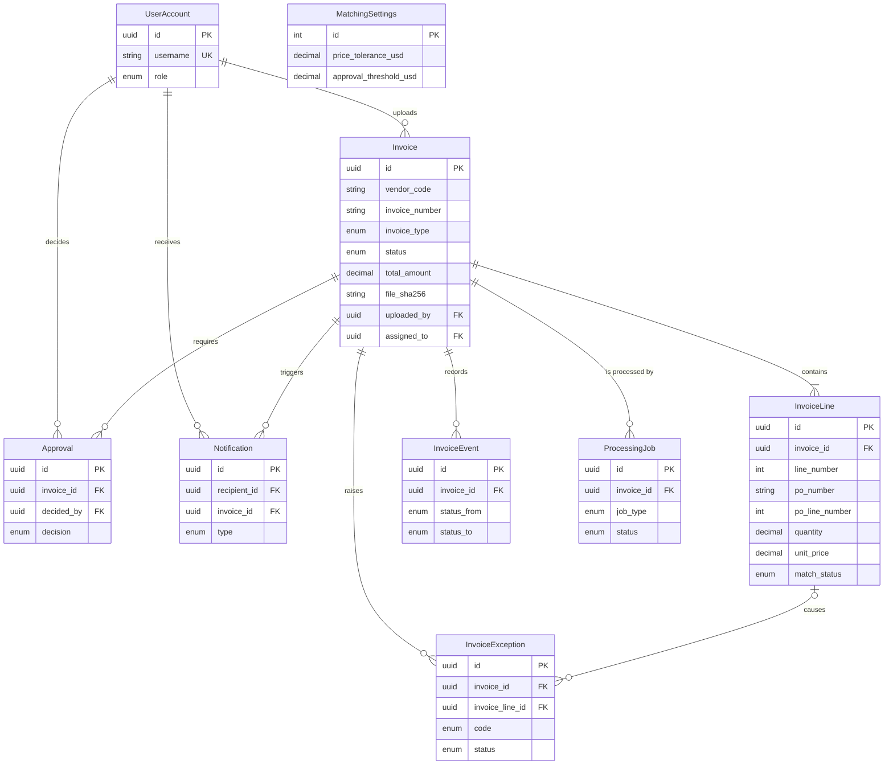
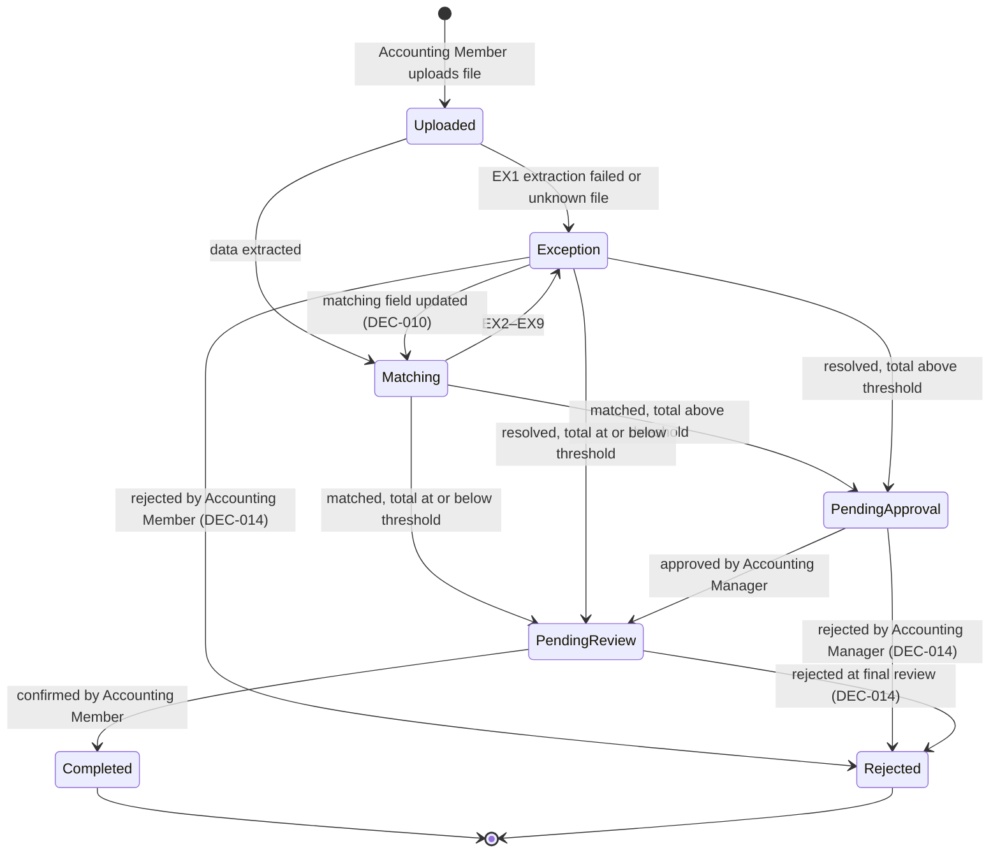

# Data Model

Scope: Proof of Concept ([DEC-003](../01-requirements/decision-log.md#dec-003)). Linear: [SAPS-31](https://linear.app/jiringuyen/issue/SAPS-31).

> **Assumption:** the SAPS Worker and the job queue come from [ADR-0004](adr/0004-process-invoices-in-background-worker.md),
> which is still `proposed`. If it is rejected, `ProcessingJob` is removed and nothing else changes.

## 1. Overview
| Data store | Technology | Owning container | Entities | ADR |
|---|---|---|---|---|
| SAPS Database | PostgreSQL (version in the Developer Guide) | SAPS API (the SAPS Worker shares the codebase and schema) | UserAccount, Invoice, InvoiceLine, InvoiceException, Approval, InvoiceEvent, Notification, MatchingSettings, ProcessingJob | [ADR-0003](adr/0003-use-postgresql-and-docker-compose.md), [ADR-0004](adr/0004-process-invoices-in-background-worker.md) |
| Invoice file store | Docker volume (proposal, Q3) | SAPS API | Uploaded invoice files, referenced by `Invoice.file_storage_key` | — |
| Dummy sample set | JSON fixture files | Dummy Extraction Adapter | ExtractedInvoice (§4.2) | [ADR-0001](adr/0001-isolate-extraction-and-erp-behind-ports.md), [DEC-012](../01-requirements/decision-log.md#dec-012) |
| Dummy ERP data | JSON fixture files | Dummy ERP Adapter | Vendor, PurchaseOrder, PurchaseOrderLine, GoodsReceipt, GoodsReceiptLine (§4.2) | [ADR-0001](adr/0001-isolate-extraction-and-erp-behind-ports.md) |

ERP data and extraction results are **not** stored in the SAPS Database: they are read through the ERP Data Port and
the Extraction Port, so the real sources can replace the fixtures later ([CON-03](arc42/02-constraints.md)).

## 2. Entity Relationship Diagram

## 3. Data Classification
| Level | Meaning | Handling |
|---|---|---|
| Public | Can be published | No restriction |
| Internal | Business data, not sensitive | Authenticated access only |
| Confidential | Financial or commercial data | Role-based access, encrypted at rest, audit reads of bulk exports |
| Restricted | Personal data (PII), credentials, bank details | Need-to-know access, masked in logs and non-prod, encrypted, access audited |

The PoC uses only synthetic data ([DEC-004](../01-requirements/decision-log.md#dec-004)); the classification applies from the first phase with real data.

## 4. Entities

### 4.1 Entities in the SAPS Database
Conventions:
- Every table also has the audit columns `created_at` (timestamp UTC), `created_by` (string(100)),
  `updated_at` (timestamp UTC) and `updated_by` (string(100)), all Not null, class Internal. They are not repeated below.
- Amounts are in USD only in the PoC ([DEC-006](../01-requirements/decision-log.md#dec-006)).
- Retention: TBD (MTG-20261114 Q30). In the PoC, demo data is reset by recreating the containers.
- Expected volume: demo scale in the PoC (tens of invoices); production volume TBD (MTG-20261114 Q5).

### UserAccount
A person who signs in: an Accounting Member or an Accounting Manager ([NFR-SEC-001](../01-requirements/nfr.md#nfr-sec-001)).

| Property | Value |
|---|---|
| Data store / table | SAPS Database / `user_account` |
| Owning container | SAPS API |
| Lifecycle | simple CRUD (seeded in the PoC) |
| Retention | TBD (Q2) |
| Expected volume | a few demo users |

| Attribute | Type | Null | Key | Class. | Description |
|---|---|---|---|---|---|
| id | uuid | No | PK | Internal | Surrogate key |
| username | string(100) | No | UK | Internal | Sign-in name |
| display_name | string(200) | No | — | Restricted | Name shown in the UI |
| password_hash | string(255) | No | — | Restricted | Salted password hash; never logged |
| role | enum | No | — | Internal | `ACCOUNTING_MEMBER`, `ACCOUNTING_MANAGER` |
| is_active | boolean | No | — | Internal | Inactive users cannot sign in |

### Invoice
An uploaded vendor invoice and its processing state.

| Property | Value |
|---|---|
| Data store / table | SAPS Database / `invoice` |
| Owning container | SAPS API |
| Lifecycle | see [§5](#invoice-lifecycle) |
| Retention | TBD (Q2) |
| Expected volume | demo scale in the PoC |

| Attribute | Type | Null | Key | Class. | Description |
|---|---|---|---|---|---|
| id | uuid | No | PK | Internal | Surrogate key |
| status | enum | No | — | Internal | `UPLOADED`, `MATCHING`, `EXCEPTION`, `PENDING_APPROVAL`, `PENDING_REVIEW`, `COMPLETED`, `REJECTED` (§5) |
| invoice_type | enum | Yes | — | Internal | `TRADE_PO`, `NON_TRADE_PO`, `NON_PO`; null until derived ([DEC-005](../01-requirements/decision-log.md#dec-005)) |
| vendor_code | string(20) | Yes | — | Confidential | Vendor identifier from extraction; with `invoice_number` used for duplicate detection ([DEC-008](../01-requirements/decision-log.md#dec-008)) |
| vendor_name | string(200) | Yes | — | Confidential | Vendor name from extraction |
| invoice_number | string(50) | Yes | — | Confidential | Vendor's invoice number |
| invoice_date | date | Yes | — | Confidential | Invoice date |
| currency | string(3) | No | — | Internal | `USD` only in the PoC |
| subtotal_amount | decimal(18,2) | Yes | — | Confidential | Amount before tax |
| tax_amount | decimal(18,2) | Yes | — | Confidential | Tax amount |
| total_amount | decimal(18,2) | Yes | — | Confidential | Amount incl. tax; compared with the approval threshold ([DEC-009](../01-requirements/decision-log.md#dec-009)) |
| price_tolerance_applied | decimal(18,4) | Yes | — | Internal | Tolerance used in the last matching run (snapshot of MatchingSettings) |
| approval_threshold_applied | decimal(18,2) | Yes | — | Internal | Threshold used to decide on approval (snapshot) |
| requires_approval | boolean | Yes | — | Internal | True when `total_amount` > `approval_threshold_applied` |
| assigned_to | uuid | Yes | FK → UserAccount | Internal | Accounting Member who picked the invoice from the exception queue ([DEC-016](../01-requirements/decision-log.md#dec-016)) |
| uploaded_by | uuid | No | FK → UserAccount | Internal | Accounting Member who uploaded the file |
| file_name | string(255) | No | — | Internal | Original file name |
| file_content_type | string(100) | No | — | Internal | MIME type: PDF or image |
| file_size_bytes | bigint | No | — | Internal | File size |
| file_sha256 | string(64) | No | — | Internal | Content hash; identifies the dummy sample (Q4) |
| file_storage_key | string(500) | No | — | Internal | Location of the file in the invoice file store |
| rejected_reason | string(1000) | Yes | — | Internal | Reason entered at rejection ([DEC-014](../01-requirements/decision-log.md#dec-014)) |

Index (not unique): (`vendor_code`, `invoice_number`) for duplicate detection. It is not a unique key because a
duplicate is stored and raised as EX9.

### InvoiceLine
One line of an invoice and its matching result.

| Property | Value |
|---|---|
| Data store / table | SAPS Database / `invoice_line` |
| Owning container | SAPS API |
| Lifecycle | created from extraction; updated by manual edits and matching |
| Retention | as Invoice |
| Expected volume | a few lines per invoice |

| Attribute | Type | Null | Key | Class. | Description |
|---|---|---|---|---|---|
| id | uuid | No | PK | Internal | Surrogate key |
| invoice_id | uuid | No | FK → Invoice | Internal | Parent invoice |
| line_number | int | No | — | Internal | Line number on the invoice; unique per invoice |
| description | string(500) | Yes | — | Confidential | Item or service description |
| po_number | string(7) | Yes | — | Confidential | PO number; 7 digits ([DEC-005](../01-requirements/decision-log.md#dec-005)); null for non-PO invoices |
| po_line_number | int | Yes | — | Confidential | PO line this invoice line refers to ([DEC-007](../01-requirements/decision-log.md#dec-007)) |
| quantity | decimal(18,3) | Yes | — | Confidential | Invoiced quantity |
| unit_price | decimal(18,4) | Yes | — | Confidential | Invoiced unit price (USD) |
| line_amount | decimal(18,2) | Yes | — | Confidential | Line amount (USD) |
| match_status | enum | No | — | Internal | `NOT_MATCHED`, `MATCHED`, `MISMATCH`, `NOT_APPLICABLE` (non-PO) |
| po_unit_price | decimal(18,4) | Yes | — | Confidential | PO unit price seen in the last matching run |
| expected_quantity | decimal(18,3) | Yes | — | Confidential | Received-not-invoiced quantity (3-way) or PO quantity not yet invoiced (2-way) in the last run |

### InvoiceException
An exception raised for an invoice; an invoice can have several, at most one open per code and line.

| Property | Value |
|---|---|
| Data store / table | SAPS Database / `invoice_exception` |
| Owning container | SAPS API |
| Lifecycle | `OPEN` → `RESOLVED` (manual resolution or successful re-match) |
| Retention | as Invoice |
| Expected volume | 0–n per invoice |

| Attribute | Type | Null | Key | Class. | Description |
|---|---|---|---|---|---|
| id | uuid | No | PK | Internal | Surrogate key |
| invoice_id | uuid | No | FK → Invoice | Internal | Invoice concerned |
| invoice_line_id | uuid | Yes | FK → InvoiceLine | Internal | Line concerned; null for header-level exceptions (EX1, EX2, EX5, EX9) |
| code | enum | No | — | Internal | `EX1` … `EX9` ([DEC-018](../01-requirements/decision-log.md#dec-018)) |
| message | string(1000) | No | — | Internal | Human-readable details, e.g. expected vs. invoiced value |
| status | enum | No | — | Internal | `OPEN`, `RESOLVED` |
| resolved_by | uuid | Yes | FK → UserAccount | Internal | User who resolved it; null when resolved by re-matching |
| resolved_at | timestamp UTC | Yes | — | Internal | Resolution time |

### Approval
The Accounting Manager's decision on an invoice above the approval threshold ([DEC-009](../01-requirements/decision-log.md#dec-009), [DEC-013](../01-requirements/decision-log.md#dec-013)).

| Property | Value |
|---|---|
| Data store / table | SAPS Database / `approval` |
| Owning container | SAPS API |
| Lifecycle | insert only |
| Retention | as Invoice |
| Expected volume | 0–1 per invoice in the PoC |

| Attribute | Type | Null | Key | Class. | Description |
|---|---|---|---|---|---|
| id | uuid | No | PK | Internal | Surrogate key |
| invoice_id | uuid | No | FK → Invoice | Internal | Invoice decided on |
| decided_by | uuid | No | FK → UserAccount | Internal | Accounting Manager |
| decision | enum | No | — | Internal | `APPROVED`, `REJECTED` |
| comment | string(1000) | Yes | — | Internal | Reason, mandatory when rejected |
| decided_at | timestamp UTC | No | — | Internal | Decision time |

### InvoiceEvent
Audit trail of status changes and user actions on an invoice.

| Property | Value |
|---|---|
| Data store / table | SAPS Database / `invoice_event` |
| Owning container | SAPS API |
| Lifecycle | insert only |
| Retention | as Invoice |
| Expected volume | 5–15 per invoice |

| Attribute | Type | Null | Key | Class. | Description |
|---|---|---|---|---|---|
| id | uuid | No | PK | Internal | Surrogate key |
| invoice_id | uuid | No | FK → Invoice | Internal | Invoice concerned |
| status_from | enum | Yes | — | Internal | Previous status; null on creation |
| status_to | enum | No | — | Internal | New status |
| action | string(50) | No | — | Internal | e.g. `UPLOAD`, `MATCH`, `UPDATE_FIELDS`, `APPROVE`, `REJECT`, `CONFIRM` |
| actor | string(100) | No | — | Internal | User or `system` (SAPS Worker) |
| details | json | Yes | — | Confidential | Changed fields, old and new values |
| occurred_at | timestamp UTC | No | — | Internal | Event time |

### Notification
An in-app notification for one user ([DEC-021](../01-requirements/decision-log.md#dec-021)). One row per recipient,
so read state is per user.

| Property | Value |
|---|---|
| Data store / table | SAPS Database / `notification` |
| Owning container | SAPS API |
| Lifecycle | created unread; `read_at` set when opened |
| Retention | TBD (Q2) |
| Expected volume | 1–n per invoice step |

| Attribute | Type | Null | Key | Class. | Description |
|---|---|---|---|---|---|
| id | uuid | No | PK | Internal | Surrogate key |
| recipient_id | uuid | No | FK → UserAccount | Internal | Recipient |
| invoice_id | uuid | No | FK → Invoice | Internal | Invoice concerned |
| type | enum | No | — | Internal | `EXCEPTION_RAISED` (Accounting Members), `APPROVAL_REQUESTED` (Accounting Manager), `REVIEW_REQUESTED` (Accounting Members) |
| message | string(500) | No | — | Internal | Text shown in the UI |
| read_at | timestamp UTC | Yes | — | Internal | Null while unread |

### MatchingSettings
Single-row table with the configurable matching settings ([DEC-015](../01-requirements/decision-log.md#dec-015)).

| Property | Value |
|---|---|
| Data store / table | SAPS Database / `matching_settings` |
| Owning container | SAPS API |
| Lifecycle | one row (id = 1), updated by the Accounting Manager |
| Retention | current values only; changes are visible in `updated_at` / `updated_by` |
| Expected volume | 1 row |

| Attribute | Type | Null | Key | Class. | Description |
|---|---|---|---|---|---|
| id | int | No | PK | Internal | Always 1 |
| price_tolerance_usd | decimal(18,4) | No | — | Internal | Default 0.5 |
| approval_threshold_usd | decimal(18,2) | No | — | Internal | Default 300 |

### ProcessingJob
A unit of background work for the SAPS Worker ([ADR-0004](adr/0004-process-invoices-in-background-worker.md), proposed).

| Property | Value |
|---|---|
| Data store / table | SAPS Database / `processing_job` |
| Owning container | SAPS API (written), SAPS Worker (processed) |
| Lifecycle | `QUEUED` → `RUNNING` → `SUCCEEDED` / `FAILED`; retried while `attempts` < max |
| Retention | delete succeeded jobs after TBD days |
| Expected volume | 1–n per invoice |

| Attribute | Type | Null | Key | Class. | Description |
|---|---|---|---|---|---|
| id | uuid | No | PK | Internal | Surrogate key |
| invoice_id | uuid | No | FK → Invoice | Internal | Invoice to process |
| job_type | enum | No | — | Internal | `PROCESS_INVOICE`, `REMATCH_INVOICE` ([DEC-010](../01-requirements/decision-log.md#dec-010)) |
| status | enum | No | — | Internal | `QUEUED`, `RUNNING`, `SUCCEEDED`, `FAILED` |
| attempts | int | No | — | Internal | Number of runs so far |
| run_after | timestamp UTC | No | — | Internal | Earliest start (back-off between retries) |
| locked_by | string(100) | Yes | — | Internal | Worker instance holding the job |
| last_error | string(2000) | Yes | — | Internal | Last error message; no personal data |

### 4.2 External entities (read through ports, not stored)
Logical structure of the data the SAPS API and SAPS Worker read. In the PoC it comes from JSON fixture files;
later from the real services ([ADR-0001](adr/0001-isolate-extraction-and-erp-behind-ports.md)).
Field names of SAP / MuleSoft are mapped in the adapters later.

| Entity | Port | Key fields | Other fields |
|---|---|---|---|
| ExtractedInvoice | Extraction Port | file_sha256 | vendor_code, vendor_name, invoice_number, invoice_date, currency, subtotal_amount, tax_amount, total_amount, lines (line_number, description, po_number, po_line_number, quantity, unit_price, line_amount) |
| Vendor | ERP Data Port | vendor_code | name |
| PurchaseOrder | ERP Data Port | po_number | vendor_code, currency |
| PurchaseOrderLine | ERP Data Port | po_number, po_line_number | description, ordered_quantity, unit_price |
| GoodsReceipt | ERP Data Port | gr_number | po_number, receipt_date |
| GoodsReceiptLine | ERP Data Port | gr_number, po_line_number | received_quantity |

Derived values used in matching ([DEC-007](../01-requirements/decision-log.md#dec-007)):
- **Already invoiced quantity** of a PO line = sum of `InvoiceLine.quantity` for that PO line on invoices in status
  `PENDING_APPROVAL`, `PENDING_REVIEW` or `COMPLETED` (proposal, Q1).
- **Received-not-invoiced quantity** = sum of `GoodsReceiptLine.received_quantity` − already invoiced quantity.
- **PO quantity not yet invoiced** = `PurchaseOrderLine.ordered_quantity` − already invoiced quantity.

## 5. Entity Lifecycles

### Invoice lifecycle
Approved by the Product Owner in [MTG-20261128](../01-requirements/meetings/2026-11-28-poc-flow-review.md) R2.
State names in the diagram map to the `Invoice.status` enum values (`PendingApproval` = `PENDING_APPROVAL`, …).

| State | Meaning | Waiting for |
|---|---|---|
| Uploaded | File received; processing job queued | SAPS Worker |
| Matching | Extraction, duplicate check, type derivation and matching in progress | SAPS Worker |
| Exception | Automatic processing stopped (EX1–EX9); in the shared exception queue | Accounting Member |
| PendingApproval | Total amount above the approval threshold | Accounting Manager |
| PendingReview | Ready for the final check | Accounting Member |
| Completed | Final result confirmed | — |
| Rejected | Invoice rejected; final state | — |

## 6. Retention & Archival
| Data category | Online retention | Archive | Deletion | Requirement |
|---|---|---|---|---|
| Invoices, lines, exceptions, approvals, events, files | PoC: until the demo environment is reset; later TBD | TBD | TBD | TBD (MTG-20261114 Q30) |
| Notifications | TBD | none | TBD | — |
| Processing jobs | Succeeded jobs: TBD days | none | Purge job | — |

## 7. Schema Migration Approach
- Tool: Alembic with SQLAlchemy (proposal; confirmed in the Developer Guide).
- Location: in the SAPS API codebase, folder `migrations/`.
- Rules: migrations are forward-only and run automatically when the SAPS API container starts in the PoC.

## 8. Open Questions
| # | Question | Asked to | Due | Status |
|---|---|---|---|---|
| Q1 | Which invoices count as "already invoiced" for a PO line? Proposal: invoices in status PendingApproval, PendingReview or Completed | Product Owner (Customer) | 2026-12-05 | open |
| Q2 | Retention periods for invoices, files, notifications (MTG-20261114 Q30) | Product Owner (Customer) | after PoC | open |
| Q3 | Invoice file store in the PoC: a Docker volume shared by SAPS API and SAPS Worker (proposal); object storage later | Solution Architect (our company) | 2026-12-05 | open |
| Q4 | Identify dummy sample files by SHA-256 hash of the file content, not by file name (proposal) | Solution Architect (our company) | 2026-12-05 | open |
| Q5 | Which fields are "matching fields" that trigger re-matching (DEC-010)? Proposal: vendor_code, invoice_number, po_number, po_line_number, quantity, unit_price | Product Owner (Customer) | 2026-12-05 | open |
