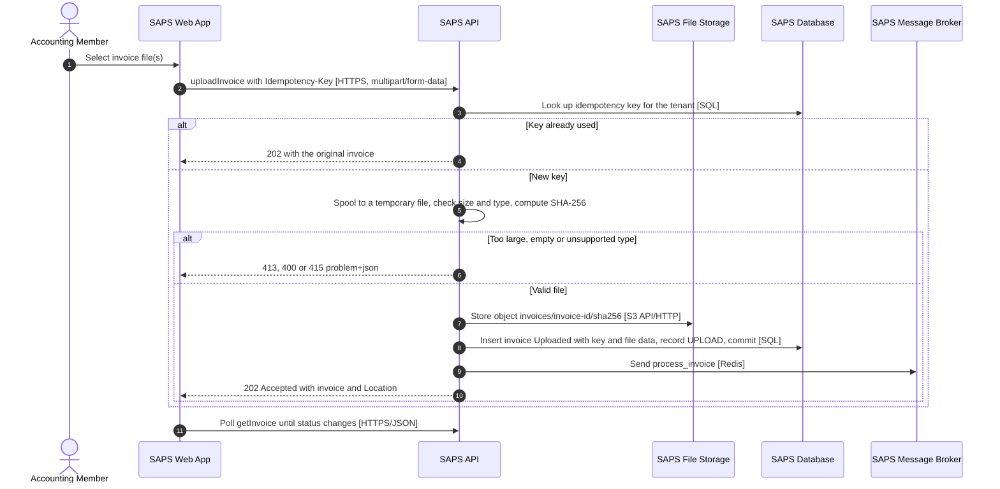

# SAPS-17 — Invoice upload

## 1. Summary
An Accounting Member uploads an invoice file (PDF or image) in the SAPS Web App. The SAPS API checks the file, stores it
in SAPS File Storage, creates the invoice with status Uploaded and queues processing; it answers at once with
`202 Accepted`. Extraction, duplicate check and matching run in the SAPS Worker ([SAPS-18](SAPS-18-dummy-invoice-extraction.md),
[SAPS-23](https://linear.app/jiringuyen/issue/SAPS-23), [SAPS-19](SAPS-19-invoice-matching.md)). Every demo scenario starts here.

| Item | Value |
|---|---|
| Linear | [SAPS-17](https://linear.app/jiringuyen/issue/SAPS-17) |
| Use cases | [UC-02 Upload invoice](../02-architecture/arc42/01-introduction-and-goals.md#use-cases) |
| Scope items | [SCP-IN-01](../01-requirements/scope.md#31-functional-capabilities) |
| Target release | PoC demo 2027-02-22 (Linear milestone "PoC demo") |

## 2. Requirements

### 2.1 Business Rules
| ID | Rule | Source |
|---|---|---|
| BR-01 | Only Accounting Members upload invoices; manual upload is the only intake channel in the PoC. | [SCP-IN-01](../01-requirements/scope.md#31-functional-capabilities), [scope AS1](../01-requirements/scope.md#5-assumptions) |
| BR-02 | One file is one invoice. Accepted types: PDF, JPEG, PNG, recognized by file content (magic bytes), not only by the declared content type. | [saps-api.openapi.yaml](../02-architecture/api/saps-api.openapi.yaml) `uploadInvoice` |
| BR-03 | Maximum file size is a setting; default 10 MB in the PoC (technical limit chosen by the Solution Architect; file size requirements are out of the PoC scope, MTG-20261114 Q7). | §6 |
| BR-04 | The SAPS API computes the SHA-256 of the content while receiving it; the hash identifies the file in the dummy sample set and names the stored object. | [DEC-012](../01-requirements/decision-log.md#dec-012), [data model Q4](../02-architecture/data-model.md#8-open-questions) |
| BR-05 | Order of work: store the file in SAPS File Storage, insert the invoice (status Uploaded) and the `UPLOAD` event, commit, then send `process_invoice`. | [ADR-0004](../02-architecture/adr/0004-process-invoices-in-background-worker.md), [ADR-0006](../02-architecture/adr/0006-store-invoice-files-in-seaweedfs.md) |
| BR-06 | `Idempotency-Key` is required: a repeated request with the same key (same tenant) returns the invoice created by the first request and does not create a second one. | [saps-api.openapi.yaml](../02-architecture/api/saps-api.openapi.yaml) |
| BR-07 | Uploading the same file again with a new key creates a new invoice; whether it is a duplicate is decided later by the duplicate check (EX9), not at upload. | [DEC-008](../01-requirements/decision-log.md#dec-008) |
| BR-08 | The Web App allows selecting several files; it sends one request per file and shows each invoice's status by polling `getInvoice`. | [arc42 §6.2](../02-architecture/arc42/06-runtime-view.md) |

### 2.2 Affected NFRs
| NFR | How this feature is affected |
|---|---|
| [NFR-SCAL-001](../01-requirements/nfr.md#nfr-scal-001) | Upload does not wait for processing (`202`); the file is spooled to a temporary file while it is hashed, not held in memory. |
| [NFR-SEC-001](../01-requirements/nfr.md#nfr-sec-001) | Upload needs a signed-in Accounting Member ([ADR-0008](../02-architecture/adr/0008-use-session-cookies-for-authentication.md)). |

### 2.3 Out of Scope
- Mailbox intake ([SCP-OUT-11](../01-requirements/scope.md#4-out-of-scope)); e-invoice XML (MTG-20261114 Q9).
- Malware scanning of uploaded files (PoC is local with synthetic files; needed before real data).
- Several invoices in one file (MTG-20261114 Q12, deferred).

## 3. Design

### 3.1 Affected Building Blocks
| Container | Change | Description |
|---|---|---|
| SAPS Web App | new | Upload page (drag and drop, several files), per-file progress and status |
| SAPS API | new | `uploadInvoice`: validation, hashing, storage, invoice creation, idempotency, message |
| SAPS File Storage | modified | New objects under `invoices/{invoice_id}/{sha256}` |
| SAPS Database | modified | Invoice row with file metadata and idempotency key; `UPLOAD` event |
| SAPS Message Broker | modified | `process_invoice` message |

### 3.2 Main Flow

### 3.3 Edge Cases & Error Handling
| ID | Case | Expected behavior | Response / signal |
|---|---|---|---|
| EC-01 | File larger than the limit | Streaming stops when the limit is reached; nothing stored | `413` |
| EC-02 | Empty file, or content is not PDF / JPEG / PNG (even if the name says `.pdf`) | Refused | `400` (empty) / `415` |
| EC-03 | Same `Idempotency-Key` sent twice (double click, network retry) | Second request returns the first invoice | `202`, same invoice id |
| EC-04 | Two requests with the same key at the same time | Unique index (`tenant_id`, `idempotency_key`); the loser reads and returns the winner's invoice | `202` |
| EC-05 | File stored, database commit fails | Orphan object stays; harmless in the PoC ([ADR-0006](../02-architecture/adr/0006-store-invoice-files-in-seaweedfs.md)) | `500`; client retries with the same key |
| EC-06 | Commit succeeds, sending the message fails | Invoice stays Uploaded; the sweeper sends `process_invoice` later ([ADR-0004](../02-architecture/adr/0004-process-invoices-in-background-worker.md) S1) | `202` already returned |
| EC-07 | SAPS File Storage unavailable | Nothing in the database | `500` problem+json |
| EC-08 | Accounting Manager tries to upload | Refused | `403` |

### 3.4 API Changes
| operationId | Method & path | Change | Breaking | Spec |
|---|---|---|---|---|
| `uploadInvoice` | POST /v1/invoices | description: maximum size is a setting, default 10 MB; content checked by magic bytes (API 0.3.1) | No | [saps-api.openapi.yaml](../02-architecture/api/saps-api.openapi.yaml) |
| `getInvoice` | GET /v1/invoices/{invoiceId} | none (polling) | No | ″ |

### 3.5 Event Changes
Sends `process_invoice(invoice_id)` ([ADR-0004](../02-architecture/adr/0004-process-invoices-in-background-worker.md)); consumed by [SAPS-18](SAPS-18-dummy-invoice-extraction.md).

### 3.6 Data Model Changes
| Entity | Change | Migration | Backward compatible |
|---|---|---|---|
| [Invoice](../02-architecture/data-model.md#invoice) | Attribute `idempotency_key` string(64), not null; unique (`tenant_id`, `idempotency_key`) | none — created by `0003_core_invoice_schema` ([SAPS-36](https://linear.app/jiringuyen/issue/SAPS-36)) | Yes |

### 3.7 Security & Permissions
- Roles: Accounting Member only (`x-roles`); tenant from the session's user ([ADR-0007](../02-architecture/adr/0007-prepare-data-model-for-tenants.md)).
- CSRF: `Origin` check ([ADR-0008](../02-architecture/adr/0008-use-session-cookies-for-authentication.md)).
- Files: type checked by content; stored only in SAPS File Storage (never on the API container disk); object keys contain no user input.
- Audit: `UPLOAD` event with file name, size and hash.

### 3.8 Configuration & Feature Flags
| Key | Purpose | Default | Per environment |
|---|---|---|---|
| `MAX_UPLOAD_SIZE_MB` | Maximum invoice file size | 10 | PoC only |

### 3.9 Observability
- Logs: `invoice_uploaded` (invoice_id, tenant_id, size, content type, duration_ms), `upload_rejected` (reason). No file content.

## 4. Rollout & Rollback
1. No migration of its own; the schema comes from `0003_core_invoice_schema` ([SAPS-36](https://linear.app/jiringuyen/issue/SAPS-36)).
2. Deploy SAPS API and SAPS Web App with `docker compose up -d --build`.

**Rollback:** revert the pull request and recreate the local stack.

## 5. Test Scenarios
| ID | Scenario | Level | Covers |
|---|---|---|---|
| TS-01 | Upload a PDF, a JPEG and a PNG → 202, invoice Uploaded, object stored, message sent | Integration | BR-02, BR-04, BR-05 |
| TS-02 | 10 MB + 1 byte → 413; empty → 400; `.pdf` name with text content → 415 | Integration | BR-03, EC-01, EC-02 |
| TS-03 | Same Idempotency-Key twice, sequentially and in parallel → one invoice | Integration | BR-06, EC-03, EC-04 |
| TS-04 | Same file with two keys → two invoices | Integration | BR-07 |
| TS-05 | Message lost after commit → sweeper processes the invoice | Integration | EC-06 |
| TS-06 | Accounting Manager upload → 403; no `Origin` header → 403 | Integration | EC-08, §3.7 |
| TS-07 | Upload several files in the Web App; statuses update by polling | E2E | BR-08 |
| TS-08 | All demo scenarios DS-01 … DS-20 start with this upload | E2E | [Test Strategy §11](../05-testing/test-strategy.md#11-poc-demo-acceptance) |

## 6. Decisions
| Decision | Rationale | ADR |
|---|---|---|
| Default maximum size 10 MB, configurable | A technical guard for the PoC; real limits are part of the extraction requirements after the PoC (MTG-20261114 Q7) | — |
| Idempotency key stored on the invoice | Simplest store with a unique index; no separate table | — |
| File type by content (magic bytes) | The declared content type and file name can be wrong | — |
| Spool to a temporary file before storing | The object key contains the SHA-256, which is known only after the whole file is read | [ADR-0006](../02-architecture/adr/0006-store-invoice-files-in-seaweedfs.md) |

## 7. Open Questions
None.

## 8. Documentation Checklist
- [ ] API spec updated (`uploadInvoice` description; version 0.3.1)
- [ ] Data model updated (`Invoice.idempotency_key`)
- [ ] Developer Guide §6 updated (`MAX_UPLOAD_SIZE_MB`)
- [ ] Release notes entry prepared
