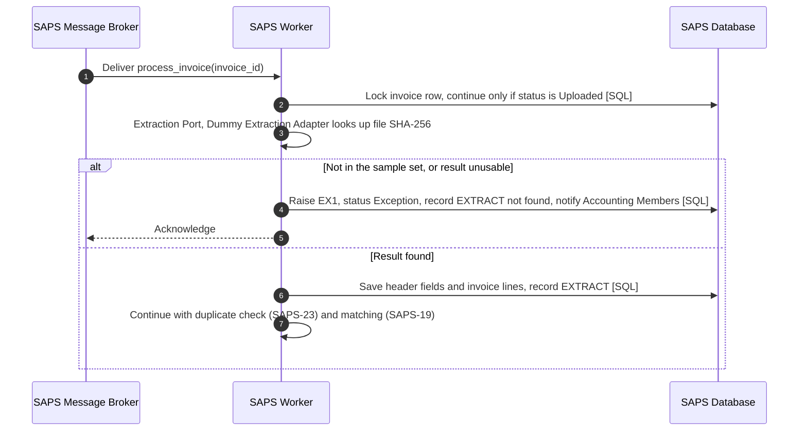

# SAPS-18 — Dummy invoice extraction

## 1. Summary
In the PoC, invoice data is not read from the file by OCR / AI. Instead, the SAPS Worker looks up the uploaded file's
SHA-256 in a dummy sample set and loads the predefined extraction result: header and lines. An unknown file raises EX1.
The lookup sits behind the Extraction Port, so a real extraction service can replace it after the PoC. This feature also
defines how the sample set is built, so that the invoice shown in the demo matches the data the system uses.

| Item | Value |
|---|---|
| Linear | [SAPS-18](https://linear.app/jiringuyen/issue/SAPS-18) |
| Use cases | [UC-02 Upload invoice](../02-architecture/arc42/01-introduction-and-goals.md#use-cases) |
| Scope items | [SCP-IN-02](../01-requirements/scope.md#31-functional-capabilities) |
| Target release | PoC demo 2027-02-22 (Linear milestone "PoC demo") |

## 2. Requirements

### 2.1 Business Rules
| ID | Rule | Source |
|---|---|---|
| BR-01 | Extraction runs first in the `process_invoice` job, before the duplicate check ([SAPS-23](https://linear.app/jiringuyen/issue/SAPS-23)) and matching ([SAPS-19](SAPS-19-invoice-matching.md)). | [arc42 §6.2](../02-architecture/arc42/06-runtime-view.md) |
| BR-02 | The Dummy Extraction Adapter finds the extraction result by the file's SHA-256 (`Invoice.file_sha256`). | [DEC-012](../01-requirements/decision-log.md#dec-012) |
| BR-03 | File not in the sample set → EX1 "Invoice unreadable"; status Exception; Accounting Members notified. | [DEC-012](../01-requirements/decision-log.md#dec-012), [DEC-033](../01-requirements/decision-log.md#dec-033) |
| BR-04 | An extraction result without lines, or with values that do not fit the data model (e.g. a currency other than USD), is treated as unusable → EX1. | [DEC-006](../01-requirements/decision-log.md#dec-006), [SAPS-19](SAPS-19-invoice-matching.md) EC-06 |
| BR-05 | A usable result fills the invoice header (vendor code and name, invoice number and date, currency, subtotal, tax, total) and creates the invoice lines (line number, description, PO number, PO line number, quantity, unit price, line amount). | [data model §4.2](../02-architecture/data-model.md#42-external-entities-read-through-ports-not-stored) |
| BR-06 | Each sample has a PDF (or PNG / JPEG) whose visible content is generated from the same JSON as the extraction result, so the demo file and the system data always agree. | design, §6 |
| BR-07 | The sample set covers every demo scenario DS-01 … DS-20; samples are grouped per scenario. | [DEC-033](../01-requirements/decision-log.md#dec-033), [Test Strategy §4](../05-testing/test-strategy.md#4-test-data-management) |
| BR-08 | The step is recorded as an InvoiceEvent `EXTRACT` (found / not found). | [data model](../02-architecture/data-model.md#invoiceevent) |

### 2.2 Affected NFRs
| NFR | How this feature is affected |
|---|---|
| [NFR-SCAL-001](../01-requirements/nfr.md#nfr-scal-001) | Extraction runs in the SAPS Worker; the sample index is loaded once per worker process. |

### 2.3 Out of Scope
- Real OCR / AI extraction ([SCP-OUT-01](../01-requirements/scope.md#4-out-of-scope)); extraction accuracy and confidence (MTG-20261114 Q10, Q11, deferred).
- Editing extracted data ([SAPS-20](SAPS-20-exception-handling.md)).

## 3. Design

### 3.1 Affected Building Blocks
| Container | Change | Description |
|---|---|---|
| SAPS Worker — Extraction Port | new | `extract(invoice) -> ExtractedInvoice | NotFound` ([ADR-0001](../02-architecture/adr/0001-isolate-extraction-and-erp-behind-ports.md)) |
| SAPS Worker — Dummy Extraction Adapter | new | Loads `backend/fixtures/manifest.json` and returns the JSON result for a SHA-256 |
| SAPS Worker | modified | `process_invoice` calls the port, saves header and lines, or raises EX1 |
| Repository — fixtures and tooling | new | Sample JSON per scenario, generated PDF / PNG files, manifest, generator script (§3.8) |
| SAPS Database | modified | Invoice header fields, InvoiceLine rows, InvoiceException EX1, InvoiceEvent `EXTRACT` |

### 3.2 Main Flow
Part of the `process_invoice` job; runs in the job's transaction with the invoice row locked
([SAPS-19](SAPS-19-invoice-matching.md) §3.2).

### 3.3 Edge Cases & Error Handling
| ID | Case | Expected behavior | Response / signal |
|---|---|---|---|
| EC-01 | Unknown file (DS-07) | EX1 | InvoiceException EX1 |
| EC-02 | Result without lines, or currency not USD | EX1 (BR-04) | InvoiceException EX1 |
| EC-03 | The same sample uploaded twice | Same data extracted twice; the duplicate check raises EX9 on the second invoice (DS-15) | InvoiceException EX9 |
| EC-04 | Manifest or fixture JSON broken | Worker fails at start-up (fixtures are validated against a JSON schema), not during a demo | Start-up error log |
| EC-05 | Sample file edited without regenerating the manifest | Hash no longer matches → EX1; CI check compares manifest and files | CI failure |

### 3.4 API Changes
None. The result is visible through `getInvoice` ([saps-api.openapi.yaml](../02-architecture/api/saps-api.openapi.yaml)).

### 3.5 Event Changes
Consumes `process_invoice(invoice_id)` sent by [SAPS-17](SAPS-17-invoice-upload.md) or the sweeper.

### 3.6 Data Model Changes
None. Fills Invoice and InvoiceLine; ExtractedInvoice is defined in [data model §4.2](../02-architecture/data-model.md#42-external-entities-read-through-ports-not-stored).

### 3.7 Security & Permissions
- Runs as `system` in the SAPS Worker; writes only the invoice's own tenant data ([ADR-0007](../02-architecture/adr/0007-prepare-data-model-for-tenants.md)).
- Fixtures contain synthetic data only; no real vendors, invoices or people (public repository, [DEC-028](../01-requirements/decision-log.md#dec-028)).

### 3.8 Configuration & Fixtures
| Key / path | Purpose | Default |
|---|---|---|
| `EXTRACTION_ADAPTER` | Extraction Port implementation | `dummy` |
| `FIXTURES_DIR` | Root of the sample set | `backend/fixtures` |
| `backend/fixtures/<scenario>/invoices/<name>.json` | Extraction result (source of truth for a sample) | — |
| `backend/fixtures/<scenario>/invoices/<name>.pdf` (or `.png`) | Generated from the JSON by `make fixtures` | — |
| `backend/fixtures/manifest.json` | SHA-256 → JSON path; generated | — |
| `backend/fixtures/schema/extracted-invoice.schema.json` | JSON schema of an extraction result | — |

`<scenario>` is the demo scenario ID in lower case, e.g. `ds-07`. The generator renders a simple, readable invoice
layout (vendor, invoice number and date, PO numbers, lines, totals) so the demo audience sees the same values the system uses.
At least one sample per supported type (PDF, PNG, JPEG) exists.

### 3.9 Observability
- Logs: `extraction_completed` (invoice_id, found, line_count, duration_ms).

## 4. Rollout & Rollback
1. Generate the sample set (`make fixtures`) and commit JSON, files and manifest.
2. Deploy SAPS Worker with `docker compose up -d --build`.

**Rollback:** revert the pull request and recreate the local stack.

## 5. Test Scenarios
| ID | Scenario | Level | Covers |
|---|---|---|---|
| TS-01 | Known sample → header and lines saved, event EXTRACT | Integration | BR-02, BR-05, BR-08 |
| TS-02 | Unknown file → EX1, status Exception, Accounting Members notified | Integration | BR-03, EC-01 |
| TS-03 | Result without lines; currency EUR → EX1 | Unit | BR-04, EC-02 |
| TS-04 | Every fixture JSON is valid against the schema; manifest hashes match the files | Unit (CI) | EC-04, EC-05 |
| TS-05 | Every demo scenario DS-01 … DS-20 has its samples | Unit (CI) | BR-07 |
| TS-06 | Generated PDF shows the values of its JSON (text extracted from the PDF in the test) | Unit | BR-06 |
| TS-07 | Same sample uploaded twice → second invoice EX9 | E2E | EC-03 (DS-15) |

## 6. Decisions
| Decision | Rationale | ADR |
|---|---|---|
| Sample PDFs are generated from the JSON, not drawn by hand | The demo file and the extraction result can never disagree | — |
| Lookup by SHA-256 of the content | A renamed file is still found; a changed file is not (data model Q4, answered) | — |
| Fixtures validated at worker start-up and in CI | Broken demo data is found before the demo | — |

## 7. Open Questions
None.

## 8. Documentation Checklist
- [ ] Test Strategy §4 links the fixture layout
- [ ] Release notes entry prepared
