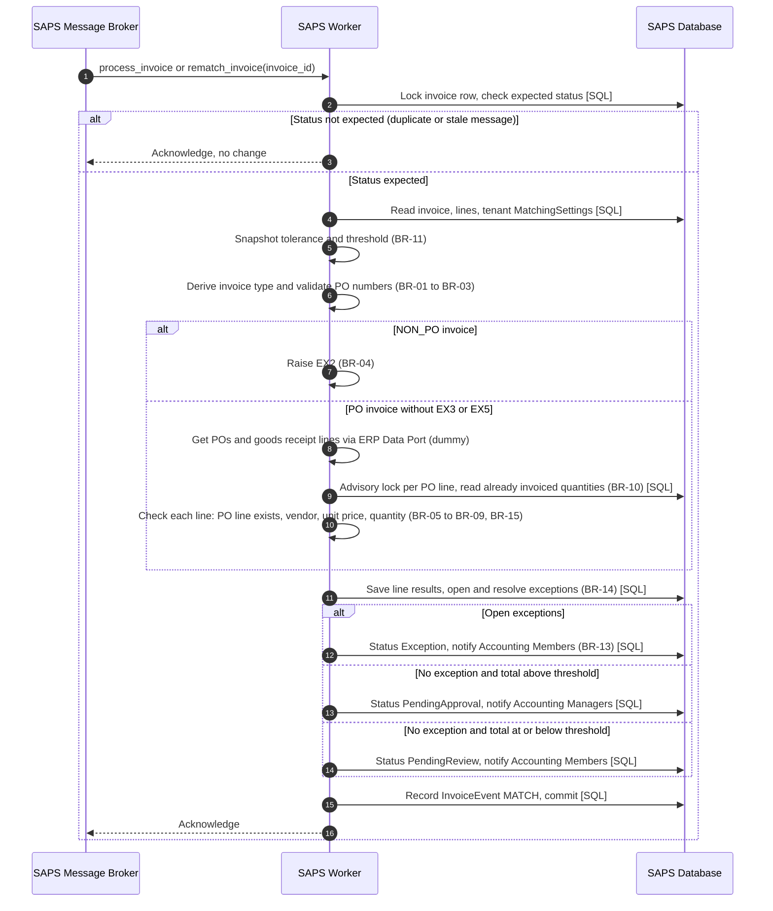
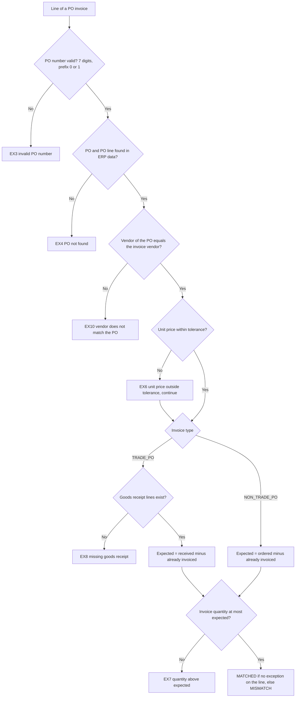

# SAPS-19 — Invoice matching

## 1. Summary
After extraction and the duplicate check, the SAPS Worker derives the invoice type from the PO numbers, compares every
line with its purchase order line (2-way) or with its purchase order line and goods receipts (3-way), and sets the next
status: Exception, PendingApproval or PendingReview. The same logic runs again when an Accounting Member changes a
matching field. Matching is the core of the PoC demo.

| Item | Value |
|---|---|
| Linear | [SAPS-19](https://linear.app/jiringuyen/issue/SAPS-19) |
| Use cases | [UC-02 Upload invoice, UC-03 Handle exception](../02-architecture/arc42/01-introduction-and-goals.md#use-cases) |
| Scope items | [SCP-IN-03](../01-requirements/scope.md#31-functional-capabilities) |
| Target release | PoC demo 2027-02-22 (Linear milestone "PoC demo") |

## 2. Requirements

### 2.1 Business Rules
| ID | Rule | Source |
|---|---|---|
| BR-01 | The invoice type comes from the PO numbers on the lines (lines without a PO number do not count): no line has a PO number → `NON_PO`; all PO numbers start with `0` → `TRADE_PO`; all start with `1` → `NON_TRADE_PO`. | [DEC-005](../01-requirements/decision-log.md#dec-005) |
| BR-02 | A PO number that is not 7 digits or starts with a digit other than `0` / `1` raises EX3 on that line. On an invoice where at least one line has a PO number, a line without a PO number also raises EX3. | [DEC-005](../01-requirements/decision-log.md#dec-005), [DEC-031](../01-requirements/decision-log.md#dec-031) |
| BR-03 | PO numbers starting with `0` and with `1` on the same invoice raise EX5 (one exception for the invoice). | [DEC-007](../01-requirements/decision-log.md#dec-007) |
| BR-04 | A `NON_PO` invoice gets no automatic checks; it raises EX2 for manual review. | [DEC-006](../01-requirements/decision-log.md#dec-006) |
| BR-05 | Each invoice line refers to its own PO line (`poNumber`, `poLineNumber`). PO or PO line not found through the ERP Data Port → EX4 on that line. | [DEC-007](../01-requirements/decision-log.md#dec-007) |
| BR-06 | Unit price: `abs(invoice unit price − PO unit price) ≤ price tolerance`, else EX6. The bound is inclusive. | [DEC-006](../01-requirements/decision-log.md#dec-006), [DEC-015](../01-requirements/decision-log.md#dec-015) |
| BR-07 | `TRADE_PO` (3-way): received quantity = sum of the goods receipt lines of the PO line; no goods receipt line → EX8. Expected quantity = received − already invoiced. | [DEC-007](../01-requirements/decision-log.md#dec-007) |
| BR-08 | `NON_TRADE_PO` (2-way): expected quantity = PO ordered quantity − already invoiced. | [DEC-007](../01-requirements/decision-log.md#dec-007) |
| BR-09 | Quantity check: the invoice quantity must not exceed the expected quantity (BR-07, BR-08); above → EX7. A smaller quantity passes (partial invoicing). | [DEC-032](../01-requirements/decision-log.md#dec-032), [DEC-007](../01-requirements/decision-log.md#dec-007) |
| BR-10 | Already invoiced quantity of a PO line = sum of line quantities on **other** invoices of the same tenant in status PendingApproval, PendingReview or Completed. | [DEC-023](../01-requirements/decision-log.md#dec-023), [ADR-0007](../02-architecture/adr/0007-prepare-data-model-for-tenants.md) |
| BR-11 | The price tolerance and the approval threshold are read from the tenant's MatchingSettings at the start of a run and stored on the invoice (`priceToleranceApplied`, `approvalThresholdApplied`). | [DEC-015](../01-requirements/decision-log.md#dec-015) |
| BR-12 | Result: any open exception → status Exception. No exception → `requiresApproval = totalAmount > approval threshold`; true → PendingApproval, false → PendingReview. | [DEC-009](../01-requirements/decision-log.md#dec-009), [DEC-013](../01-requirements/decision-log.md#dec-013) |
| BR-13 | Notifications on the result: Exception → `EXCEPTION_RAISED` to all Accounting Members of the tenant; PendingApproval → `APPROVAL_REQUESTED` to Accounting Managers; PendingReview → `REVIEW_REQUESTED` to Accounting Members. | [DEC-021](../01-requirements/decision-log.md#dec-021) |
| BR-14 | Re-match (`rematch_invoice`) runs all checks again with the current settings. Exceptions that no longer occur are resolved by the system (`resolvedBy` empty); new ones are opened. | [DEC-010](../01-requirements/decision-log.md#dec-010), [DEC-024](../01-requirements/decision-log.md#dec-024) |
| BR-15 | The vendor on the invoice must equal the vendor of each referenced PO; otherwise EX10 on that line, and the price and quantity checks of that line are skipped. | [DEC-033](../01-requirements/decision-log.md#dec-033) |

### 2.2 Affected NFRs
| NFR | How this feature is affected |
|---|---|
| [NFR-SCAL-001](../01-requirements/nfr.md#nfr-scal-001) | Matching runs in the SAPS Worker and scales with worker instances; ERP data is read once per invoice (batch per PO number), not per check. |

### 2.3 Out of Scope
- Extraction ([SAPS-18](https://linear.app/jiringuyen/issue/SAPS-18)) and the duplicate check EX9 ([SAPS-23](https://linear.app/jiringuyen/issue/SAPS-23)); they run before matching in the same job.
- Exception handling UI and the claim / update / resolve operations ([SAPS-20](https://linear.app/jiringuyen/issue/SAPS-20)).
- Approval and final review ([SAPS-22](https://linear.app/jiringuyen/issue/SAPS-22), [SAPS-21](https://linear.app/jiringuyen/issue/SAPS-21)); delivery and display of notifications ([SAPS-24](https://linear.app/jiringuyen/issue/SAPS-24)).
- GR-based invoice verification and delivery order references ([SCP-OUT-13](../01-requirements/scope.md#4-out-of-scope), [DEC-034](../01-requirements/decision-log.md#dec-034)).
- Checks of line amounts, invoice totals and tax ([SCP-OUT-04](../01-requirements/scope.md#4-out-of-scope)); currencies other than USD ([SCP-OUT-06](../01-requirements/scope.md#4-out-of-scope)); credit notes ([SCP-OUT-05](../01-requirements/scope.md#4-out-of-scope)); automated non-PO checks ([SCP-OUT-07](../01-requirements/scope.md#4-out-of-scope)).

## 3. Design

### 3.1 Affected Building Blocks
| Container | Change | Description |
|---|---|---|
| SAPS Worker | new | Matching use case (`application/`) and rules (`domain/`); called by the `process_invoice` and `rematch_invoice` actors |
| SAPS Worker — ERP Data Port | new | `get_purchase_orders(po_numbers)` and `get_goods_receipt_lines(po_numbers)`, one call each per invoice ([ADR-0001](../02-architecture/adr/0001-isolate-extraction-and-erp-behind-ports.md)) |
| SAPS Worker — Dummy ERP Adapter | new | Reads the fixtures in `backend/fixtures/<scenario>/erp/` |
| SAPS Database | modified | Writes InvoiceLine match results, InvoiceException, InvoiceEvent, Notification; new index (§3.6) |
| SAPS API | none | Re-match is queued by `updateInvoice` ([SAPS-20](https://linear.app/jiringuyen/issue/SAPS-20)) |

### 3.2 Main Flow
Runs inside one transaction with the invoice row locked ([ADR-0004](../02-architecture/adr/0004-process-invoices-in-background-worker.md) S2, [TD-01](../02-architecture/arc42/11-risks-and-technical-debt.md#td-01)).

Line checks (one invoice line; all lines are checked, all exceptions are collected):

A line with EX6 is still checked for quantity, so the Accounting Member sees all problems at once.

### 3.3 Edge Cases & Error Handling
| ID | Case | Expected behavior | Response / signal |
|---|---|---|---|
| EC-01 | Two lines of the same invoice refer to the same PO line | Quantities of these lines are added up before the quantity check | EX7 on both lines if the sum fails |
| EC-02 | Two invoices for the same PO line are matched at the same time | A transaction-level advisory lock per (tenant, PO number, PO line number) serializes the quantity check and the status change, so both cannot consume the same quantity | Second invoice gets EX7 if the quantity is used up |
| EC-03 | Duplicate or stale message (already processed, or `rematch_invoice` for an invoice no longer in Matching — [SAPS-20](SAPS-20-exception-handling.md)) | Idempotent: no change, message acknowledged | Log `matching_skipped` |
| EC-04 | Some lines have a PO number and others do not | EX3 on the lines without a PO number; type from the other lines (BR-02, [DEC-031](../01-requirements/decision-log.md#dec-031)) | InvoiceException EX3 |
| EC-05 | Vendor on the invoice differs from the vendor on the PO | EX10 on the line; price and quantity checks of that line are skipped (BR-15) | InvoiceException EX10 |
| EC-06 | Invoice without lines | EX1 (extraction result not usable) | InvoiceException EX1 |
| EC-07 | Unit price difference exactly equal to the tolerance (e.g. 0.50 USD) | Passes (inclusive bound, BR-06) | Line MATCHED |
| EC-08 | Settings changed by the Accounting Manager between upload and re-match | Re-match uses the current settings and stores the new snapshot (BR-11) | — |
| EC-09 | ERP Data Port fails (not possible with dummy data; relevant after the PoC) | Actor raises; Dramatiq retries with back-off ([ADR-0004](../02-architecture/adr/0004-process-invoices-in-background-worker.md) S4). Handling after the last retry: Q4 | Error log |

All arithmetic uses decimals (no floating point).

### 3.4 API Changes
No new operations. The result is visible through existing operations in [saps-api.openapi.yaml](../02-architecture/api/saps-api.openapi.yaml):

| operationId | Method & path | Change | Breaking | Spec |
|---|---|---|---|---|
| `getInvoice` | GET /v1/invoices/{invoiceId} | none — returns `invoiceType`, line `matchStatus`, `poUnitPrice`, `expectedQuantity`, `exceptions`, applied settings | No | [saps-api.openapi.yaml](../02-architecture/api/saps-api.openapi.yaml) |
| `updateInvoice` | PATCH /v1/invoices/{invoiceId} | none — queues `rematch_invoice` when a matching field changes ([SAPS-20](https://linear.app/jiringuyen/issue/SAPS-20)) | No | [saps-api.openapi.yaml](../02-architecture/api/saps-api.openapi.yaml) |

### 3.5 Event Changes
Internal job messages only (no AsyncAPI in the PoC): `process_invoice(invoice_id)` and `rematch_invoice(invoice_id)` on the
SAPS Message Broker ([ADR-0004](../02-architecture/adr/0004-process-invoices-in-background-worker.md)). This feature consumes both.

### 3.6 Data Model Changes
| Entity | Change | Migration | Backward compatible |
|---|---|---|---|
| [InvoiceLine](../02-architecture/data-model.md#invoiceline) | Index (`tenant_id`, `po_number`, `po_line_number`) for the already invoiced query (BR-10) | `add_invoice_line_po_index` | Yes |
| [InvoiceLine](../02-architecture/data-model.md#invoiceline), [Invoice](../02-architecture/data-model.md#invoice), [InvoiceException](../02-architecture/data-model.md#invoiceexception) | No new attributes; uses `match_status`, `po_unit_price`, `expected_quantity`, `invoice_type`, `requires_approval`, `*_applied` | — | Yes |

### 3.7 Security & Permissions
- Roles: none; the SAPS Worker runs as `system`. Actor in InvoiceEvent: `system`.
- Tenant: taken from the invoice; every query and the advisory lock key include `tenant_id` ([ADR-0007](../02-architecture/adr/0007-prepare-data-model-for-tenants.md)).
- Sensitive data: prices and quantities are Confidential; logs contain IDs, invoice type, exception codes and durations only, no amounts.
- Audit: one InvoiceEvent `MATCH` per run with the exception codes opened and resolved in `details`.

### 3.8 Configuration & Feature Flags
| Key | Purpose | Default | Per environment |
|---|---|---|---|
| MatchingSettings (per tenant, database) | Price tolerance, approval threshold | 0.5 USD, 300 USD | — |
| `ERP_ADAPTER` | ERP Data Port implementation | `dummy` | PoC only |
| `backend/fixtures/<scenario>/erp/erp.json` | Purchase orders and goods receipts of the Dummy ERP Adapter; format in `backend/fixtures/README.md`; validated when loaded | — | PoC only |

### 3.9 Observability
- Logs: `matching_completed` (invoice_id, tenant_id, invoice_type, result status, exception codes, duration_ms) and `matching_skipped`.
- Metrics and alerts: none in the PoC (no monitoring stack).

## 4. Rollout & Rollback
1. Migration `add_invoice_line_po_index` runs at SAPS API start (Alembic).
2. Fixtures for the matching demo scenarios are added under `backend/fixtures/`.
3. Restart SAPS Worker with the new actors.

**Rollback:** revert the pull request and recreate the local stack (`docker compose down -v && docker compose up -d --build`); PoC data is demo data only.

## 5. Test Scenarios
| ID | Scenario | Level | Covers |
|---|---|---|---|
| TS-01 | Type derivation: no PO, all `0…`, all `1…`, mixed `0…`/`1…`, invalid PO numbers, some lines without PO number | Unit | BR-01, BR-02, BR-03, EC-04 |
| TS-02 | Non-PO invoice raises EX2 and no other exception | Unit | BR-04 |
| TS-03 | PO / PO line not found raises EX4 | Unit | BR-05 |
| TS-04 | Unit price difference 0.40, 0.50 and 0.60 USD with tolerance 0.50; and 0.80 with tolerance 1.00 | Unit | BR-06, BR-11, EC-07 |
| TS-05 | 3-way: one goods receipt, two goods receipts, none (EX8) | Unit | BR-07 |
| TS-06 | Quantity check: below, equal to and above the expected quantity; already invoiced quantities from invoices in each status | Unit + Integration | BR-08, BR-09, BR-10 |
| TS-07 | Two lines on the same PO line | Unit | EC-01 |
| TS-08 | Two invoices for the same PO line matched in parallel by two workers | Integration | EC-02 |
| TS-09 | Result status and notifications for Exception, PendingApproval, PendingReview | Integration | BR-12, BR-13 |
| TS-10 | Re-match resolves fixed exceptions and opens new ones; stale message is skipped | Integration | BR-14, EC-03 |
| TS-11 | Demo scenarios DS-01, DS-02, DS-04, DS-05, DS-06, DS-09, DS-10, DS-11, DS-12, DS-13, DS-14, DS-18, DS-20 | E2E | [Test Strategy §11](../05-testing/test-strategy.md#11-poc-demo-acceptance) |
| TS-12 | Vendor of the PO differs from the invoice vendor raises EX10 and skips price and quantity checks | Unit | BR-15, EC-05 |

## 6. Decisions
| Decision | Rationale | ADR |
|---|---|---|
| Check all lines and collect all exceptions in one run | The Accounting Member sees every problem at once | — |
| Inclusive tolerance bound (≤) | DEC-006: "may differ by at most 0.5 USD" | — |
| "PO line not found" also raises EX4 | EX4 covers both PO and PO line ([DEC-033](../01-requirements/decision-log.md#dec-033)) | — |
| EX10 skips the price and quantity checks of that line | The PO probably belongs to another vendor; comparing prices and quantities with it would only add noise | — |
| Quantities of lines on the same PO line are added up | Prevents splitting an over-invoiced quantity across lines | — |
| Advisory lock per (tenant, PO number, PO line number) | PO lines are ERP data, not database rows, so there is no row to lock; prevents two in-flight invoices consuming the same quantity (DEC-023) | — |
| Read ERP data once per invoice (batch per PO number) | Fewer port calls; ready for slower MuleSoft calls after the PoC (NFR-SCAL-001) | [ADR-0001](../02-architecture/adr/0001-isolate-extraction-and-erp-behind-ports.md) |

## 7. Open Questions
| # | Question | Asked to | Due | Status |
|---|---|---|---|---|
| Q1 | An invoice where some lines have a PO number and others do not: how is it handled? Proposal: EX3 on the lines without a PO number; the type comes from the lines with a PO number. | Product Owner (Customer) | next meeting | answered → [MTG-20261208](../01-requirements/meetings/2026-12-08-matching-rules.md) R1 |
| Q2 | Quantity rule: must the invoice quantity **equal** the expected quantity (DEC-006 "match exactly"), or only **not exceed** it (DEC-007 "above it → exception", which allows invoicing part of a delivery)? Proposal: must not exceed. | Product Owner (Customer) | next meeting | answered → [MTG-20261208](../01-requirements/meetings/2026-12-08-matching-rules.md) R2 |
| Q3 | Vendor on the invoice differs from the vendor on the PO: is this an exception? Proposal: yes, EX4 (PO not found for this vendor). | Product Owner (Customer) | next meeting | answered → [MTG-20261208](../01-requirements/meetings/2026-12-08-matching-rules.md) R3 |
| Q4 | After the PoC: what happens to an invoice when the ERP Data Port still fails after the last retry? | Solution Architect / Tech Lead | after PoC | open |

## 8. Documentation Checklist
- [x] Data model updated (InvoiceLine index)
- [x] Glossary checked (no new terms)
- [x] Demo scenario fixtures added for the scenarios in TS-11 (ERP data; invoice samples come with [SAPS-18](https://linear.app/jiringuyen/issue/SAPS-18))
- [ ] Release notes entry prepared
