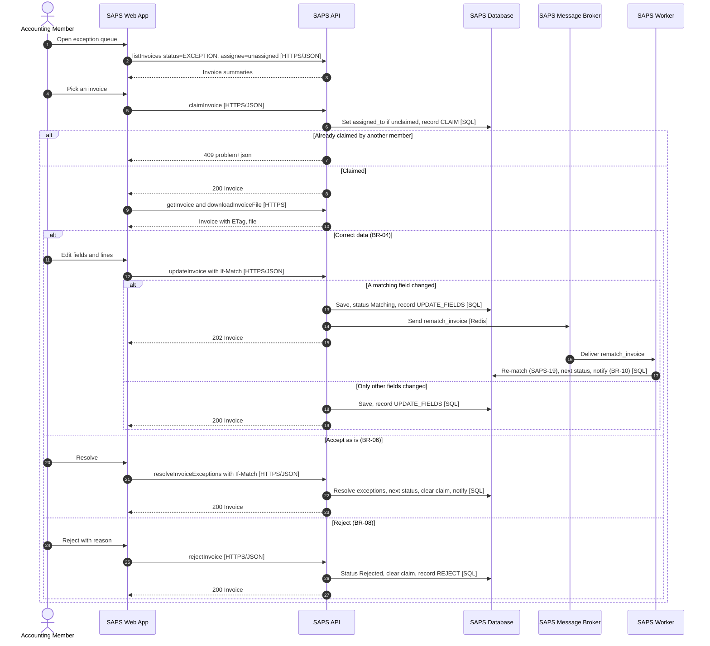

# SAPS-20 — Exception handling

> **Note ([SAPS-49](SAPS-49-straight-through-posting.md), 2027-03-01):** "Accept as is" (`resolveInvoiceExceptions`) now
> answers `202`, sets the status `MATCHING` and runs the workflow again, without extraction; the accepted exceptions keep a
> fingerprint of their values and are not raised again while the values are unchanged (BR-05). The result is Exception
> (a new problem), Pending approval or Posting. Rejecting at the final review is gone ([DEC-063](../01-requirements/decision-log.md#dec-063)).

> **Note ([SAPS-51](SAPS-51-trade-po-lot-matching.md), 2027-03-01):** EX11, EX12 and EX13 cannot be accepted as is
> (BR-06, [DEC-068](../01-requirements/decision-log.md#dec-068)). The DO number of a line and the invoice date are
> matching fields ([DEC-069](../01-requirements/decision-log.md#dec-069), BR-05).

## 1. Summary
When matching ([SAPS-19](SAPS-19-invoice-matching.md)) or extraction raises exceptions, the invoice enters the shared
exception queue. An Accounting Member picks (claims) an invoice, sees the file, the extracted data and every open
exception, and then corrects the data (which re-runs matching), accepts the invoice as it is, or rejects it.
This is the main manual step of the PoC and covers 11 of the 20 demo scenarios.

| Item | Value |
|---|---|
| Linear | [SAPS-20](https://linear.app/jiringuyen/issue/SAPS-20) |
| Use cases | [UC-03 Handle exception, UC-05 Reject invoice](../02-architecture/arc42/01-introduction-and-goals.md#use-cases) |
| Scope items | [SCP-IN-04, SCP-IN-14](../01-requirements/scope.md#31-functional-capabilities) |
| Target release | PoC demo 2027-02-22 (Linear milestone "PoC demo") |

## 2. Requirements

### 2.1 Business Rules
| ID | Rule | Source |
|---|---|---|
| BR-01 | Invoices in status Exception form one shared queue per tenant; any Accounting Member can claim an unclaimed invoice. | [DEC-016](../01-requirements/decision-log.md#dec-016) |
| BR-02 | Only the Accounting Member who claimed an invoice can update it, resolve its exceptions or reject it during exception handling. | [DEC-016](../01-requirements/decision-log.md#dec-016) |
| BR-03 | A claim can be released by the claimant, or by an Accounting Manager for any claim; the invoice returns to the unclaimed queue. | [DEC-036](../01-requirements/decision-log.md#dec-036) |
| BR-04 | Correcting data: header fields and lines can be changed; `lines`, when sent, replaces all lines. If a matching field changes, the status becomes Matching and re-matching is queued; the invoice stays claimed. | [DEC-010](../01-requirements/decision-log.md#dec-010), [DEC-024](../01-requirements/decision-log.md#dec-024) |
| BR-05 | Matching fields: vendor code, invoice number, PO number, PO line number, quantity, unit price. Changes to other fields are saved without re-matching. | [DEC-024](../01-requirements/decision-log.md#dec-024) |
| BR-06 | Accepting as is (resolve): marks all open exceptions resolved without re-matching and sets the next status — PendingApproval if the total amount is above the approval threshold of the last matching run (the stored snapshot; the current setting when there is none), otherwise PendingReview. Allowed only when every open exception is EX2, EX6, EX7 or EX9; EX1, EX3, EX4, EX5, EX8 and EX10 need corrected data or a rejection. | [DEC-013](../01-requirements/decision-log.md#dec-013), [DEC-035](../01-requirements/decision-log.md#dec-035) |
| BR-07 | A non-PO invoice (EX2) is always handled by accepting it after review (BR-06) or rejecting it. | [DEC-006](../01-requirements/decision-log.md#dec-006) |
| BR-08 | Rejecting requires a reason; status Rejected is final. | [DEC-014](../01-requirements/decision-log.md#dec-014) |
| BR-09 | When an invoice leaves status Exception (to PendingApproval, PendingReview or Rejected) the claim is cleared. | design, §6 |
| BR-10 | When re-matching ends in Exception again, only the claimant is notified; a new unclaimed exception notifies all Accounting Members. | [DEC-021](../01-requirements/decision-log.md#dec-021), [DEC-037](../01-requirements/decision-log.md#dec-037) |
| BR-11 | Every action is recorded as an InvoiceEvent: `CLAIM`, `RELEASE`, `UPDATE_FIELDS` (changed fields with old and new values), `RESOLVE`, `REJECT`. | [data model](../02-architecture/data-model.md#invoiceevent) |

### 2.2 Affected NFRs
| NFR | How this feature is affected |
|---|---|
| [NFR-SEC-001](../01-requirements/nfr.md#nfr-sec-001) | All operations need a signed-in Accounting Member; claimant checks run in the SAPS API ([ADR-0008](../02-architecture/adr/0008-use-session-cookies-for-authentication.md)). |
| [NFR-USAB-001](../01-requirements/nfr.md#nfr-usab-001) | Exception messages and screens are in English. |

### 2.3 Out of Scope
- Raising exceptions and re-matching logic ([SAPS-19](SAPS-19-invoice-matching.md)); duplicate detection ([SAPS-23](https://linear.app/jiringuyen/issue/SAPS-23)).
- Approval and final review ([SAPS-22](https://linear.app/jiringuyen/issue/SAPS-22), [SAPS-21](https://linear.app/jiringuyen/issue/SAPS-21)); notification list and badges ([SAPS-24](https://linear.app/jiringuyen/issue/SAPS-24)).
- Review SLA and escalation (MTG-20261114 Q23 was answered with a shared queue only).
- Splitting an invoice, or adding new invoices from the exception screen.

## 3. Design

### 3.1 Affected Building Blocks
| Container | Change | Description |
|---|---|---|
| SAPS Web App | new | Exception queue (Unclaimed / Mine; read-only for Accounting Managers, who can only release a claim), invoice detail with file viewer, lines with match results, exceptions and history; edit form for header and lines; accept as is and reject; routes `#/exceptions`, `#/invoices/{id}` |
| SAPS API | new | `claimInvoice`, `releaseInvoiceClaim`, `updateInvoice`, `resolveInvoiceExceptions`, `rejectInvoice`, `listInvoices`, `listInvoiceEvents`, `downloadInvoiceFile`; claimant and status checks; ETag handling |
| SAPS Worker | modified | `rematch_invoice` expects status Matching; matching ends the claim when the invoice leaves Exception (BR-09). The sweeper that re-sends `rematch_invoice` for invoices stuck in Matching is [SAPS-37](https://linear.app/jiringuyen/issue/SAPS-37) (§6) |
| SAPS Database | modified | Writes Invoice, InvoiceLine, InvoiceException, InvoiceEvent, Notification |

### 3.2 Main Flow

### 3.3 Edge Cases & Error Handling
| ID | Case | Expected behavior | Response / signal |
|---|---|---|---|
| EC-01 | Two members claim the same invoice at the same time | Conditional update (`assigned_to IS NULL`); one wins | Loser: `409` |
| EC-02 | The invoice changed since the member loaded it (e.g. re-match finished, another tab) | Optimistic locking with ETag | `412`; the Web App reloads the invoice |
| EC-03 | Update, resolve or reject while the status is Matching (re-match pending) | Not allowed until re-matching finishes | `409`; the Web App shows "re-matching in progress" |
| EC-04 | Resolve while an open exception is EX1, EX3, EX4, EX5, EX8 or EX10 (BR-06) | Refused; the member must correct the data or reject | `422` naming the exception codes |
| EC-05 | Re-match message lost or worker crashed | Sweeper re-sends `rematch_invoice` for invoices in Matching ([ADR-0004](../02-architecture/adr/0004-process-invoices-in-background-worker.md) S1; [SAPS-37](https://linear.app/jiringuyen/issue/SAPS-37)). When sending fails after the save, the answer is still `202` | Log `sweeper_resent` / `rematch_not_sent` |
| EC-06 | EX1 (file not in the sample set): no extracted data | The member may enter header and lines manually (`updateInvoice`), which re-runs matching; or reject (DS-07) | `202` / `200` |
| EC-07 | Vendor code or invoice number changed on an invoice with EX9 | Re-matching also re-runs the duplicate check ([SAPS-23](https://linear.app/jiringuyen/issue/SAPS-23)) | EX9 resolved or raised again |
| EC-08 | `updateInvoice` with no real change | Nothing saved, no event | `200` |
| EC-09 | Reject without a reason | Refused | `400` |
| EC-10 | Caller is not the claimant, or is an Accounting Manager | Refused | `403` |
| EC-11 | The claimant claims the invoice again | Nothing changes | `200` |
| EC-12 | `lines` is sent | Lines are matched by line number, so their IDs stay valid; a line that is no longer sent is removed and its exceptions are resolved by the member and detached from the line; the re-match then checks everything again | `202` |
| EC-13 | Reject an invoice that is in Pending review | Handled as the final review by [SAPS-21](SAPS-21-final-result-review.md): any Accounting Member, no claim. A member cannot reject an invoice in Pending approval (the manager rejects it through the approval, [SAPS-22](SAPS-22-invoice-approval.md)) | `200` / `409` |
| EC-14 | Invalid field values (not a 7-digit PO number, too many decimals, empty or null header field, no field sent) | Refused by the schema | `400` |

**SAPS Web App behaviour:** while the status is Matching it shows "Re-matching in progress" and polls `getInvoice` every 2 s; `412` reloads the invoice and says why; Accept as is is disabled, with the codes named, while EX1, EX3, EX4, EX5, EX8 or EX10 is open; a lost claim race (`409`) is explained and the queue refreshed.

**Order of checks:** invoice exists in the caller's tenant (`404`) → status (`409`) → claimant (`403`) → ETag (`412`; `428` when `If-Match` is missing) → business rules (`422`).

### 3.4 API Changes
Contract: [saps-api.openapi.yaml](../02-architecture/api/saps-api.openapi.yaml) (0.4.1: every response with an `Invoice` carries its `ETag`).

| operationId | Method & path | Change | Breaking | Spec |
|---|---|---|---|---|
| `listInvoices` | GET /v1/invoices | none — queue filters `status=EXCEPTION`, `assignee=unassigned\|me`; newest first, cursor paging | No | [saps-api.openapi.yaml](../02-architecture/api/saps-api.openapi.yaml) |
| `claimInvoice` | POST /v1/invoices/{invoiceId}/claim | description: `ETag` header; repeating a claim you hold is `200` | No | ″ |
| `releaseInvoiceClaim` | DELETE /v1/invoices/{invoiceId}/claim | **new** (BR-03) | No | ″ |
| `updateInvoice` | PATCH /v1/invoices/{invoiceId} | description: a matching-field change sets status Matching; `409` while Matching | No | ″ |
| `resolveInvoiceExceptions` | POST /v1/invoices/{invoiceId}/resolution | adds `422` when an exception type may not be accepted (BR-06) | No | ″ |
| `rejectInvoice` | POST /v1/invoices/{invoiceId}/rejection | `ETag` header; in Exception for the claimant; in Pending review for any member ([SAPS-21](SAPS-21-final-result-review.md)) | No | ″ |
| `getInvoice`, `downloadInvoiceFile`, `listInvoiceEvents` | GET … | none | No | ″ |

### 3.5 Event Changes
`rematch_invoice(invoice_id)` is sent by the SAPS API after a matching-field change and by the sweeper for invoices
stuck in Matching. The actor expects status Matching ([ADR-0004](../02-architecture/adr/0004-process-invoices-in-background-worker.md)).

### 3.6 Data Model Changes
None. Uses `Invoice.assigned_to`, `Invoice.rejected_reason`, InvoiceException `status` / `resolved_by` / `resolved_at`,
and InvoiceEvent actions `CLAIM`, `RELEASE`, `UPDATE_FIELDS`, `RESOLVE`, `REJECT` ([data model](../02-architecture/data-model.md)).

### 3.7 Security & Permissions
- Roles: Accounting Member for all write operations; Accounting Manager may read and may release any claim ([DEC-036](../01-requirements/decision-log.md#dec-036)).
- Authorization check: in the SAPS API application layer — role (`x-roles`), claimant (`assigned_to` = caller), tenant (`tenant_id` of the session's user, [ADR-0007](../02-architecture/adr/0007-prepare-data-model-for-tenants.md)), status.
- CSRF: `Origin` check on all state-changing requests ([ADR-0008](../02-architecture/adr/0008-use-session-cookies-for-authentication.md)).
- Sensitive data: invoice data is Confidential; `UPDATE_FIELDS` events store old and new values in the database, never in logs.
- Audit: BR-11.

### 3.8 Configuration & Feature Flags
None.

### 3.9 Observability
- Logs: `invoice_claimed`, `invoice_claim_released`, `invoice_updated` (rematch: true/false), `exceptions_resolved` (status), `invoice_rejected`, `rematch_not_sent` — IDs and statuses only.
- Metrics and alerts: none in the PoC.

## 4. Rollout & Rollback
1. Merge the OpenAPI change (0.4.1) with the SAPS API implementation. The feature ships in two pull requests: SAPS API and SAPS Worker first, then the SAPS Web App screens.
2. Deploy with `docker compose up -d --build`.

**Rollback:** revert the pull request and recreate the local stack; PoC data is demo data only.

## 5. Test Scenarios
| ID | Scenario | Level | Covers |
|---|---|---|---|
| TS-01 | Claim an unclaimed invoice; second claim by another member gets 409 | Integration | BR-01, EC-01 |
| TS-02 | Non-claimant and Accounting Manager cannot update, resolve or reject | Integration | BR-02, EC-10 |
| TS-03 | Release by claimant; release of another member's claim by an Accounting Manager; release by a non-claimant member → 403 | Integration | BR-03 |
| TS-04 | Update with a matching field → status Matching, 202, re-match queued; update with other fields only → 200, no re-match | Integration | BR-04, BR-05 |
| TS-05 | Stale ETag → 412; missing If-Match → 428 | Integration | EC-02 |
| TS-06 | Update / resolve / reject while Matching → 409 | Integration | EC-03 |
| TS-07 | Resolve with each of EX2, EX6, EX7, EX9 → next status by approval threshold; with any of EX1, EX3, EX4, EX5, EX8, EX10 → 422 | Unit + Integration | BR-06, BR-07, EC-04 |
| TS-08 | Reject with and without reason | Integration | BR-08, EC-09 |
| TS-09 | Claim cleared when leaving Exception; notifications to claimant vs. all members | Integration | BR-09, BR-10 |
| TS-10 | Sweeper re-sends `rematch_invoice` for an invoice stuck in Matching — tested in [SAPS-37](SAPS-37-stuck-invoice-sweeper.md) TS-09; here: an update still answers `202` when sending fails | Integration | EC-05 |
| TS-11 | Events CLAIM, RELEASE, UPDATE_FIELDS (old/new values), RESOLVE, REJECT recorded | Integration | BR-11 |
| TS-12 | Demo scenarios DS-07, DS-08, DS-09, DS-10, DS-11, DS-12, DS-13, DS-14, DS-15, DS-20; DS-17 for rejection outside this feature | E2E | [Test Strategy §11](../05-testing/test-strategy.md#11-poc-demo-acceptance) |

## 6. Decisions
| Decision | Rationale | ADR |
|---|---|---|
| Claim before working on an invoice | Prevents two members editing the same invoice in a shared queue | — |
| A matching-field change sets status Matching and keeps the claim | Matches the invoice lifecycle (Exception → Matching); the same member continues if re-matching raises exceptions again | — |
| Sweeper sends `process_invoice` for Uploaded and `rematch_invoice` for Matching | Each actor checks its own expected status (ADR-0004 S2); otherwise an invoice stuck in Matching would never be recovered | [ADR-0004](../02-architecture/adr/0004-process-invoices-in-background-worker.md) |
| New operation `releaseInvoiceClaim` | Without it, an invoice claimed by an absent member is blocked | — |
| Lines are updated in place by line number, not deleted and re-inserted | Exceptions and IDs of unchanged lines stay valid; only removed lines lose their exceptions (EC-12) | — |
| One transaction per operation with the invoice row locked | The claim race (EC-01) and the status checks cannot interleave; the message is sent after the commit | [ADR-0004](../02-architecture/adr/0004-process-invoices-in-background-worker.md) |
| Accepting as is uses the approval threshold of the last matching run | The same rule that decided the status at that time (DEC-013) | — |
| Events show the user's display name as `actor` | The contract says display name; the audit row stores the username | — |
| `lines` replaces all lines in `updateInvoice` | Simple, explicit edit model for the PoC | — |

## 7. Open Questions
| # | Question | Asked to | Due | Status |
|---|---|---|---|---|
| Q1 | Which exception types may an Accounting Member accept as is (resolve without correcting data)? Proposal: allowed for EX2 (non-PO review), EX6 (price variance), EX7 (quantity variance), EX9 (not a real duplicate); not allowed for EX1, EX3, EX4, EX5, EX8, EX10 — these need corrected data or a rejection. | Product Owner (Customer) | next meeting | answered → [MTG-20261210](../01-requirements/meetings/2026-12-10-exception-handling-rules.md) R1 |
| Q2 | Can an Accounting Manager release another member's claim (e.g. the member is absent)? Proposal: yes. | Product Owner (Customer) | next meeting | answered → [MTG-20261210](../01-requirements/meetings/2026-12-10-exception-handling-rules.md) R2 |
| Q3 | When re-matching raises exceptions again, notify only the claimant (proposal) or all Accounting Members? | Product Owner (Customer) | next meeting | answered → [MTG-20261210](../01-requirements/meetings/2026-12-10-exception-handling-rules.md) R3 |
| Q4 | Clarifications found while planning the build: the exception queue for Accounting Managers (read-only, with Release; Web App pull request), rejecting only invoices in Exception now (EC-13), and the two pull requests | Solution Architect / Tech Lead | before coding | answered: agreed (2026-12-15) |

## 8. Documentation Checklist
- [x] API spec updated (`releaseInvoiceClaim`, `updateInvoice`, `resolveInvoiceExceptions` existed; 0.4.1 adds the `ETag` header)
- [x] Glossary checked (no new terms)
- [x] arc42 §6.3 sweeper note: actor chosen by status
- [ ] Release notes entry prepared
