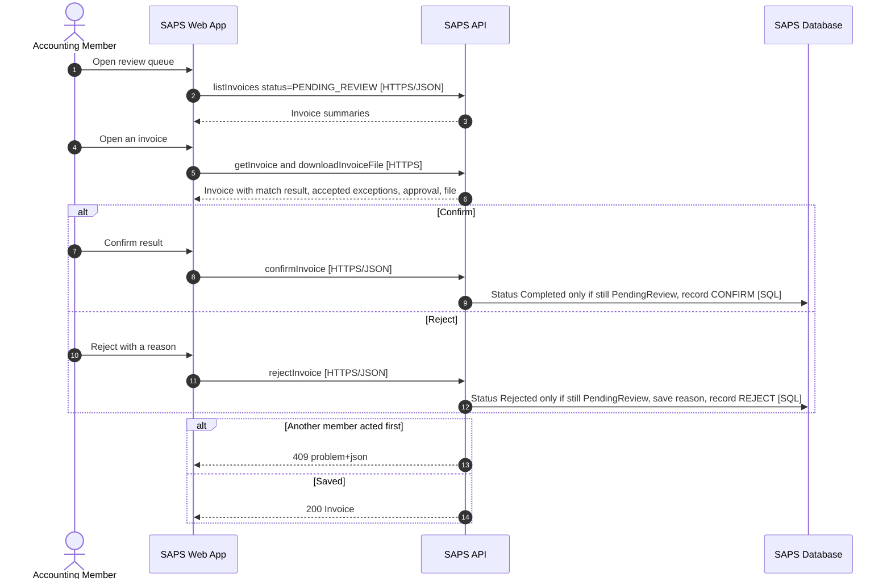

# SAPS-21 — Final result review

> **Note ([SAPS-49](SAPS-49-straight-through-posting.md), 2027-03-01):** withdrawn in Phase 2
> ([DEC-063](../01-requirements/decision-log.md#dec-063), SCP-IN-05). Invoices are posted to the ERP without a final review;
> `confirmInvoice`, the review queue and the notification "ready for final review" are removed. This spec describes the PoC.

## 1. Summary
The last step of the flow. Invoices in status PendingReview — matched without exceptions, accepted after exception
handling, or approved by the Accounting Manager — wait for an Accounting Member to check the result. The member
confirms (status Completed, ready for posting) or rejects the invoice. The result is only displayed; nothing is posted.

| Item | Value |
|---|---|
| Linear | [SAPS-21](https://linear.app/jiringuyen/issue/SAPS-21) |
| Use cases | [UC-06 Review final result, UC-05 Reject invoice](../02-architecture/arc42/01-introduction-and-goals.md#use-cases) |
| Scope items | [SCP-IN-05, SCP-IN-14](../01-requirements/scope.md#31-functional-capabilities) |
| Target release | PoC demo 2027-02-22 (Linear milestone "PoC demo") |

## 2. Requirements

### 2.1 Business Rules
| ID | Rule | Source |
|---|---|---|
| BR-01 | Invoices reach PendingReview from matching, from accepting exceptions, or from approval; Accounting Members get a `REVIEW_REQUESTED` notification. | [DEC-013](../01-requirements/decision-log.md#dec-013), [DEC-021](../01-requirements/decision-log.md#dec-021) |
| BR-02 | Any Accounting Member of the tenant can review, including the member who uploaded the invoice or accepted its exceptions (no four-eyes rule in the PoC); there is no claim. The first action wins. | [DEC-021](../01-requirements/decision-log.md#dec-021), [DEC-041](../01-requirements/decision-log.md#dec-041) |
| BR-03 | Confirm → status Completed, a final state meaning "ready for posting"; posting and payment happen outside the system. | [glossary: Completed](../02-architecture/arc42/12-glossary.md#121-domain-terms), [SCP-OUT-08](../01-requirements/scope.md#4-out-of-scope) |
| BR-04 | Reject → status Rejected, a final state. A reason is required. No notification is sent on rejection. | [DEC-014](../01-requirements/decision-log.md#dec-014), [DEC-040](../01-requirements/decision-log.md#dec-040) |
| BR-05 | The review screen shows the file, header, lines with match results, accepted exceptions and the approval decision (if any). Data cannot be changed in this step and the invoice cannot be returned for correction. | [SCP-IN-05](../01-requirements/scope.md#31-functional-capabilities), [DEC-039](../01-requirements/decision-log.md#dec-039) |
| BR-06 | Each action is recorded as an InvoiceEvent (`CONFIRM` or `REJECT`). | [data model](../02-architecture/data-model.md#invoiceevent) |

### 2.2 Affected NFRs
| NFR | How this feature is affected |
|---|---|
| [NFR-SEC-001](../01-requirements/nfr.md#nfr-sec-001) | Only signed-in Accounting Members can confirm or reject ([ADR-0008](../02-architecture/adr/0008-use-session-cookies-for-authentication.md)). |
| [NFR-USAB-001](../01-requirements/nfr.md#nfr-usab-001) | Review screen in English. |

### 2.3 Out of Scope
- Posting to the ERP or exporting the result ([SCP-OUT-08](../01-requirements/scope.md#4-out-of-scope)); payment ([SCP-OUT-03](../01-requirements/scope.md#4-out-of-scope)).
- Reopening a Completed or Rejected invoice.

## 3. Design

### 3.1 Affected Building Blocks
| Container | Change | Description |
|---|---|---|
| SAPS Web App | new | Review queue (`status=PENDING_REVIEW`; shares one queue page with the approval queue of SAPS-22), read-only result view with the approval decision, Confirm and Reject (reason required); banners for Completed (ready for posting) and Rejected (with the reason); routes `#/review`, `#/review/{id}` |
| SAPS API | new | `confirmInvoice`; `rejectInvoice` for PendingReview; role, tenant and status checks |
| SAPS Database | modified | Writes Invoice status, `rejected_reason`, InvoiceEvent |

### 3.2 Main Flow

### 3.3 Edge Cases & Error Handling
| ID | Case | Expected behavior | Response / signal |
|---|---|---|---|
| EC-01 | Two members act on the same invoice at the same time | Conditional update on status PendingReview; the first wins | Second: `409` |
| EC-02 | Reject without a reason | Refused | `400` |
| EC-03 | Accounting Manager calls `confirmInvoice` | Refused (role) | `403` |
| EC-04 | Invoice not in PendingReview | Refused | `409` |
| EC-05 | A member rejects an invoice in Pending approval through `rejectInvoice` | Refused; the Accounting Manager rejects it through the approval ([SAPS-22](SAPS-22-invoice-approval.md)) | `409` |

**Order of checks:** invoice exists in the caller's tenant (`404`) → status (`409`). `rejectInvoice` keeps the SAPS-20 rules for invoices in Exception (claimant only).

### 3.4 API Changes
Contract 0.4.3: the confirmation response carries the invoice's `ETag` like the other `Invoice` responses (additive). Uses operations of [saps-api.openapi.yaml](../02-architecture/api/saps-api.openapi.yaml):

| operationId | Method & path | Change | Breaking | Spec |
|---|---|---|---|---|
| `listInvoices` | GET /v1/invoices?status=PENDING_REVIEW | none | No | [saps-api.openapi.yaml](../02-architecture/api/saps-api.openapi.yaml) |
| `getInvoice`, `downloadInvoiceFile` | GET /v1/invoices/{invoiceId}, …/file | none | No | ″ |
| `confirmInvoice` | POST /v1/invoices/{invoiceId}/confirmation | `ETag` header on `200` | No | ″ |
| `rejectInvoice` | POST /v1/invoices/{invoiceId}/rejection | now also in Pending review, for any member ([SAPS-20](SAPS-20-exception-handling.md) EC-13) | No | ″ |

### 3.6 Data Model Changes
None. Uses Invoice `status` / `rejected_reason` and InvoiceEvent ([data model](../02-architecture/data-model.md)).

### 3.7 Security & Permissions
- Roles: Accounting Member confirms or rejects; Accounting Manager can read only.
- Authorization check: SAPS API — role, tenant of the session's user ([ADR-0007](../02-architecture/adr/0007-prepare-data-model-for-tenants.md)), status.
- CSRF: `Origin` check ([ADR-0008](../02-architecture/adr/0008-use-session-cookies-for-authentication.md)).
- Audit: InvoiceEvent `CONFIRM` / `REJECT` with the actor.

### 3.9 Observability
- Logs: `invoice_completed`, `invoice_rejected_at_review` (IDs only).

## 4. Rollout & Rollback
1. Deploy SAPS API and SAPS Web App with `docker compose up -d --build`.

**Rollback:** revert the pull request and recreate the local stack.

## 5. Test Scenarios
| ID | Scenario | Level | Covers |
|---|---|---|---|
| TS-01 | Confirm → Completed, event CONFIRM | Integration | BR-03, BR-06 |
| TS-02 | Reject with reason → Rejected; without reason → 400 | Integration | BR-04, EC-02 |
| TS-03 | Two members act at the same time → one 200, one 409 | Integration | EC-01 |
| TS-04 | Manager cannot confirm (403); action on an invoice not in PendingReview (409) | Integration | EC-03, EC-04 |
| TS-05 | Review screen shows accepted exceptions and the approval decision; no edit controls | E2E | BR-05 |
| TS-06 | Demo scenarios DS-01, DS-02, DS-03, DS-17 | E2E | [Test Strategy §11](../05-testing/test-strategy.md#11-poc-demo-acceptance) |

## 6. Decisions
| Decision | Rationale | ADR |
|---|---|---|
| No claim for the review step | Review is a single action; a conditional status update prevents double handling | — |
| The status check runs under the invoice row lock | The second of two members acting at once waits, then sees the new status and gets `409` (EC-01) | [ADR-0004](../02-architecture/adr/0004-process-invoices-in-background-worker.md) |
| Rejecting at final review reuses `rejectInvoice` and its event `REJECT` | One operation for every member rejection; the status decides the rule (claimant in Exception, anyone in Pending review) | — |

## 7. Open Questions
| # | Question | Asked to | Due | Status |
|---|---|---|---|---|
| Q1 | May the Accounting Member who uploaded the invoice or accepted its exceptions also confirm it at final review, or must another member review it (four-eyes principle)? Proposal: no restriction in the PoC. | Product Owner (Customer) | next meeting | answered → [MTG-20261211](../01-requirements/meetings/2026-12-11-approval-review-rules.md) R4 |

Return for correction and notification on rejection were decided with SAPS-22: [DEC-039](../01-requirements/decision-log.md#dec-039), [DEC-040](../01-requirements/decision-log.md#dec-040).

## 8. Documentation Checklist
- [ ] Release notes entry prepared
