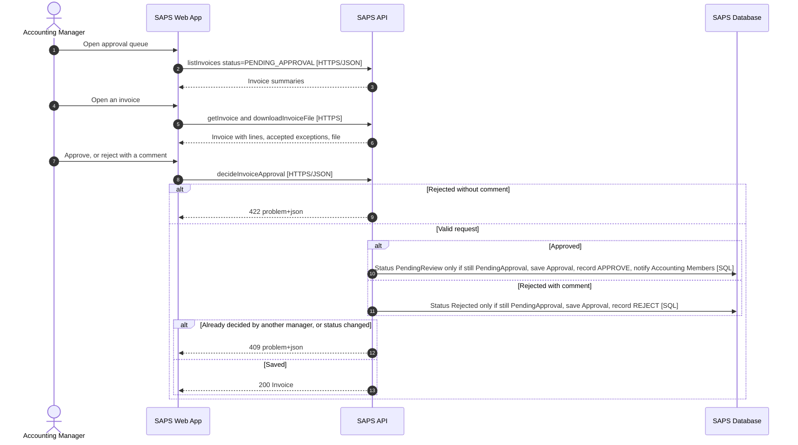

# SAPS-22 — Invoice approval

## 1. Summary
Invoices whose total amount (tax included) is above the approval threshold wait in status PendingApproval for an
Accounting Manager. The manager sees the invoice, its match result and any exceptions that an Accounting Member accepted
as is, and approves or rejects it. Approved invoices go to the final review ([SAPS-21](SAPS-21-final-result-review.md));
rejected invoices end in status Rejected.

| Item | Value |
|---|---|
| Linear | [SAPS-22](https://linear.app/jiringuyen/issue/SAPS-22) |
| Use cases | [UC-04 Approve invoice, UC-05 Reject invoice](../02-architecture/arc42/01-introduction-and-goals.md#use-cases) |
| Scope items | [SCP-IN-06, SCP-IN-14](../01-requirements/scope.md#31-functional-capabilities) |
| Target release | PoC demo 2027-02-22 (Linear milestone "PoC demo") |

## 2. Requirements

### 2.1 Business Rules
| ID | Rule | Source |
|---|---|---|
| BR-01 | An invoice needs approval when its total amount (tax included) is above the approval threshold stored on the invoice (`approvalThresholdApplied`). The status PendingApproval is set by matching ([SAPS-19](SAPS-19-invoice-matching.md) BR-12) or by accepting exceptions ([SAPS-20](SAPS-20-exception-handling.md) BR-06). | [DEC-009](../01-requirements/decision-log.md#dec-009), [DEC-015](../01-requirements/decision-log.md#dec-015) |
| BR-02 | The rule applies to all invoice types, including non-PO invoices. | [DEC-013](../01-requirements/decision-log.md#dec-013) |
| BR-03 | Only an Accounting Manager of the invoice's tenant can decide. Any Accounting Manager of the tenant can decide; the first decision wins (pending Q1). | [DEC-009](../01-requirements/decision-log.md#dec-009), Q1 |
| BR-04 | Approve → status PendingReview; Accounting Members get a `REVIEW_REQUESTED` notification. | [DEC-013](../01-requirements/decision-log.md#dec-013), [DEC-021](../01-requirements/decision-log.md#dec-021) |
| BR-05 | Reject → status Rejected, a final state. A comment is required. | [DEC-014](../01-requirements/decision-log.md#dec-014) |
| BR-06 | The manager cannot change invoice data. Return for correction instead of rejection: pending Q2. | [DEC-014](../01-requirements/decision-log.md#dec-014), Q2 |
| BR-07 | The approval screen shows the exceptions that were accepted as is (code, who accepted, when), so the manager knows which variances were accepted. | [DEC-035](../01-requirements/decision-log.md#dec-035) |
| BR-08 | Each decision is saved as an Approval and recorded as an InvoiceEvent (`APPROVE` or `REJECT`). | [data model](../02-architecture/data-model.md#approval) |
| BR-09 | Changing the approval threshold later does not change invoices already in PendingApproval; they keep the stored threshold. | [DEC-015](../01-requirements/decision-log.md#dec-015) |

### 2.2 Affected NFRs
| NFR | How this feature is affected |
|---|---|
| [NFR-SEC-001](../01-requirements/nfr.md#nfr-sec-001) | Only signed-in Accounting Managers can decide; role check in the SAPS API ([ADR-0008](../02-architecture/adr/0008-use-session-cookies-for-authentication.md)). |
| [NFR-USAB-001](../01-requirements/nfr.md#nfr-usab-001) | Approval screen in English. |

### 2.3 Out of Scope
- Several approval levels or amount-based approver chains (one threshold, one decision in the PoC).
- Delegation of approval rights; approval by email.
- Changing the threshold ([SAPS-28](https://linear.app/jiringuyen/issue/SAPS-28)); notification list and badges ([SAPS-24](https://linear.app/jiringuyen/issue/SAPS-24)).

## 3. Design

### 3.1 Affected Building Blocks
| Container | Change | Description |
|---|---|---|
| SAPS Web App | new | Approval queue (`status=PENDING_APPROVAL`), invoice detail with accepted exceptions, approve / reject dialog |
| SAPS API | new | `decideInvoiceApproval`; role, tenant and status checks; next status; notifications |
| SAPS Database | modified | Writes Approval, Invoice status, InvoiceEvent, Notification |

### 3.2 Main Flow

### 3.3 Edge Cases & Error Handling
| ID | Case | Expected behavior | Response / signal |
|---|---|---|---|
| EC-01 | Two managers decide the same invoice at the same time | Conditional update on status PendingApproval; the first wins | Second: `409` |
| EC-02 | Reject without a comment | Refused | `422` |
| EC-03 | Accounting Member calls `decideInvoiceApproval` | Refused (role) | `403` (DS-19) |
| EC-04 | Invoice not in PendingApproval | Refused | `409` |
| EC-05 | Threshold changed after the invoice entered PendingApproval | Invoice still needs approval (BR-09) | — |
| EC-06 | Non-PO invoice above the threshold after the Accounting Member accepted EX2 | Normal approval (BR-02) | DS-08 |

### 3.4 API Changes
No change. Uses operations of [saps-api.openapi.yaml](../02-architecture/api/saps-api.openapi.yaml) 0.3.0:

| operationId | Method & path | Change | Breaking | Spec |
|---|---|---|---|---|
| `listInvoices` | GET /v1/invoices?status=PENDING_APPROVAL | none | No | [saps-api.openapi.yaml](../02-architecture/api/saps-api.openapi.yaml) |
| `getInvoice`, `downloadInvoiceFile` | GET /v1/invoices/{invoiceId}, …/file | none | No | ″ |
| `decideInvoiceApproval` | POST /v1/invoices/{invoiceId}/approval | none | No | ″ |

### 3.6 Data Model Changes
None. Uses [Approval](../02-architecture/data-model.md#approval), Invoice `status` / `requires_approval` / `approval_threshold_applied`, InvoiceEvent, Notification.

### 3.7 Security & Permissions
- Roles: Accounting Manager decides; Accounting Members can read the invoice but not decide.
- Authorization check: SAPS API — role (`x-roles`), tenant of the session's user ([ADR-0007](../02-architecture/adr/0007-prepare-data-model-for-tenants.md)), status.
- CSRF: `Origin` check ([ADR-0008](../02-architecture/adr/0008-use-session-cookies-for-authentication.md)).
- Audit: Approval row (decision, comment, decided by, decided at) and InvoiceEvent.

### 3.9 Observability
- Logs: `invoice_approved`, `invoice_rejected_by_manager` (IDs only).

## 4. Rollout & Rollback
1. Deploy SAPS API and SAPS Web App with `docker compose up -d --build`.

**Rollback:** revert the pull request and recreate the local stack.

## 5. Test Scenarios
| ID | Scenario | Level | Covers |
|---|---|---|---|
| TS-01 | Approve → PendingReview, Approval saved, Accounting Members notified | Integration | BR-04, BR-08 |
| TS-02 | Reject with comment → Rejected; without comment → 422 | Integration | BR-05, EC-02 |
| TS-03 | Two managers decide at the same time → one 200, one 409 | Integration | BR-03, EC-01 |
| TS-04 | Member cannot decide (403); decision on an invoice not in PendingApproval (409) | Integration | EC-03, EC-04 |
| TS-05 | Threshold change does not affect invoices already waiting | Integration | BR-09, EC-05 |
| TS-06 | Approval screen lists accepted exceptions with who and when | E2E | BR-07 |
| TS-07 | Demo scenarios DS-03, DS-08, DS-16, DS-19 | E2E | [Test Strategy §11](../05-testing/test-strategy.md#11-poc-demo-acceptance) |

## 6. Decisions
| Decision | Rationale | ADR |
|---|---|---|
| No assignment of approvals to a specific manager | One shared approval queue, like the exception queue (DEC-016) | — |
| Conditional status update instead of ETag for the decision | The decision does not change invoice data; only the status transition must be unique | — |

## 7. Open Questions
| # | Question | Asked to | Due | Status |
|---|---|---|---|---|
| Q1 | With several Accounting Managers, can any of them decide, the first decision being final? Proposal: yes. | Product Owner (Customer) | next meeting | open |
| Q2 | Should the manager be able to return an invoice for correction (back to Exception) instead of rejecting it? Proposal: not in the PoC; reject only. | Product Owner (Customer) | next meeting | open |
| Q3 | Should anyone be notified when an invoice is rejected (by the manager or at final review)? Proposal: no notification in the PoC; the status is visible in the invoice list. | Product Owner (Customer) | next meeting | open |

## 8. Documentation Checklist
- [ ] Release notes entry prepared
