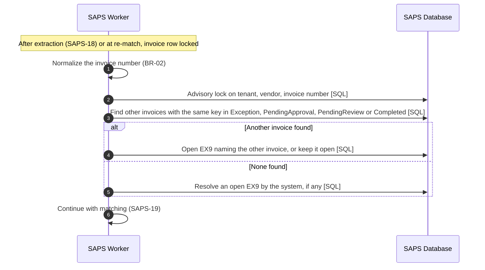

# SAPS-23 — Duplicate invoice detection

## 1. Summary
A vendor may send the same invoice twice, or a member may upload it twice. After extraction, the SAPS Worker compares
the invoice's vendor and invoice number with the other invoices of the tenant. A match raises EX9 so that an Accounting
Member decides: reject the duplicate, or accept it when it is not a real duplicate. The check runs again when the vendor
code or invoice number is corrected.

| Item | Value |
|---|---|
| Linear | [SAPS-23](https://linear.app/jiringuyen/issue/SAPS-23) |
| Use cases | [UC-02 Upload invoice, UC-03 Handle exception](../02-architecture/arc42/01-introduction-and-goals.md#use-cases) |
| Scope items | [SCP-IN-07](../01-requirements/scope.md#31-functional-capabilities) |
| Target release | PoC demo 2027-02-22 (Linear milestone "PoC demo") |

## 2. Requirements

### 2.1 Business Rules
| ID | Rule | Source |
|---|---|---|
| BR-01 | An invoice is a duplicate when another invoice of the same tenant has the same vendor code and the same invoice number. | [DEC-008](../01-requirements/decision-log.md#dec-008), [ADR-0007](../02-architecture/adr/0007-prepare-data-model-for-tenants.md) |
| BR-02 | Invoice numbers are compared after normalization (pending Q1). | Q1 |
| BR-03 | Invoices compared with: status Exception, PendingApproval, PendingReview or Completed. Not compared: Uploaded / Matching (no data yet) and Rejected (pending Q2). | [DEC-039](../01-requirements/decision-log.md#dec-039), Q2 |
| BR-04 | A duplicate raises one EX9 on the invoice being processed (header level); the message names the other invoice (number and status). The earlier invoice is not changed. | [DEC-008](../01-requirements/decision-log.md#dec-008), [DEC-033](../01-requirements/decision-log.md#dec-033) |
| BR-05 | A duplicate is never rejected automatically; matching still runs, so all exceptions are shown together. | [DEC-008](../01-requirements/decision-log.md#dec-008), [SAPS-19](SAPS-19-invoice-matching.md) §6 |
| BR-06 | The check runs in `process_invoice` after extraction and before matching, and again in `rematch_invoice` (the vendor code and invoice number are matching fields). | [DEC-024](../01-requirements/decision-log.md#dec-024), [SAPS-20](SAPS-20-exception-handling.md) EC-07 |
| BR-07 | EX9 may be accepted as is (not a real duplicate) or the invoice rejected. | [DEC-035](../01-requirements/decision-log.md#dec-035) |

### 2.2 Affected NFRs
| NFR | How this feature is affected |
|---|---|
| [NFR-SCAL-001](../01-requirements/nfr.md#nfr-scal-001) | One indexed query per invoice; an advisory lock per (tenant, vendor, invoice number) keeps parallel workers correct. |

### 2.3 Out of Scope
- Fuzzy duplicate detection (same amount and date with a different number, similar vendor names).
- Comparing with invoices in the ERP (after the PoC, through MuleSoft).

## 3. Design

### 3.1 Affected Building Blocks
| Container | Change | Description |
|---|---|---|
| SAPS Worker | new | Duplicate check in `domain/` and `application/`; called by `process_invoice` and `rematch_invoice` |
| SAPS Database | modified | Reads Invoice; writes InvoiceException EX9 |

### 3.2 Main Flow

### 3.3 Edge Cases & Error Handling
| ID | Case | Expected behavior | Response / signal |
|---|---|---|---|
| EC-01 | Two copies processed at the same time by two workers | The advisory lock is held until the job commits; the second copy sees the first and gets EX9 | EX9 on one invoice |
| EC-02 | Same sample uploaded twice (DS-15) | The second invoice gets EX9 | EX9 |
| EC-03 | Invoice rejected, corrected invoice uploaded again (DEC-039) | Not a duplicate of the rejected invoice (BR-03, pending Q2) | — |
| EC-04 | Member corrects the invoice number after EX9 | Re-match runs the check again; EX9 is resolved by the system if no other invoice matches | EX9 resolved |
| EC-05 | EX9 accepted as is, later another invoice with the same key arrives | The new invoice gets EX9 against both earlier invoices | EX9 |
| EC-06 | Vendor code or invoice number missing after extraction | No duplicate check for this invoice (cannot compare); other checks continue | — |

### 3.4 API Changes
None. EX9 is visible through `getInvoice` ([saps-api.openapi.yaml](../02-architecture/api/saps-api.openapi.yaml)).

### 3.6 Data Model Changes
| Entity | Change | Migration | Backward compatible |
|---|---|---|---|
| [Invoice](../02-architecture/data-model.md#invoice) | Depends on Q1: if invoice numbers are normalized, add `invoice_number_normalized` string(50) and replace the duplicate index with (`tenant_id`, `vendor_code`, `invoice_number_normalized`) | `add_invoice_number_normalized` | Yes |

### 3.7 Security & Permissions
- Runs as `system`; queries are limited to the invoice's tenant ([ADR-0007](../02-architecture/adr/0007-prepare-data-model-for-tenants.md)).
- The EX9 message shows only the other invoice's number and status, both from the same tenant.

### 3.9 Observability
- Logs: `duplicate_found` (invoice_id, other_invoice_id), `duplicate_cleared`.

## 4. Rollout & Rollback
1. Migration (only if Q1 introduces normalization).
2. Deploy SAPS Worker with `docker compose up -d --build`.

**Rollback:** revert the pull request and recreate the local stack.

## 5. Test Scenarios
| ID | Scenario | Level | Covers |
|---|---|---|---|
| TS-01 | Same vendor and number as an invoice in each compared status → EX9; in Uploaded, Matching, Rejected → no EX9 | Integration | BR-01, BR-03 |
| TS-02 | Normalization variants of the invoice number (per Q1) | Unit | BR-02 |
| TS-03 | Same number, different vendor → no EX9 | Unit | BR-01 |
| TS-04 | Two copies processed in parallel → exactly one EX9 | Integration | EC-01 |
| TS-05 | Duplicate also gets its matching exceptions | Integration | BR-05 |
| TS-06 | Correcting the invoice number resolves EX9 | Integration | BR-06, EC-04 |
| TS-07 | Demo scenario DS-15 | E2E | [Test Strategy §11](../05-testing/test-strategy.md#11-poc-demo-acceptance) |

## 6. Decisions
| Decision | Rationale | ADR |
|---|---|---|
| EX9 goes to the later invoice; the earlier one is unchanged | The earlier invoice may already be approved or completed | — |
| Advisory lock per duplicate key | Same pattern as the PO line lock in SAPS-19; prevents two copies passing in parallel | — |
| Matching still runs on a duplicate | All problems are visible at once (SAPS-19 §6) | — |

## 7. Open Questions
| # | Question | Asked to | Due | Status |
|---|---|---|---|---|
| Q1 | Should invoice numbers be normalized before comparison, so that "INV-0001", "inv 0001" and "INV0001" count as the same? Proposal: yes — ignore case, spaces, dashes, dots and slashes; keep leading zeros. | Product Owner (Customer) | next meeting | open |
| Q2 | Should rejected invoices be ignored by the duplicate check, so that a corrected invoice can be uploaded again (DEC-039)? Proposal: yes. | Product Owner (Customer) | next meeting | open |

## 8. Documentation Checklist
- [ ] Data model updated (only if Q1 adds normalization)
- [ ] Release notes entry prepared
