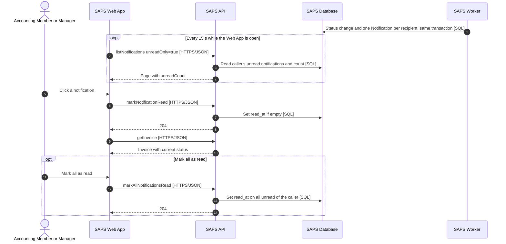

# SAPS-24 — In-app notifications

## 1. Summary
Users learn about work waiting for them through in-app notifications: Accounting Members about exceptions and final
reviews, Accounting Managers about approvals. Notifications are created together with the status change that causes
them, one per recipient. The SAPS Web App shows a bell with the unread count, a list, and opens the invoice on click.
Email and Microsoft Teams are not used in the PoC.

| Item | Value |
|---|---|
| Linear | [SAPS-24](https://linear.app/jiringuyen/issue/SAPS-24) |
| Use cases | [UC-08 View notifications](../02-architecture/arc42/01-introduction-and-goals.md#use-cases) |
| Scope items | [SCP-IN-08](../01-requirements/scope.md#31-functional-capabilities) |
| Target release | PoC demo 2027-02-22 (Linear milestone "PoC demo") |

## 2. Requirements

### 2.1 Business Rules
| ID | Rule | Source |
|---|---|---|
| BR-01 | Notification types and recipients: | [DEC-021](../01-requirements/decision-log.md#dec-021), [DEC-037](../01-requirements/decision-log.md#dec-037), [DEC-040](../01-requirements/decision-log.md#dec-040) |

| Trigger (status change) | Type | Recipients | Produced by |
|---|---|---|---|
| Invoice enters Exception and is unclaimed | `EXCEPTION_RAISED` | All active Accounting Members of the tenant | SAPS Worker ([SAPS-18](SAPS-18-dummy-invoice-extraction.md), [SAPS-19](SAPS-19-invoice-matching.md)) |
| Re-matching of a claimed invoice ends in Exception | `EXCEPTION_RAISED` | The claimant only | SAPS Worker ([SAPS-20](SAPS-20-exception-handling.md) BR-10) |
| Invoice enters PendingApproval | `APPROVAL_REQUESTED` | All active Accounting Managers of the tenant | SAPS Worker or SAPS API ([SAPS-19](SAPS-19-invoice-matching.md), [SAPS-20](SAPS-20-exception-handling.md)) |
| Invoice enters PendingReview | `REVIEW_REQUESTED` | All active Accounting Members of the tenant | SAPS Worker or SAPS API ([SAPS-19](SAPS-19-invoice-matching.md), [SAPS-20](SAPS-20-exception-handling.md), [SAPS-22](SAPS-22-invoice-approval.md)) |
| Rejected, Completed | none | — | ([DEC-040](../01-requirements/decision-log.md#dec-040)) |

| ID | Rule | Source |
|---|---|---|
| BR-02 | One Notification row per recipient, created in the same transaction as the status change; read state is per user. | [data model](../02-architecture/data-model.md#notification) |
| BR-03 | Recipients are resolved when the notification is created; users added later do not receive older notifications. | design, §6 |
| BR-04 | The message names the invoice (invoice number and vendor name, or the file name before extraction) and the reason (e.g. exception codes). | [NFR-USAB-001](../01-requirements/nfr.md#nfr-usab-001) |
| BR-05 | Notifications are not deleted when the invoice moves on; opening one shows the invoice with its current status. | design, §6 |
| BR-06 | The SAPS Web App polls for unread notifications and shows the count on a bell; clicking a notification marks it read and opens the invoice; "mark all as read" is available. | [arc42 §6.2](../02-architecture/arc42/06-runtime-view.md) |

### 2.2 Affected NFRs
| NFR | How this feature is affected |
|---|---|
| [NFR-SCAL-001](../01-requirements/nfr.md#nfr-scal-001) | Polling is one indexed query per user every 15 s; push (WebSocket / SSE) can replace polling later without changing the data model. |
| [NFR-USAB-001](../01-requirements/nfr.md#nfr-usab-001) | Messages in English. |

### 2.3 Out of Scope
- Email, Microsoft Teams or mobile push notifications.
- Notification preferences, digests, deleting notifications.
- Retention and cleanup of old notifications (data model Q2, after the PoC).

## 3. Design

### 3.1 Affected Building Blocks
| Container | Change | Description |
|---|---|---|
| SAPS Web App | new | Bell with unread count (polling), notification list, open invoice, mark all as read |
| SAPS API | new | `listNotifications` (with unread count), `markNotificationRead`, `markAllNotificationsRead`; creates notifications on its own status changes |
| SAPS Worker | modified | Creates notifications on its status changes |
| SAPS Database | modified | Notification rows; index (`recipient_id`, `read_at`, `created_at`) |

### 3.2 Main Flow

### 3.3 Edge Cases & Error Handling
| ID | Case | Expected behavior | Response / signal |
|---|---|---|---|
| EC-01 | Notification for an invoice already handled by someone else | Opens the invoice with its current status; no action offered if not allowed | — |
| EC-02 | Marking a notification of another user | Not found for the caller | `404` |
| EC-03 | Marking an already read notification | No change | `204` (idempotent) |
| EC-04 | No active recipient (e.g. no Accounting Manager in the tenant) | No notification created; warning logged | Log `notification_no_recipient` |
| EC-05 | Status change transaction rolls back | Notifications roll back with it (same transaction) | — |
| EC-06 | Session expired while polling | Polling stops; the Web App shows the sign-in page | `401` |

### 3.4 API Changes
Contract: [saps-api.openapi.yaml](../02-architecture/api/saps-api.openapi.yaml) (version 0.4.0 with this spec).

| operationId | Method & path | Change | Breaking | Spec |
|---|---|---|---|---|
| `listNotifications` | GET /v1/notifications | `NotificationPage` gets `unreadCount` | No | [saps-api.openapi.yaml](../02-architecture/api/saps-api.openapi.yaml) |
| `markNotificationRead` | POST /v1/notifications/{notificationId}/read | none | No | ″ |
| `markAllNotificationsRead` | POST /v1/notifications/read-all | **new** | No | ″ |

### 3.6 Data Model Changes
| Entity | Change | Migration | Backward compatible |
|---|---|---|---|
| [Notification](../02-architecture/data-model.md#notification) | Index (`recipient_id`, `read_at`, `created_at`) | `add_notification_recipient_index` | Yes |

### 3.7 Security & Permissions
- Every operation returns or changes only the caller's own notifications; tenant from the session ([ADR-0007](../02-architecture/adr/0007-prepare-data-model-for-tenants.md), [ADR-0008](../02-architecture/adr/0008-use-session-cookies-for-authentication.md)).
- Messages contain invoice number and vendor name (Confidential); never logged.

### 3.8 Configuration & Feature Flags
| Key | Purpose | Default | Per environment |
|---|---|---|---|
| `VITE_NOTIFICATION_POLL_SECONDS` | Polling interval of the SAPS Web App | 15 | PoC only |

### 3.9 Observability
- Logs: `notifications_created` (invoice_id, type, recipient_count), `notification_no_recipient`.

## 4. Rollout & Rollback
1. Merge the OpenAPI change (0.4.0) with the implementation; migration `add_notification_recipient_index`.
2. Deploy all containers with `docker compose up -d --build`.

**Rollback:** revert the pull request and recreate the local stack.

## 5. Test Scenarios
| ID | Scenario | Level | Covers |
|---|---|---|---|
| TS-01 | Each trigger in BR-01 creates the right type for the right recipients; rejection and completion create none | Integration | BR-01 |
| TS-02 | Re-exception on a claimed invoice notifies only the claimant | Integration | BR-01 (DEC-037) |
| TS-03 | Notifications roll back with a failed status change | Integration | BR-02, EC-05 |
| TS-04 | Inactive users and users created later receive nothing | Integration | BR-03 |
| TS-05 | List with `unreadOnly`, `unreadCount`; mark one read (idempotent); mark all read; another user's notification → 404 | Integration | BR-06, EC-02, EC-03 |
| TS-06 | Bell count updates by polling; click opens the invoice | E2E | BR-06 |
| TS-07 | Notification checks inside demo scenarios DS-01 … DS-20 ([Test Strategy §11](../05-testing/test-strategy.md#11-poc-demo-acceptance)) | E2E | BR-01 |

## 6. Decisions
| Decision | Rationale | ADR |
|---|---|---|
| Fan-out at creation, same transaction as the status change | Per-user read state; no lost or orphan notifications | — |
| Polling every 15 s instead of push | Simplest for the PoC; push can be added later (arc42 §6.2 note) | — |
| `unreadCount` in the list response and a "mark all as read" operation | Bell badge without a second call; usable list for the demo | — |
| Notifications stay after the invoice moves on | Simple and auditable; the invoice shows its current status | — |

## 7. Open Questions
None. Recipients follow DEC-021, DEC-037 and DEC-040.

## 8. Documentation Checklist
- [ ] API spec updated (`unreadCount`, `markAllNotificationsRead`; version 0.4.0)
- [ ] Data model updated (Notification index)
- [ ] Release notes entry prepared
