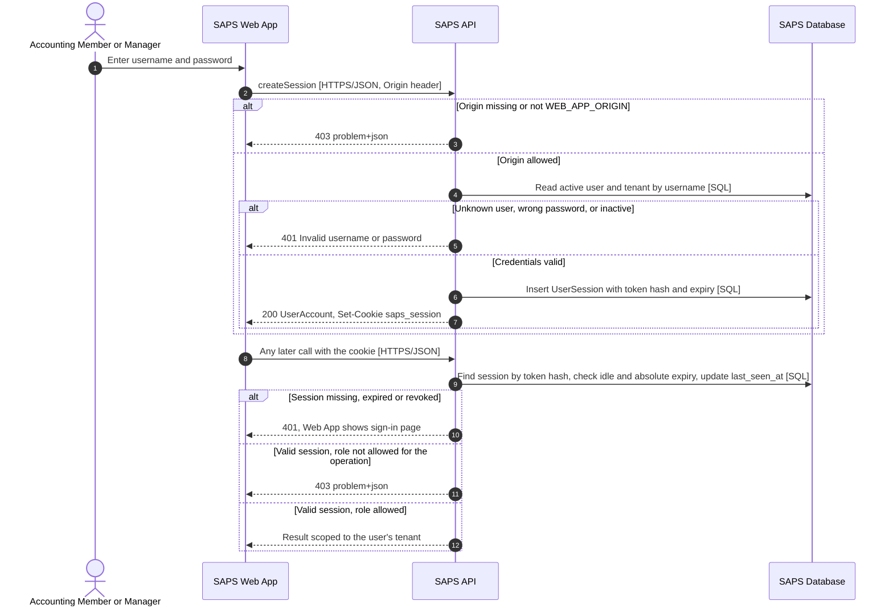

# SAPS-27 — User roles and sign-in

## 1. Summary
> **Superseded in part by [SAPS-44](SAPS-44-single-sign-on.md) (2027-03-01):** the password sign-in (BR-02, BR-03,
> `createSession`), the seeded passwords (BR-09) and the username/password page (BR-10) are replaced by the sign-in through
> Keycloak. The session, role and Origin rules (BR-04 to BR-08) still apply.

Users sign in with simple accounts; the SAPS API keeps a server-side session in an HttpOnly cookie and checks role,
tenant and request origin on every call. The PoC has one tenant with seeded demo users: Accounting Members and an
Accounting Manager. Every other feature builds on this one: it provides the current user, the tenant and the role checks.

| Item | Value |
|---|---|
| Linear | [SAPS-27](https://linear.app/jiringuyen/issue/SAPS-27) |
| Use cases | [UC-01 Sign in](../02-architecture/arc42/01-introduction-and-goals.md#use-cases) |
| Scope items | [SCP-IN-12](../01-requirements/scope.md#31-functional-capabilities) |
| Target release | PoC demo 2027-02-22 (Linear milestone "PoC demo") |

## 2. Requirements

### 2.1 Business Rules
| ID | Rule | Source |
|---|---|---|
| BR-01 | Two roles: Accounting Member and Accounting Manager; each user has exactly one role. | [SCP-IN-12](../01-requirements/scope.md#31-functional-capabilities) |
| BR-02 | Sign-in with username and password; a wrong username or password gives the same message ("Invalid username or password"). Inactive users and users of an inactive tenant cannot sign in. | [NFR-SEC-001](../01-requirements/nfr.md#nfr-sec-001) |
| BR-03 | Passwords are stored as Argon2id hashes. | [ADR-0008](../02-architecture/adr/0008-use-session-cookies-for-authentication.md) |
| BR-04 | A sign-in creates a new session: random 256-bit token in cookie `saps_session` (HttpOnly, SameSite=Lax, Secure when configured); only its SHA-256 is stored. Idle timeout 30 min, absolute timeout 8 h (settings). Sign-out revokes the session. | [ADR-0008](../02-architecture/adr/0008-use-session-cookies-for-authentication.md) |
| BR-05 | Every request except `getHealth` and `createSession` needs a valid session; otherwise `401`. Each successful request refreshes `last_seen_at`. | [ADR-0008](../02-architecture/adr/0008-use-session-cookies-for-authentication.md) |
| BR-06 | Every POST, PUT, PATCH and DELETE must carry an `Origin` header equal to `WEB_APP_ORIGIN`; otherwise `403` (CSRF protection). | [ADR-0008](../02-architecture/adr/0008-use-session-cookies-for-authentication.md) |
| BR-07 | Role check per operation (`x-roles` in the OpenAPI contract); a wrong role gives `403`. | [saps-api.openapi.yaml](../02-architecture/api/saps-api.openapi.yaml) |
| BR-08 | The tenant of a request is the tenant of the session's user; data of other tenants is never returned (`404`). | [ADR-0007](../02-architecture/adr/0007-prepare-data-model-for-tenants.md) |
| BR-09 | Demo data: one tenant "PoC Customer" with its MatchingSettings (0.5 USD, 300 USD) and the users in §3.8, created by an idempotent seed. | [DEC-015](../01-requirements/decision-log.md#dec-015) |
| BR-10 | The SAPS Web App shows a sign-in page, the signed-in user and role, a sign-out button, and only the menu items allowed for the role (Accounting Member: Upload invoices, Exception queue, Review queue; Accounting Manager: Approval queue, Exception queue read-only, Matching settings — [SAPS-20](SAPS-20-exception-handling.md)). A `401` from any call returns to the sign-in page. | [NFR-USAB-001](../01-requirements/nfr.md#nfr-usab-001) |

### 2.2 Affected NFRs
| NFR | How this feature is affected |
|---|---|
| [NFR-SEC-001](../01-requirements/nfr.md#nfr-sec-001) | Implements it: simple accounts, every function except sign-in needs a signed-in user. |
| [NFR-USAB-001](../01-requirements/nfr.md#nfr-usab-001) | Sign-in page and messages in English. |

### 2.3 Out of Scope
- User administration UI, self-registration, password change or reset (demo users are seeded).
- SSO ([SCP-OUT-10](../01-requirements/scope.md#4-out-of-scope)); multi-factor authentication.
- Account lockout and rate limiting of sign-in ([TD-03](../02-architecture/arc42/11-risks-and-technical-debt.md#td-03)).

## 3. Design

### 3.1 Affected Building Blocks
| Container | Change | Description |
|---|---|---|
| SAPS API | new | `createSession`, `getSession`, `deleteSession`; authentication dependency (session → current user, tenant, role); role check; Origin check middleware |
| SAPS Database | new | Tables `tenant`, `user_account`, `user_session`, `matching_settings` (migration `0002`) |
| SAPS Web App | new | Sign-in page, session context, sign-out, route guard, role-based menu |
| SAPS API image | modified | Runs the seed after migrations when `SEED_USER_PASSWORD` is set |

### 3.2 Main Flow

### 3.3 Edge Cases & Error Handling
| ID | Case | Expected behavior | Response / signal |
|---|---|---|---|
| EC-01 | Unknown username | Same answer and similar time as a wrong password (a dummy hash check is run) | `401` |
| EC-02 | Session idle for more than 30 min, or older than 8 h | Session ends | `401` |
| EC-03 | Sign-out, then reuse of the old cookie | Session revoked | `401` |
| EC-04 | State-changing request from another site, or without `Origin` | Refused before any processing | `403` |
| EC-05 | Accounting Member calls a manager-only operation | Refused | `403` |
| EC-06 | User deactivated while signed in | Next request refused | `401` |
| EC-07 | Seed runs twice | No duplicates; existing users keep their data; passwords are reset to `SEED_USER_PASSWORD` | — |
| EC-08 | `SEED_USER_PASSWORD` empty | Seed skipped with a warning; sign-in impossible until set | Log `seed_skipped` |

### 3.4 API Changes
No contract change; implements operations of [saps-api.openapi.yaml](../02-architecture/api/saps-api.openapi.yaml) 0.4.0:

| operationId | Method & path | Change | Breaking | Spec |
|---|---|---|---|---|
| `createSession` | POST /v1/session | implemented | No | [saps-api.openapi.yaml](../02-architecture/api/saps-api.openapi.yaml) |
| `getSession` | GET /v1/session | implemented | No | ″ |
| `deleteSession` | DELETE /v1/session | implemented | No | ″ |

### 3.6 Data Model Changes
| Entity | Change | Migration | Backward compatible |
|---|---|---|---|
| [Tenant](../02-architecture/data-model.md#tenant), [UserAccount](../02-architecture/data-model.md#useraccount), [UserSession](../02-architecture/data-model.md#usersession), [MatchingSettings](../02-architecture/data-model.md#matchingsettings) | New tables as described in the data model | `0002_tenants_users_sessions` | Yes (new tables) |

### 3.7 Security & Permissions
- Authentication and session rules: [ADR-0008](../02-architecture/adr/0008-use-session-cookies-for-authentication.md); tenant scoping: [ADR-0007](../02-architecture/adr/0007-prepare-data-model-for-tenants.md).
- Never logged: passwords, cookie values, token hashes. Logged: `user_signed_in`, `sign_in_failed` (username only), `user_signed_out`.
- `SEED_USER_PASSWORD` is a local test value set by each developer; it is not committed (`.env` is git-ignored).

### 3.8 Configuration & Seed
| Key | Purpose | Default |
|---|---|---|
| `WEB_APP_ORIGIN` | Allowed `Origin` | `http://localhost:5173` |
| `SESSION_IDLE_TIMEOUT_MINUTES`, `SESSION_ABSOLUTE_TIMEOUT_HOURS`, `SESSION_COOKIE_SECURE` | Session rules | 30, 8, true (`false` in `.env.example` for local HTTP) |
| `SEED_USER_PASSWORD` | Password of all seeded demo users | empty → seed skipped |

Seeded demo users (Q1, agreed):

| Username | Display name | Role |
|---|---|---|
| `member1` | Accounting Member 1 | Accounting Member |
| `member2` | Accounting Member 2 | Accounting Member |
| `manager1` | Accounting Manager 1 | Accounting Manager |
| `manager2` | Accounting Manager 2 | Accounting Manager |

Two users per role are needed for the demo of the shared queue (DEC-016) and of "first decision wins" (DEC-038).

### 3.9 Observability
- Logs as in §3.7, with `user_id` and `tenant_id`.

## 4. Rollout & Rollback
1. Migration `0002_tenants_users_sessions`; the SAPS API container runs migrations, then the seed.
2. `docker compose up -d --build --wait`.

**Rollback:** revert the pull request and recreate the local stack (`docker compose down -v`).

## 5. Test Scenarios
| ID | Scenario | Level | Covers |
|---|---|---|---|
| TS-01 | Sign-in with valid credentials sets the cookie with the right flags; `getSession` returns the user | Integration | BR-02, BR-04 |
| TS-02 | Wrong password, unknown user, inactive user, inactive tenant → same `401` | Integration | BR-02, EC-01, EC-06 |
| TS-03 | Password stored as Argon2id; token stored as hash only | Integration | BR-03, BR-04 |
| TS-04 | Idle and absolute expiry; sign-out revokes | Integration | EC-02, EC-03 |
| TS-05 | No or foreign `Origin` on POST/PUT/PATCH/DELETE → 403; GET without Origin → allowed | Integration | BR-06, EC-04 |
| TS-06 | Role check helper: allowed and refused roles | Unit | BR-07, EC-05 |
| TS-07 | Seed is idempotent; skipped without password | Integration | BR-09, EC-07, EC-08 |
| TS-08 | Web App: sign-in, wrong password message, sign-out, redirect on 401, menu by role | Unit (Vitest) + E2E | BR-10 |
| TS-09 | Demo scenario DS-19 (sign-in and role access) | E2E | [Test Strategy §11](../05-testing/test-strategy.md#11-poc-demo-acceptance) |

## 6. Decisions
| Decision | Rationale | ADR |
|---|---|---|
| Dummy password check for unknown users | Same response time; usernames cannot be probed | [ADR-0008](../02-architecture/adr/0008-use-session-cookies-for-authentication.md) |
| Origin check as middleware for all state-changing methods | One place, cannot be forgotten per endpoint | [ADR-0008](../02-architecture/adr/0008-use-session-cookies-for-authentication.md) |
| Tenant and MatchingSettings created by the seed | The data model says settings are created with the tenant; SAPS-19 needs them | [ADR-0007](../02-architecture/adr/0007-prepare-data-model-for-tenants.md) |

## 7. Open Questions
| # | Question | Asked to | Due | Status |
|---|---|---|---|---|
| Q1 | Demo users: two Accounting Members and two Accounting Managers as in §3.8? | Solution Architect / Tech Lead | before coding | answered: agreed (2026-12-15) |
| Q2 | Seed runs automatically after migrations when the SAPS API container starts (idempotent) — or only by a manual command? Proposal: automatically. | Solution Architect / Tech Lead | before coding | answered: automatically after migrations (2026-12-15) |
| Q3 | No account lockout or sign-in rate limiting in the PoC (local, synthetic users); recorded as technical debt TD-03 for later phases. Agreed? | Solution Architect / Tech Lead | before coding | answered: agreed; [TD-03](../02-architecture/arc42/11-risks-and-technical-debt.md#td-03) (2026-12-15) |

## 8. Documentation Checklist
- [x] arc42 §11: TD-03
- [x] Developer Guide §2.4: sign-in step verified
- [ ] Release notes entry prepared
