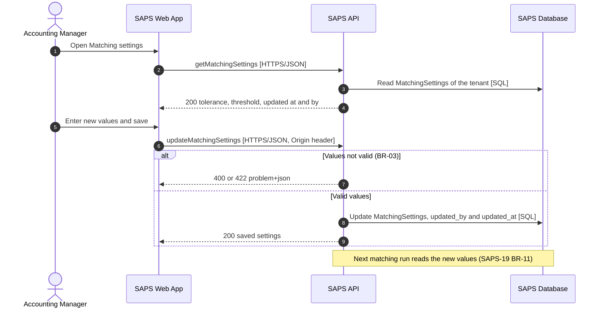

# SAPS-28 — Matching settings

## 1. Summary
The price tolerance (default 0.5 USD) and the approval threshold (default 300 USD) are settings of the tenant, not fixed
values (DEC-015). An Accounting Manager opens the Matching settings screen, sees the current values and who changed them
last, and saves new values. New values apply to the next matching runs and acceptance decisions; invoices already
processed keep the values they were processed with. This covers demo scenario DS-18.

| Item | Value |
|---|---|
| Linear | [SAPS-28](https://linear.app/jiringuyen/issue/SAPS-28) |
| Use cases | [UC-07 Change matching settings](../02-architecture/arc42/01-introduction-and-goals.md#use-cases) |
| Scope items | [SCP-IN-13](../01-requirements/scope.md#31-functional-capabilities) |
| Target release | PoC demo 2027-02-22 (Linear milestone "PoC demo") |

## 2. Requirements

### 2.1 Business Rules
| ID | Rule | Source |
|---|---|---|
| BR-01 | Only an Accounting Manager can read and change the matching settings. Accounting Members do not see the screen and the SAPS API refuses them. | [DEC-015](../01-requirements/decision-log.md#dec-015), [NFR-SEC-001](../01-requirements/nfr.md#nfr-sec-001) |
| BR-02 | There is one set of matching settings per tenant, created with the tenant with the defaults 0.5 USD and 300 USD ([SAPS-27](SAPS-27-user-roles-sign-in.md) seed). | [DEC-015](../01-requirements/decision-log.md#dec-015), [data model](../02-architecture/data-model.md#matchingsettings) |
| BR-03 | Both values are saved together. The allowed values are defined by Q1 (proposal: price tolerance ≥ 0 with up to 4 decimals, approval threshold ≥ 0 with up to 2 decimals, no upper limit). | Q1 |
| BR-04 | New values apply to matching runs that start after the change (first matching and re-matching, [SAPS-19](SAPS-19-invoice-matching.md) BR-11) and to acceptance decisions of invoices without a stored threshold ([SAPS-20](SAPS-20-exception-handling.md) BR-06). Invoices keep the values they were processed with (`priceToleranceApplied`, `approvalThresholdApplied`); invoices already waiting for approval are not re-evaluated ([SAPS-22](SAPS-22-invoice-approval.md) BR-09). | [DEC-015](../01-requirements/decision-log.md#dec-015), [saps-api.openapi.yaml](../02-architecture/api/saps-api.openapi.yaml) `updateMatchingSettings` |
| BR-05 | Each save records who changed the settings and when (`updated_by`, `updated_at`); the screen shows them. Whether earlier changes must be kept as a history is Q2. | [data model](../02-architecture/data-model.md#matchingsettings), Q2 |

### 2.2 Affected NFRs
| NFR | How this feature is affected |
|---|---|
| [NFR-SEC-001](../01-requirements/nfr.md#nfr-sec-001) | Only signed-in Accounting Managers can read or change the settings; role check in the SAPS API ([ADR-0008](../02-architecture/adr/0008-use-session-cookies-for-authentication.md)). |
| [NFR-USAB-001](../01-requirements/nfr.md#nfr-usab-001) | Screen and messages in English. |

### 2.3 Out of Scope
- Re-matching invoices automatically after a change (an invoice in Exception is matched again only after a correction, [SAPS-20](SAPS-20-exception-handling.md)).
- Other settings (per vendor, per currency, quantity tolerance); several approval levels.
- Settings per legal entity or company (one tenant = one set, [ADR-0007](../02-architecture/adr/0007-prepare-data-model-for-tenants.md)).

## 3. Design

### 3.1 Affected Building Blocks
| Container | Change | Description |
|---|---|---|
| SAPS Web App | new | Matching settings screen for Accounting Managers: current values, last change (who, when), form with both values |
| SAPS API | new | `getMatchingSettings`, `updateMatchingSettings`; role and tenant checks; value checks (BR-03) |
| SAPS Database | modified | Updates MatchingSettings of the caller's tenant |
| SAPS Worker | none | Already reads the settings at the start of each matching run ([SAPS-19](SAPS-19-invoice-matching.md) BR-11) |

### 3.2 Main Flow

### 3.3 Edge Cases & Error Handling
| ID | Case | Expected behavior | Response / signal |
|---|---|---|---|
| EC-01 | Accounting Member calls `getMatchingSettings` or `updateMatchingSettings` | Refused (role); the menu item is not shown to members | `403` (DS-18) |
| EC-02 | Missing value, not a number, too many decimals | Refused by the schema | `400` |
| EC-03 | Value outside the allowed range (Q1, e.g. a negative tolerance) | Refused | `422` naming the field |
| EC-04 | Two managers save at the same time | The last save wins; each save is complete (both values) | `200` |
| EC-05 | Save with the same values | Nothing changes; `updated_by` and `updated_at` stay | `200` |
| EC-06 | Tolerance raised while an invoice is in Exception with EX6 | The invoice stays in Exception; the new tolerance applies when it is matched again after a correction (BR-04) | — |

### 3.4 API Changes
No contract change; implements operations of [saps-api.openapi.yaml](../02-architecture/api/saps-api.openapi.yaml) 0.4.3:

| operationId | Method & path | Change | Breaking | Spec |
|---|---|---|---|---|
| `getMatchingSettings` | GET /v1/matching-settings | implemented | No | [saps-api.openapi.yaml](../02-architecture/api/saps-api.openapi.yaml) |
| `updateMatchingSettings` | PUT /v1/matching-settings | implemented; `422` for values outside the range of BR-03 | No | ″ |

`updatedBy` is shown as the user's display name (`system` for the defaults created by the seed), like the actor of invoice events.

### 3.6 Data Model Changes
None. Uses [MatchingSettings](../02-architecture/data-model.md#matchingsettings) (`price_tolerance_usd`, `approval_threshold_usd`, `updated_by`, `updated_at`). If Q2 asks for a history of changes, a new entity is needed and this section changes.

### 3.7 Security & Permissions
- Roles: Accounting Manager reads and changes; Accounting Member has no access (BR-01).
- Authorization check: SAPS API — role (`x-roles`), tenant of the session's user ([ADR-0007](../02-architecture/adr/0007-prepare-data-model-for-tenants.md)).
- CSRF: `Origin` check on `updateMatchingSettings` ([ADR-0008](../02-architecture/adr/0008-use-session-cookies-for-authentication.md)).
- Sensitive data: the values are Internal.
- Audit: `updated_by` and `updated_at` on MatchingSettings; log `matching_settings_updated` with old and new values.

### 3.9 Observability
- Logs: `matching_settings_updated` (tenant_id, user_id, old and new tolerance and threshold).

## 4. Rollout & Rollback
1. Deploy SAPS API and SAPS Web App with `docker compose up -d --build`. No migration.

**Rollback:** revert the pull request; settings changed in the meantime stay in the database and are still used by matching.

## 5. Test Scenarios
| ID | Scenario | Level | Covers |
|---|---|---|---|
| TS-01 | Manager reads the defaults (0.5, 300, updated by `system`) and saves new values; read again shows them with the manager as `updatedBy` | Integration | BR-02, BR-05 |
| TS-02 | Member gets `403` on read and on update | Integration | BR-01, EC-01 |
| TS-03 | Invalid values: missing, not a number, too many decimals → `400`; outside the range → `422` | Unit + Integration | BR-03, EC-02, EC-03 |
| TS-04 | Same values saved again → `updated_at` unchanged | Integration | EC-05 |
| TS-05 | After raising the tolerance to 1.00, an invoice with a 0.80 USD difference matches; an invoice processed before keeps its applied tolerance | Integration | BR-04, EC-06 |
| TS-06 | Raising the threshold does not move an invoice already waiting for approval | Integration | BR-04 |
| TS-07 | Demo scenario DS-18 (settings screen, member cannot open it) | E2E | [Test Strategy §11](../05-testing/test-strategy.md#11-poc-demo-acceptance) |

## 6. Decisions
| Decision | Rationale | ADR |
|---|---|---|
| Last save wins (no `If-Match`) | Two values edited rarely by few managers; the contract has no precondition for this operation | — |
| No automatic re-matching after a change | Invoices keep the values they were processed with (contract, DEC-015); a correction re-matches with the new values | — |
| A save with the same values changes nothing | `updated_by` keeps showing who really changed the settings | — |

## 7. Open Questions
| # | Question | Asked to | Due | Status |
|---|---|---|---|---|
| Q1 | Which values are allowed? Proposal: price tolerance 0 or more (0 = the unit price must equal the PO price), up to 4 decimals; approval threshold 0 or more (0 = every invoice with a positive total needs approval), up to 2 decimals; no upper limit for either. | Product Owner (Customer) | next meeting | open |
| Q2 | Must earlier changes of the settings be kept as a history (who, when, old and new values), or is the last change enough? Proposal: the last change is enough in the PoC; the log keeps old and new values. | Product Owner (Customer) | next meeting | open |

## 8. Documentation Checklist
- [ ] API spec updated (no change expected; `422` rule described)
- [ ] Data model checked (no change unless Q2 asks for a history)
- [ ] Developer Guide §2.4 settings walk-through
- [ ] Release notes entry prepared
