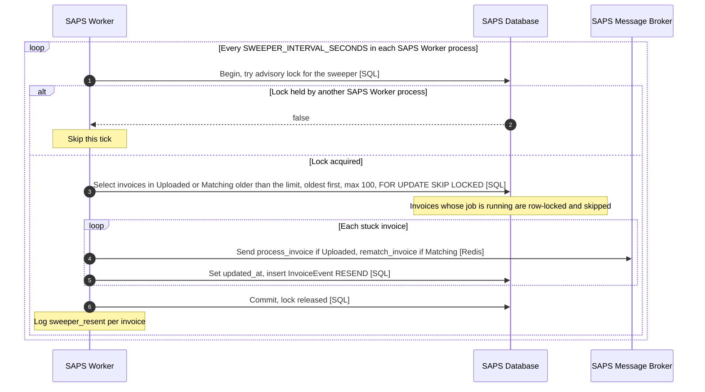

# SAPS-37 — Stuck-invoice sweeper

## 1. Summary
> **Note ([SAPS-52](SAPS-52-processing-calendar.md), 2027-03-01):** an invoice On hold waits on purpose. It is not a stuck
> status: the sweeper still looks only at Uploaded and Matching.

The SAPS API commits an invoice and only then sends a message to the SAPS Message Broker. When sending fails, Redis loses the
message, or a SAPS Worker dies in the middle of a job, the invoice stays in Uploaded or Matching and nobody notices. A timer in the
SAPS Worker finds such invoices and sends the missing message again. This is the recovery path chosen in
[ADR-0004](../02-architecture/adr/0004-process-invoices-in-background-worker.md) S1, verified in spike
[SAPS-34](https://linear.app/jiringuyen/issue/SAPS-34), and the safety net that [SAPS-17](SAPS-17-invoice-upload.md) EC-06 and
[SAPS-20](SAPS-20-exception-handling.md) EC-05 rely on. Users do not see a new screen; the invoice history shows a `RESEND` event.

| Item | Value |
|---|---|
| Linear | [SAPS-37](https://linear.app/jiringuyen/issue/SAPS-37) |
| Use cases | none (platform reliability; no actor) |
| Scope items | none; supports [SCP-IN-01](../01-requirements/scope.md#31-functional-capabilities) (upload) and [SCP-IN-04](../01-requirements/scope.md#31-functional-capabilities) (re-matching after a correction) |
| Target release | PoC demo 2027-02-22 (Linear milestone "PoC demo") |

## 2. Requirements

### 2.1 Business Rules
| ID | Rule | Source |
|---|---|---|
| BR-01 | An invoice is stuck when its status is Uploaded or Matching and its `updated_at` is older than `SWEEPER_STUCK_AFTER_SECONDS` (default 60 s). The age is measured with the SAPS Database clock. | [ADR-0004](../02-architecture/adr/0004-process-invoices-in-background-worker.md) S1 |
| BR-02 | A stuck invoice in Uploaded gets `process_invoice`; one in Matching gets `rematch_invoice`. Invoices in any other status are never touched. | [arc42 §6.3](../02-architecture/arc42/06-runtime-view.md#63-recovery-of-stuck-invoices-sweeper), [SAPS-17](SAPS-17-invoice-upload.md) EC-06, [SAPS-20](SAPS-20-exception-handling.md) EC-05 |
| BR-03 | The sweeper runs every `SWEEPER_INTERVAL_SECONDS` (default 10 s) in every SAPS Worker process, but only one sweep runs per tick across all processes (PostgreSQL advisory lock). An invoice whose job is running is skipped (its row is locked). | [ADR-0004](../02-architecture/adr/0004-process-invoices-in-background-worker.md) S1 |
| BR-04 | Each re-send sets `updated_at` to now, so the invoice waits another stuck period before the next re-send, and records an InvoiceEvent `RESEND` (actor `system`, status unchanged, `details` names the message). | design, §6 |
| BR-05 | The sweeper works across all tenants (a system job); the actors stay idempotent, so a message that arrives twice changes nothing. | [ADR-0004](../02-architecture/adr/0004-process-invoices-in-background-worker.md) S2, [ADR-0007](../02-architecture/adr/0007-prepare-data-model-for-tenants.md) |
| BR-06 | A tick re-sends at most 100 invoices, oldest `updated_at` first; the rest wait for the next tick. | design, Q1 (answered 2026-12-15) |

### 2.2 Affected NFRs
None. [nfr.md §4.3](../01-requirements/nfr.md#43-availability--disaster-recovery-avail) has no availability requirement for the PoC; the sweeper only keeps a lost message from leaving an invoice stuck for good.

### 2.3 Out of Scope
- Setting an invoice to Exception (EX1) after the last retry of `process_invoice`, and a limit on re-sends per invoice: done in [SAPS-38](SAPS-38-ex1-after-last-retry.md) (resolves [TD-04](../02-architecture/arc42/11-risks-and-technical-debt.md#td-04)); an Uploaded invoice is re-sent at most `SWEEPER_MAX_RESENDS` times, then the event `RESEND_LIMIT` is recorded.
- A transactional outbox (a later option in ADR-0004 S1).
- A screen or alert for resent invoices (the invoice history and the log are enough in the PoC).

## 3. Design

### 3.1 Affected Building Blocks
| Container | Change | Description |
|---|---|---|
| SAPS Worker | modified | A Dramatiq middleware starts an APScheduler timer when the worker boots and stops it on shutdown; each tick runs the sweep |
| SAPS Database | none | Reads and updates `invoice`, inserts `invoice_event`; no schema change |
| SAPS Message Broker | none | Receives the re-sent `process_invoice` and `rematch_invoice` messages |
| SAPS API, SAPS Web App | none | — |

Code outline (ports and adapters, [ADR-0001](../02-architecture/adr/0001-isolate-extraction-and-erp-behind-ports.md)): application `SweeperService`;
port `StuckInvoiceRepository` (advisory lock, select and lock stuck invoices, mark re-sent); the existing Job Queue Port sends the
messages; SQL adapter on the worker's session; `saps.worker.sweeper` holds the middleware and the scheduler.

Implementation notes:
- The middleware is added to the broker in `saps.worker.actors`; it starts a daemon thread with its own event loop and an `AsyncIOScheduler` at worker boot and stops it at worker shutdown. The tick never raises: any error is logged as `sweeper_failed`.
- The SQL adapter takes the lock with `pg_try_advisory_xact_lock` (one fixed key) and selects with `FOR UPDATE SKIP LOCKED`; the lock and the row locks end with the transaction.
- The log field for the message name is `message_name` (`message` is the log text).

### 3.2 Main Flow

### 3.3 Edge Cases & Error Handling
| ID | Case | Expected behavior | Response / signal |
|---|---|---|---|
| EC-01 | Another SAPS Worker process sweeps at the same time | The tick is skipped (BR-03) | no log |
| EC-02 | The job of the invoice is still running | Its row is locked; the invoice is skipped and checked again at a later tick | no log |
| EC-03 | Sending a message fails (Redis down) | The tick's transaction rolls back: no event, `updated_at` unchanged; the next tick tries again. Messages already sent in this tick may arrive although the transaction rolled back: they are duplicates (EC-04) | Log `sweeper_failed` |
| EC-04 | The message was not lost, only delayed (backlog, Dramatiq retry back-off) | A second message arrives; the actor locks the row and finds the invoice in another status, or runs the same step again, and changes nothing more ([ADR-0004](../02-architecture/adr/0004-process-invoices-in-background-worker.md) S2) | Log `processing_skipped` / `matching_skipped` |
| EC-05 | The SAPS Database is down during a tick | The tick fails and is logged; the scheduler keeps running and the next tick tries again | Log `sweeper_failed` |
| EC-06 | The SAPS Worker stops | The timer stops with it; in-flight tick finishes or rolls back | — |
| EC-07 | More than 100 invoices are stuck | The oldest 100 are re-sent; the rest at the next ticks (BR-06) | Log `sweeper_resent` per invoice |
| EC-08 | An invoice never leaves Uploaded or Matching (for example a failing actor) | It is re-sent every stuck period and gets a `RESEND` event each time; the cap (`RESEND_LIMIT`) and EX1 after the last retry are [SAPS-38](SAPS-38-ex1-after-last-retry.md) | Log `sweeper_resent` |

### 3.4 API Changes
None. The SAPS API already answers `202` when sending fails after the commit ([SAPS-17](SAPS-17-invoice-upload.md) EC-06, [SAPS-20](SAPS-20-exception-handling.md) EC-05).

### 3.6 Data Model Changes
| Entity | Change | Migration | Backward compatible |
|---|---|---|---|
| [InvoiceEvent](../02-architecture/data-model.md#invoiceevent) | New value of `action`: `RESEND` (a free-text column; the example list in the data model gets the new value) | none | Yes |

### 3.7 Security & Permissions
- Roles: no user operation; the sweeper is a system job of the SAPS Worker.
- Authorization check: none (no API). The job reads and updates invoices of all tenants ([BR-05](#21-business-rules)); it never returns data to a user.
- Sensitive data: only invoice IDs are sent in messages and written to logs; no vendor or invoice numbers are logged.
- Audit: InvoiceEvent `RESEND` with actor `system`.

### 3.8 Configuration & Feature Flags
| Key | Purpose | Default | Per environment |
|---|---|---|---|
| `SWEEPER_INTERVAL_SECONDS` | Time between two ticks | 10 | CI-only `.env`: 5 (Q2) |
| `SWEEPER_STUCK_AFTER_SECONDS` | Age after which an invoice counts as stuck | 60 | CI-only `.env`: 15 (Q2) |

Both settings already exist in `.env.example` and `saps.config`; there is no new setting.

### 3.9 Observability
- Logs: `sweeper_resent` (invoice_id, tenant_id, message name), `sweeper_failed` (error). A tick that finds nothing logs nothing.
- Alerts: none in the PoC (no monitoring stack, [DEC-026](../01-requirements/decision-log.md#dec-026)).

## 4. Rollout & Rollback
1. Deploy with `docker compose up -d --build`; the SAPS Worker starts the timer. No migration.

**Rollback:** revert the pull request. Invoices that are stuck stay stuck again; `RESEND` events already written stay in the history and are harmless.

## 5. Test Scenarios
| ID | Scenario | Level | Covers |
|---|---|---|---|
| TS-01 | Service with fakes: Uploaded gets `process_invoice`, Matching gets `rematch_invoice`; lock not acquired sends nothing; a failing send raises | Unit | BR-02, EC-01, EC-03 |
| TS-02 | Stuck and fresh invoices in every status: only stuck Uploaded and Matching are re-sent; `updated_at` is set, an event `RESEND` is written, the next tick sends nothing; a re-sent Uploaded invoice that the worker processes ends in Pending review | Integration | BR-01, BR-02, BR-04, [SAPS-17](SAPS-17-invoice-upload.md) TS-05 |
| TS-03 | An invoice row locked by another transaction (job running) is skipped, and re-sent after the lock ends and the age has passed | Integration | BR-03, EC-02 |
| TS-04 | The advisory lock is held by another session: the tick sends nothing; after it ends the tick works | Integration | BR-03, EC-01 |
| TS-05 | A failing send rolls the tick back: no event, `updated_at` unchanged, next tick sends again | Integration | EC-03, EC-05 |
| TS-06 | More than the limit stuck: the oldest are re-sent first, the rest at the next tick | Integration | BR-06, EC-07 |
| TS-07 | The middleware starts the timer on worker boot and stops it on shutdown; a failing tick is logged and the timer keeps running | Unit | EC-05, EC-06 |
| TS-08 | Lost message: stop the worker, upload DS-17, flush the broker queue, start the worker → Pending review and a `RESEND` event in the history | E2E (compose smoke) | BR-02, [SAPS-17](SAPS-17-invoice-upload.md) EC-06 |
| TS-09 | A re-matching after a correction whose message is lost ends in Pending review after the sweep | Integration | [SAPS-20](SAPS-20-exception-handling.md) TS-10, EC-05 |

## 6. Decisions
| Decision | Rationale | ADR |
|---|---|---|
| The timer runs inside each SAPS Worker process (a Dramatiq middleware starts and stops it), not as a new container | No new compose service to run and document; the advisory lock lets only one process sweep per tick (checked in spike SAPS-34, check 2) | [ADR-0004](../02-architecture/adr/0004-process-invoices-in-background-worker.md) S1, S6 |
| The age and the new `updated_at` use the database clock | One clock for the worker containers and the database; no skew | — |
| Send first, then write the event, in one transaction | When sending fails nothing is marked and the next tick retries; a duplicate message is harmless (S2) | — |
| A re-send sets `updated_at`, not a new column | The next re-send waits another stuck period without a schema change | — |
| Event action `RESEND`, actor `system` | The history shows why the invoice moved again | — |

## 7. Open Questions
| # | Question | Asked to | Due | Status |
|---|---|---|---|---|
| Q1 | How many invoices may one tick re-send? | Solution Architect / Tech Lead | before implementation | answered: 100, oldest first (2026-12-15) |
| Q2 | May the CI smoke test use a shorter stuck age and interval so the lost-message check stays short? | Solution Architect / Tech Lead | before implementation | answered: yes; `SWEEPER_STUCK_AFTER_SECONDS=15` and `SWEEPER_INTERVAL_SECONDS=5` in the CI-only `.env`, defaults stay 60 and 10 (2026-12-15) |

## 8. Documentation Checklist
- [x] API spec: no change
- [x] Data model updated (`RESEND` in the action examples of InvoiceEvent)
- [x] arc42 §6.3 updated with the implementation details (batch limit, event, failure handling)
- [x] Developer Guide §2.4 and troubleshooting (stuck invoice) updated
- [ ] Release notes entry prepared
