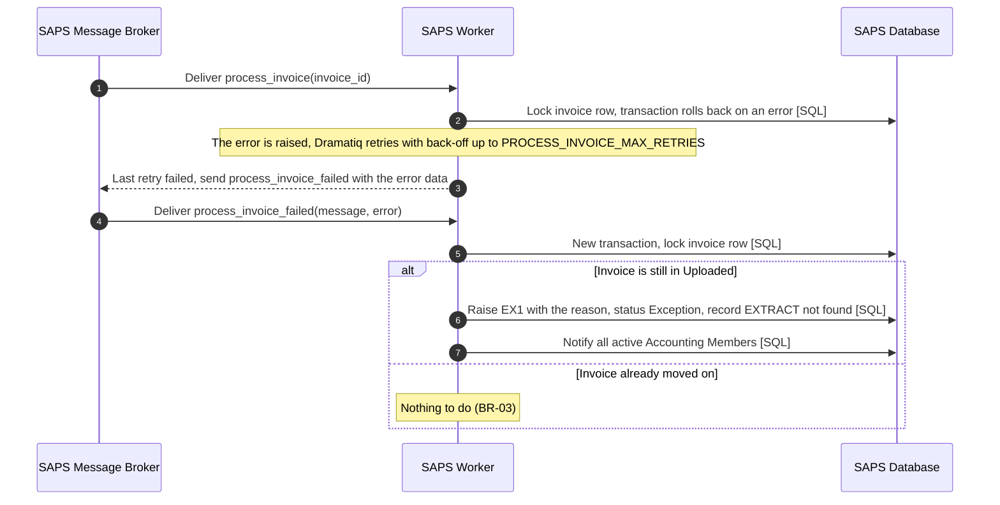
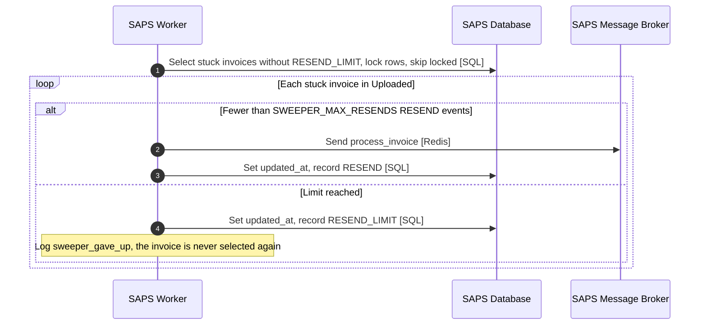

# SAPS-38 — EX1 after the last retry of process_invoice

## 1. Summary
When `process_invoice` fails on every retry (an infrastructure error, an error of the extraction service, a time limit),
the invoice stays in Uploaded and never reaches an Accounting Member. [ADR-0004](../02-architecture/adr/0004-process-invoices-in-background-worker.md)
S4 says it must become an Exception (EX1) after the last retry. Today the sweeper ([SAPS-37](SAPS-37-stuck-invoice-sweeper.md))
even sends a new message every stuck period, with a fresh retry counter, so a file that can never be read loops forever.
This feature raises EX1 after the last retry, makes the retry limits settings, and stops the sweeper after a number of re-sends.
It closes technical debt [TD-04](../02-architecture/arc42/11-risks-and-technical-debt.md#td-04). The Dummy Extraction Adapter cannot
fail, so the change matters before a real extraction service is connected; it is tested with a failing extraction port.

| Item | Value |
|---|---|
| Linear | [SAPS-38](https://linear.app/jiringuyen/issue/SAPS-38) |
| Use cases | [UC-02 Upload invoice](../02-architecture/arc42/01-introduction-and-goals.md#use-cases) |
| Scope items | [SCP-IN-02](../01-requirements/scope.md#31-functional-capabilities) |
| Target release | PoC demo 2027-02-22 (Linear milestone "PoC demo") |

## 2. Requirements

### 2.1 Business Rules
| ID | Rule | Source |
|---|---|---|
| BR-01 | After the last retry of `process_invoice` has failed (any error, also the time limit), an invoice still in Uploaded becomes Exception with EX1 "Invoice unreadable: {reason}", an InvoiceEvent `EXTRACT` (found false, the reason) and a notification to all active Accounting Members, exactly as an unreadable file ([SAPS-18](SAPS-18-dummy-invoice-extraction.md) BR-03). | [ADR-0004](../02-architecture/adr/0004-process-invoices-in-background-worker.md) S4, [DEC-033](../01-requirements/decision-log.md#dec-033) |
| BR-02 | The reason names the kind of error and a shortened message: "Processing failed after the last retry: {ErrorClass}: {message, max 200 characters}". It never contains a stack trace or the content of the file. | design, Q3 (answered 2026-12-15) |
| BR-03 | The failure step runs in a new transaction, locks the invoice row and does nothing when the invoice is no longer in Uploaded (for example the sweeper or a late retry finished it). | [ADR-0004](../02-architecture/adr/0004-process-invoices-in-background-worker.md) S2 |
| BR-04 | The number of retries and the back-off of `process_invoice` are settings: `PROCESS_INVOICE_MAX_RETRIES` (proposal 5, that is 6 attempts), `PROCESS_INVOICE_MIN_BACKOFF_MS` (15 000) and `PROCESS_INVOICE_MAX_BACKOFF_MS` (300 000), so the last retry comes within minutes (today: Dramatiq defaults, 20 retries and back-off up to 7 days). | [ADR-0004](../02-architecture/adr/0004-process-invoices-in-background-worker.md) S4, Q1 (answered 2026-12-15) |
| BR-05 | The sweeper sends `process_invoice` for an invoice in Uploaded at most `SWEEPER_MAX_RESENDS` times (proposal 3). When the limit is reached and the invoice is stuck again, the sweeper records an InvoiceEvent `RESEND_LIMIT` (actor `system`), logs `sweeper_gave_up` once and never selects the invoice again; the invoice stays in Uploaded. No EX1 is raised by the sweeper. Invoices in Matching are not limited. | [SAPS-37](SAPS-37-stuck-invoice-sweeper.md), Q2 (answered 2026-12-15) |

### 2.2 Affected NFRs
None. [nfr.md §4.3](../01-requirements/nfr.md#43-availability--disaster-recovery-avail) has no availability requirement for the PoC.

### 2.3 Out of Scope
- Failures of `rematch_invoice` after the last retry (the invoice stays in Matching and is re-sent by the sweeper, [SAPS-37](SAPS-37-stuck-invoice-sweeper.md)).
- EX1 raised by the sweeper, an alert or a screen for invoices that stay in Uploaded after `RESEND_LIMIT` (the history and the log are enough in the PoC).
- Retrying only some kinds of errors, a dead-letter queue, a transactional outbox.

## 3. Design

### 3.1 Affected Building Blocks
| Container | Change | Description |
|---|---|---|
| SAPS Worker | modified | `process_invoice` gets the retry settings and an `on_failure` callback actor `process_invoice_failed`; the sweeper skips invoices over the re-send limit |
| SAPS Database | none | Updates `invoice`, inserts `invoice_exception`, `invoice_event`, `notification`; no schema change |
| SAPS Message Broker | none | Carries the callback message |
| SAPS API, SAPS Web App | none | The invoice appears in the exception queue like any EX1 |

Code outline: Dramatiq calls the `on_failure` callback with the message and the error data after the last retry. The callback calls
`ProcessInvoiceService.fail(invoice_id, reason)` (new), which reuses `ProcessingRepository.raise_unreadable` and `notify_status`
([SAPS-18](SAPS-18-dummy-invoice-extraction.md)). The sweeper repository counts `RESEND` events and excludes invoices that have a `RESEND_LIMIT` event.

### 3.2 Main Flow

Sweeper (BR-05):

### 3.3 Edge Cases & Error Handling
| ID | Case | Expected behavior | Response / signal |
|---|---|---|---|
| EC-01 | A retry succeeds | No callback; the invoice continues as today | — |
| EC-02 | Last retry fails by the time limit | Same as any error (BR-01); the reason names `TimeLimitExceeded` | Invoice in Exception, EX1 |
| EC-03 | The invoice is no longer in Uploaded when the callback runs | Nothing changes (BR-03) | Log `process_failure_skipped` |
| EC-04 | The callback itself fails (database down) | Not retried; the invoice stays in Uploaded and the sweeper re-sends it until the limit (BR-05) | Log `process_failure_not_recorded` |
| EC-05 | The SAPS Worker is killed in the middle of a job | No error is raised: redelivery and the sweeper work as today | — |
| EC-06 | An invoice stays in Uploaded after `RESEND_LIMIT` | It is visible in the history and the log; an operator decides (out of scope) | Log `sweeper_gave_up` once |
| EC-07 | EX1 raised after the last retry, the user later corrects the invoice | Handled like any EX1 ([SAPS-20](SAPS-20-exception-handling.md)) | — |

### 3.4 API Changes
None.

### 3.6 Data Model Changes
| Entity | Change | Migration | Backward compatible |
|---|---|---|---|
| [InvoiceEvent](../02-architecture/data-model.md#invoiceevent) | New value of `action`: `RESEND_LIMIT` (free-text column; the example list in the data model gets the new value) | none | Yes |

### 3.7 Security & Permissions
- Roles: no user operation; system job of the SAPS Worker.
- Sensitive data: the reason in EX1 and in logs holds only the error class and a shortened message (BR-02); no invoice numbers or file content.
- Audit: InvoiceEvent `EXTRACT` (actor `system`) and `RESEND_LIMIT`.

### 3.8 Configuration & Feature Flags
| Key | Purpose | Default | Per environment |
|---|---|---|---|
| `PROCESS_INVOICE_MAX_RETRIES` | Retries of `process_invoice` after the first attempt | 5 | — |
| `PROCESS_INVOICE_MIN_BACKOFF_MS` | First back-off (doubles up to the maximum) | 15 000 | — |
| `PROCESS_INVOICE_MAX_BACKOFF_MS` | Longest back-off | 300 000 | — |
| `SWEEPER_MAX_RESENDS` | Re-sends of `process_invoice` per invoice | 3 | — |

All four are new in `saps.config` and `.env.example`.

### 3.9 Observability
- Logs: `process_failure_recorded` (invoice_id, error class), `process_failure_skipped`, `process_failure_not_recorded`, `sweeper_gave_up` (invoice_id, resends).
- Alerts: none in the PoC ([DEC-026](../01-requirements/decision-log.md#dec-026)).

## 4. Rollout & Rollback
1. Deploy with `docker compose up -d --build`; no migration. Messages already queued keep their old options (20 retries) until they finish.

**Rollback:** revert the pull request. Invoices that already got EX1 stay in the exception queue; `RESEND_LIMIT` events stay in the history and are harmless.

## 5. Test Scenarios
| ID | Scenario | Level | Covers |
|---|---|---|---|
| TS-01 | Service `fail`: invoice in Uploaded → EX1 with the reason, status Exception, event `EXTRACT`, members notified; another status → nothing | Unit | BR-01, BR-03, EC-03 |
| TS-02 | Reason: error class and message shortened to 200 characters, no stack trace | Unit | BR-02 |
| TS-03 | With a Dramatiq stub broker and a failing extraction port: the actor retries up to the setting, then the callback runs once; a success on a retry never calls it; the time limit counts as a failure | Unit | BR-01, BR-04, EC-01, EC-02 |
| TS-04 | On PostgreSQL: a failing extraction port, the job rolls back, the callback raises EX1 and notifies every active member; running the callback twice changes nothing more | Integration | BR-01, BR-03 |
| TS-05 | On PostgreSQL: the sweeper re-sends an Uploaded invoice three times, then records `RESEND_LIMIT` once and never selects it again; a Matching invoice is not limited | Integration | BR-05, EC-06 |
| TS-06 | A failing callback is logged and the invoice stays in Uploaded | Unit | EC-04 |
| TS-07 | Settings: defaults, and values below 1 are refused | Unit | BR-04 |

The compose smoke test is not extended: the Dummy Extraction Adapter cannot fail.

## 6. Decisions
| Decision | Rationale | ADR |
|---|---|---|
| Use the Dramatiq `on_failure` callback, not a custom middleware | It runs once after the last retry and receives the error; less code than a middleware | [ADR-0004](../02-architecture/adr/0004-process-invoices-in-background-worker.md) S4 |
| The sweeper gives up with a `RESEND_LIMIT` event and no EX1 | Agreed with the Solution Architect (2026-12-15); a failing job already gets EX1 from the callback, the sweeper only recovers lost messages | [SAPS-37](SAPS-37-stuck-invoice-sweeper.md) |
| The limit is counted from `RESEND` events | No new column; the history shows every re-send | — |
| EX1 for every kind of error after the last retry | Matches ADR-0004 S4 and TD-04; the reason tells the Accounting Member what happened | — |

## 7. Open Questions
| # | Question | Asked to | Due | Status |
|---|---|---|---|---|
| Q1 | Retry values: 5 retries, back-off from 15 s to 5 min (BR-04)? | Solution Architect / Tech Lead | before implementation | answered: yes, as proposed (2026-12-15) |
| Q2 | `SWEEPER_MAX_RESENDS` 3, then `RESEND_LIMIT` event and a log line (BR-05)? | Solution Architect / Tech Lead | before implementation | answered: yes, as proposed (2026-12-15) |
| Q3 | Wording of the reason: "Processing failed after the last retry: {ErrorClass}: {message}" (BR-02)? | Solution Architect / Tech Lead | before implementation | answered: yes, as proposed (2026-12-15) |

## 8. Documentation Checklist
- [x] API spec: no change
- [x] Data model updated (`RESEND_LIMIT` in the action examples of InvoiceEvent)
- [ ] TD-04 set to resolved with the Linear link (code PR)
- [ ] SAPS-18 known gaps, SAPS-37 out of scope, arc42 §6.3 updated (code PR)
- [ ] Developer Guide settings table and `.env.example` updated (code PR)
- [ ] Release notes entry prepared
