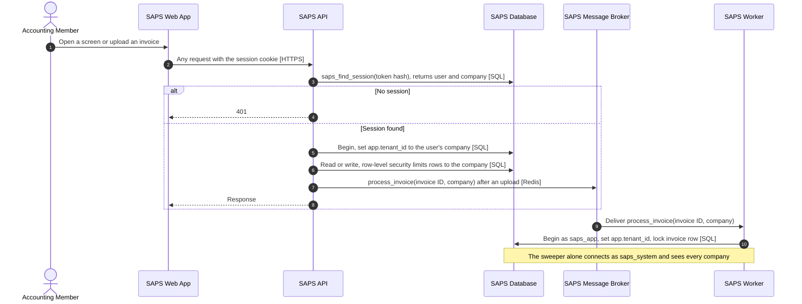

# SAPS-41 — Tenant isolation with row-level security

## 1. Summary
In Phase 2 the system serves several subsidiaries (tenants) from one database ([DEC-058](../01-requirements/decision-log.md#dec-058)).
Today the tenant is only a filter in the application code; one forgotten filter would show one company's invoices to another
([TD-02](../02-architecture/arc42/11-risks-and-technical-debt.md#td-02)). This feature adds the barrier chosen in
[ADR-0009](../02-architecture/adr/0009-isolate-tenant-data-in-a-shared-database.md): PostgreSQL row-level security (RLS) on
every tenant-owned table, separate database roles, the tenant set on every transaction, the tenant in worker messages and
in file keys. Users see no new screen; the behaviour stays the same for one company and becomes safe for several.

| Item | Value |
|---|---|
| Linear | [SAPS-41](https://linear.app/jiringuyen/issue/SAPS-41) |
| Use cases | all (cross-cutting) |
| Scope items | [SCP-IN-20](../01-requirements/scope.md#31-functional-capabilities) |
| Target release | Phase 2 demo 2027-08-30 |

## 2. Requirements

### 2.1 Business Rules
| ID | Rule | Source |
|---|---|---|
| BR-01 | A user, an API request and a worker job only read and write rows of one company; the database refuses rows of another company even if the code forgets the filter. | [DEC-056](../01-requirements/decision-log.md#dec-056), [ADR-0009](../02-architecture/adr/0009-isolate-tenant-data-in-a-shared-database.md) |
| BR-02 | Without a company set, a connection sees no tenant-owned rows and cannot write any (fail closed). | ADR-0009 |
| BR-03 | Tenant-owned tables: `user_account`, `user_session`, `matching_settings`, `invoice`, `invoice_line`, `invoice_exception`, `approval`, `invoice_event`, `notification`, and every later table with a `tenant_id`. `tenant` itself has no RLS. | [data model](../02-architecture/data-model.md), ADR-0007 |
| BR-04 | Only jobs that must see every company (the sweeper, [SAPS-37](SAPS-37-stuck-invoice-sweeper.md)) use a database role that bypasses RLS; the SAPS API never does. | ADR-0009 |
| BR-05 | Steps that happen before the company is known (finding a session from its cookie, finding a user at sign-in) use narrow database functions that return only the one matching row and its company. | design, §6 |
| BR-06 | Worker messages carry the company next to the invoice; files of new invoices are stored under a key that starts with the company. | ADR-0009 |

### 2.2 Affected NFRs
| NFR | How this feature is affected |
|---|---|
| [NFR-SEC-001](../01-requirements/nfr.md#nfr-sec-001) | Every function requires a user of exactly one company; the company now also limits the database rows. |
| [NFR-MAINT-001](../01-requirements/nfr.md#nfr-maint-001) | Works the same on Amazon RDS for PostgreSQL: roles and policies are created by migrations, connection URLs are configuration. |
| [NFR-SCAL-001](../01-requirements/nfr.md#nfr-scal-001) | One extra statement per transaction; policies use the existing `tenant_id` indexes. |

### 2.3 Out of Scope
- Companies and their demo data, mailbox addresses and Keycloak groups ([SAPS-42](https://linear.app/jiringuyen/issue/SAPS-42)).
- Sign-in through Keycloak ([SAPS-44](https://linear.app/jiringuyen/issue/SAPS-44)); this feature keeps the PoC sign-in working under RLS.
- Moving files that already exist to the new key layout (their key is stored per invoice and stays valid).
- Per-company backup, restore or deletion; data residency ([MTG-20270301-3](../01-requirements/meetings/2027-03-01-tenancy-and-identity.md) Q1).

## 3. Design

### 3.1 Affected Building Blocks
| Container | Change | Description |
|---|---|---|
| SAPS Database | modified | Roles `saps_app` and `saps_system`; RLS enabled and forced with one policy per tenant-owned table; two lookup functions for sign-in and sessions |
| SAPS API | modified | Connects as `saps_app`; sets the company at the start of every transaction that touches tenant data; session and sign-in lookups use the functions |
| SAPS Worker | modified | Connects as `saps_app` for jobs (company from the message); the sweeper connects as `saps_system` |
| SAPS File Storage | modified | New object keys `tenants/{tenant_id}/invoices/{invoice_id}/{sha256}` |
| SAPS Web App | none | — |

Design rules:
- **Roles** (created by an Alembic migration, idempotent, passwords from configuration):

  | Role | Used by | Rights |
  |---|---|---|
  | `saps` (owner, from `POSTGRES_USER`) | migrations, seed | owns the tables; not used by the running SAPS API or SAPS Worker |
  | `saps_app` | SAPS API, SAPS Worker jobs | `SELECT, INSERT, UPDATE, DELETE` on the tables; no `BYPASSRLS`; subject to every policy |
  | `saps_system` | sweeper only | like `saps_app` plus `BYPASSRLS` |

- **Policy** on each tenant-owned table: `ENABLE` and `FORCE ROW LEVEL SECURITY`; policy `tenant_isolation` for all
  commands with `USING` and `WITH CHECK` `tenant_id = NULLIF(current_setting('app.tenant_id', true), '')::uuid`. An
  unset value is `NULL`, and a connection that had the setting before reports `''` afterwards; both mean no row
  matches (BR-02).
- **Setting the company:** every unit of work that touches tenant data receives the company explicitly and starts with
  `SELECT set_config('app.tenant_id', :tenant, true)` (transaction-local, safe with connection pools). There is no
  implicit global; a unit of work without a company sees nothing.
- **Before the company is known** (BR-05): `SECURITY DEFINER` functions owned by `saps`, executable by `saps_app` only:
  `saps_find_session(token_hash)` and `saps_find_user_for_sign_in(username)`, each returning at most one row with its
  company. SAPS-44 replaces the second one with a lookup by issuer and subject.
- **Worker messages:** `process_invoice(invoice_id, tenant_id)` and `rematch_invoice(invoice_id, tenant_id)`; the job sets
  the company before reading the invoice. A message without `tenant_id` (sent before the upgrade) is accepted: the job reads
  the company of the invoice with `saps_system` once, then continues as `saps_app`.
- **Connection URLs:** `DATABASE_URL` (owner, migrations and seed), `APP_DATABASE_URL` (`saps_app`), `SYSTEM_DATABASE_URL`
  (`saps_system`); role passwords `APP_DB_PASSWORD`, `SYSTEM_DB_PASSWORD` in `.env`.
- **File keys:** `storage_key` gets the tenant: `tenants/{tenant_id}/invoices/{invoice_id}/{sha256}` for new invoices.

### 3.2 Main Flow

### 3.3 Edge Cases & Error Handling
| ID | Case | Expected behavior | Response / signal |
|---|---|---|---|
| EC-01 | Code forgets the `tenant_id` filter | RLS still limits the rows to the company | — |
| EC-02 | A unit of work runs without a company | Reads return nothing; writes fail | Error logged; `500` if it reaches the API |
| EC-03 | A write with another company's `tenant_id` | Refused by `WITH CHECK` | Error logged; `500` |
| EC-04 | Invoice ID of another company in the URL | Not visible | `404`, as today |
| EC-05 | Worker message without `tenant_id` (sent before the upgrade) | Company looked up once with `saps_system`, then normal | Log `message_without_tenant` |
| EC-06 | Worker message whose `tenant_id` does not match the invoice | The invoice is not visible; the job does nothing | Log `processing_skipped` / `matching_skipped` |
| EC-07 | New table with `tenant_id` but no policy | CI check fails | Test failure |
| EC-08 | Existing database of the PoC (one tenant) | Migration adds roles and policies; data unchanged; old file keys keep working | — |

### 3.4 API Changes
None. No operation, status code or schema changes ([saps-api.openapi.yaml](../02-architecture/api/saps-api.openapi.yaml)).

### 3.5 Event Changes
| Event | Channel | Change | Producer → Consumers | Spec |
|---|---|---|---|---|
| `process_invoice`, `rematch_invoice` | Dramatiq queue `default` | Second argument `tenant_id` (optional for messages sent before the upgrade) | SAPS API, sweeper → SAPS Worker | [ADR-0004](../02-architecture/adr/0004-process-invoices-in-background-worker.md) |

### 3.6 Data Model Changes
| Entity | Change | Migration | Backward compatible |
|---|---|---|---|
| All tenant-owned tables (BR-03) | RLS enabled and forced, policy `tenant_isolation` | `0006_tenant_row_level_security` | Yes (no column change) |
| — | Roles `saps_app`, `saps_system`; functions `saps_find_session`, `saps_find_user_for_sign_in` | same | Yes |

The [data model](../02-architecture/data-model.md) gets a section "Tenant isolation" with the roles, the policy and the functions.

### 3.7 Security & Permissions
- The SAPS API and the SAPS Worker jobs never connect as the table owner or a superuser.
- `saps_system` (`BYPASSRLS`) is configured only in the SAPS Worker and used only by the sweeper.
- The two `SECURITY DEFINER` functions set a fixed `search_path`, take one exact key and return one row; `EXECUTE` is
  granted to `saps_app` only.
- Role passwords are configuration (`.env`, later a secret store); nothing in the repository.

### 3.8 Configuration & Feature Flags
| Key | Purpose | Default | Per environment |
|---|---|---|---|
| `APP_DATABASE_URL` | Connection of the SAPS API and worker jobs (`saps_app`) | — (required) | per environment |
| `SYSTEM_DATABASE_URL` | Connection of the sweeper (`saps_system`) | — (required in the SAPS Worker) | per environment |
| `APP_DB_PASSWORD`, `SYSTEM_DB_PASSWORD` | Passwords set by the migration for the two roles | — (required for migrations) | per environment |

### 3.9 Observability
- Logs: `message_without_tenant` (invoice_id). Errors from refused writes are logged by the existing error handler.

## 4. Rollout & Rollback
1. Add the new variables to `.env` (`.env.example` shows them).
2. `docker compose up -d --build`: the SAPS API runs the migration (roles, functions, policies) and the seed, then connects as `saps_app`.
3. Messages already in the queue without a company are handled by EC-05.

**Rollback:** the migration's downgrade drops the policies, functions and roles; revert the pull request. Files stored under
the new keys keep working because the key is stored per invoice.

## 5. Test Scenarios
| ID | Scenario | Level | Covers |
|---|---|---|---|
| TS-01 | For every tenant-owned table: as `saps_app` with company A, rows of company B are invisible, and inserting or updating a row of company B is refused | Integration | BR-01, BR-03, EC-01, EC-03 |
| TS-02 | Without `app.tenant_id`: no rows, writes refused | Integration | BR-02, EC-02 |
| TS-03 | Catalog check: every table with a `tenant_id` column has RLS enabled and forced and the policy | Integration (CI) | BR-03, EC-07 |
| TS-04 | `saps_find_session` and `saps_find_user_for_sign_in` return one row with its company; sign-in and session tests of SAPS-27 pass under `saps_app` | Integration | BR-05 |
| TS-05 | Two companies end to end through the API: uploads, lists, exception queue, approvals, notifications and settings of A never show B's data; B's invoice ID gives `404` to A | Integration | BR-01, EC-04 |
| TS-06 | Worker: message with the company processes the invoice; message without company (old format) is processed after one lookup; wrong company does nothing | Integration | BR-06, EC-05, EC-06 |
| TS-07 | The sweeper sees stuck invoices of both companies and sends their company in the message | Integration | BR-04 |
| TS-08 | New invoices get keys `tenants/{tenant}/invoices/…`; old keys still download | Unit + Integration | BR-06, EC-08 |
| TS-09 | Upgrade of a PoC database: migration on existing data, then the PoC demo flow still passes (compose smoke) | E2E | EC-08 |

## 6. Decisions
| Decision | Rationale | ADR |
|---|---|---|
| Company passed explicitly to every unit of work, set with a transaction-local setting | No hidden global state; safe with pooled connections; easy to test | [ADR-0009](../02-architecture/adr/0009-isolate-tenant-data-in-a-shared-database.md) |
| `SECURITY DEFINER` lookup functions for steps before the company is known | Keeps RLS on `user_account` and `user_session` without giving the SAPS API a bypass role | — |
| Roles created by an Alembic migration with passwords from configuration | Works on a fresh and on an existing database, locally and on Amazon RDS | — |
| Old messages without company accepted for one release | No lost invoice during the upgrade | — |
| Old file keys not moved | Keys are stored per invoice; moving files gives no benefit | — |

## 7. Open Questions
| # | Question | Asked to | Due | Status |
|---|---|---|---|---|
| Q1 | Three connection URLs and two role passwords in `.env` (§3.8): acceptable for the local demo, with a secret store on AWS later? | Solution Architect / Tech Lead | before implementation | answered: yes; a secret store on AWS later (2027-03-01) |
| Q2 | Accept old worker messages without company for one release only (EC-05), then remove the fallback? | Solution Architect / Tech Lead | before implementation | answered: yes; accepted for one release, then the fallback is removed (2027-03-01) |

## 8. Documentation Checklist
- [x] API spec: no change
- [x] Data model: section "Tenant isolation" (roles, policy, functions)
- [x] Developer Guide: new variables, roles, how to run a query as a company
- [x] TD-02 resolved
- [ ] Release notes entry prepared
