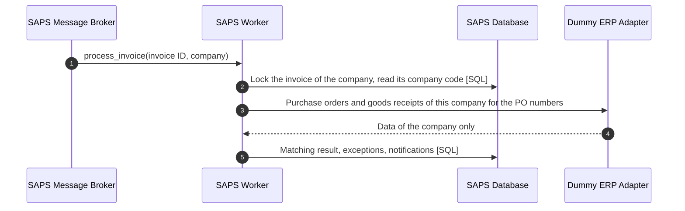

# SAPS-42 — Companies and per-company demo data

## 1. Summary
Row-level security keeps the companies' rows apart ([SAPS-41](SAPS-41-tenant-isolation.md)), but the system still has only
one company ("PoC Customer") and one set of dummy ERP data shared by everybody. This feature gives a company (tenant) the
facts the next features need — its short code, e-mail domain, Keycloak group, mailbox and time zone — seeds the
**3 demo companies** of the Phase 2 demo with their users and matching settings, and makes the dummy ERP data **per
company** ([DEC-056](../01-requirements/decision-log.md#dec-056)). Users see the same screens; each demo company works on
its own data.

| Item | Value |
|---|---|
| Linear | [SAPS-42](https://linear.app/jiringuyen/issue/SAPS-42) |
| Use cases | all (cross-cutting) |
| Scope items | [SCP-IN-20](../01-requirements/scope.md#31-functional-capabilities), [SCP-IN-09](../01-requirements/scope.md#32-integrations) |
| Target release | Phase 2 demo 2027-08-30 |

## 2. Requirements

### 2.1 Business Rules
| ID | Rule | Source |
|---|---|---|
| BR-01 | A company has a unique short code (lower case, e.g. `vn`), a name, one e-mail domain, a Keycloak group path, a mailbox address and an IANA time zone. | [DEC-059](../01-requirements/decision-log.md#dec-059), [DEC-061](../01-requirements/decision-log.md#dec-061), [DEC-055](../01-requirements/decision-log.md#dec-055), [DEC-062](../01-requirements/decision-log.md#dec-062) |
| BR-02 | The seed creates the 3 demo companies — Demo Vietnam (`vn`, `vn.example.com`, `Asia/Ho_Chi_Minh`), Demo Singapore (`sg`, `sg.example.com`, `Asia/Singapore`), Demo Malaysia (`my`, `my.example.com`, `Asia/Kuala_Lumpur`); mailbox `ap@<domain>`; Keycloak group `/companies/<code>` — with their matching settings (defaults 0.5 USD and 300 USD) and 2 Accounting Members and 1 Accounting Manager each, usernames in e-mail style (`member1@vn.example.com`); running it again changes nothing. | [DEC-015](../01-requirements/decision-log.md#dec-015), SAPS-27 BR-09 |
| BR-03 | Each company has its own dummy ERP data (purchase orders, goods receipts and the vendors on them). Matching reads only the data of the invoice's company. | [DEC-056](../01-requirements/decision-log.md#dec-056) |
| BR-04 | The dummy sample set (extraction results by file hash) stays shared: any company may upload any sample file; what happens next depends on that company's ERP data. | [DEC-012](../01-requirements/decision-log.md#dec-012), SAPS-18 |
| BR-05 | The existing company of a PoC database keeps its data; it becomes Demo Vietnam, and its users `member1`, `member2`, `manager1` are renamed to the e-mail style of `vn.example.com` (`manager2` is kept as an extra manager). | design, Q3 |

### 2.2 Affected NFRs
| NFR | How this feature is affected |
|---|---|
| [NFR-MAINT-001](../01-requirements/nfr.md#nfr-maint-001) | The ERP Data Port gets the company; the real ERP integration (SAPS-48) can choose the SAP system or company code per company without changing matching. |
| [NFR-SCAL-001](../01-requirements/nfr.md#nfr-scal-001) | Adding a company is configuration and data, no code change. |

### 2.3 Out of Scope
- Sign-in through Keycloak and the realm export (SAPS-43, SAPS-44); the Keycloak group path is only stored here.
- Reading the mailbox (SAPS-45); the mailbox address is only stored here.
- The processing calendar (SAPS-52); the time zone is only stored here.
- Screens to manage companies (administration is by the team, [DEC-054](../01-requirements/decision-log.md#dec-054)).

## 3. Design

### 3.1 Affected Building Blocks
| Container | Change | Description |
|---|---|---|
| SAPS Database | modified | New columns on `tenant` (migration `0007`) |
| SAPS API | modified | Seed of the demo companies; the signed-in user's company code is known |
| SAPS Worker | modified | Matching passes the company to the ERP Data Port; the Dummy ERP Adapter serves data per company |
| SAPS Web App | modified | The header shows the company name of the signed-in user (Q5) |

Design rules:
- **Tenant columns:** `code` (string(20), unique, `^[a-z][a-z0-9-]{1,19}$`), `email_domain` (string(255), unique),
  `keycloak_group` (string(255), unique), `mailbox_address` (string(320), unique, nullable), `time_zone` (string(64),
  IANA name, default `UTC`). `tenant` has no `tenant_id` and no row-level security; `saps_app` may read it.
- **ERP Data Port:** `get_purchase_orders(company_code, po_numbers)` and `get_goods_receipt_lines(company_code, po_numbers)`.
  Matching reads the code with the invoice (`InvoiceForMatching.company_code`).
- **Dummy ERP data per company** (Q4): `fixtures/companies.json` lists the demo companies and, for each, the ERP fixture
  folders it uses. Proposal: every demo company uses all scenario folders `ds-*/erp/` (the same demo catalogue in each
  company, kept apart per company in the adapter), plus optional company-only folders `fixtures/companies/<code>/erp/*.json`.
  PO numbers must be unique within a company, not across companies.
- **Seed:** reads the demo companies from `fixtures/companies.json` (code, name, domain, group, mailbox, time zone, users)
  and creates or updates them; users get the shared `SEED_USER_PASSWORD` as today.

### 3.2 Main Flow

### 3.3 Edge Cases & Error Handling
| ID | Case | Expected behavior | Response / signal |
|---|---|---|---|
| EC-01 | A PO number exists in company A's data but not in company B's | An invoice of B with that PO gets EX4 | EX4 |
| EC-02 | `companies.json` names a folder that does not exist, or a PO number twice within one company | The SAPS Worker does not start (as for broken fixtures today, SAPS-18 EC-04) | Start-up error |
| EC-03 | A tenant in the database has no entry in `companies.json` | Matching finds no ERP data for it: every PO is unknown (EX4); logged once | Log `erp_company_unknown` |
| EC-04 | Seed run twice, or on a PoC database | Nothing duplicated; the PoC company gets its code and domain (BR-05) | Log `seed_completed` |
| EC-05 | Two companies with the same e-mail domain, group or mailbox | Refused by unique constraints at seed time | Seed error |

### 3.4 API Changes
`getSession` and `createSession` return the company name for the header: additive field `companyName` on `UserAccount` (contract 0.4.5, not breaking).

### 3.6 Data Model Changes
| Entity | Change | Migration | Backward compatible |
|---|---|---|---|
| [Tenant](../02-architecture/data-model.md#tenant) | New columns `code`, `email_domain`, `keycloak_group`, `mailbox_address`, `time_zone`; existing row gets values from the seed (Q3) | `0007_tenant_company_details` | Yes (nullable until the seed fills them; `code` filled by the migration for existing rows) |

### 3.7 Security & Permissions
- Demo data only: domains under `example.com` (RFC 2606), no real company names, no real addresses (public repository, DEC-028).
- `tenant` is readable by `saps_app` (needed for sign-in and the header); it holds no confidential data.

### 3.8 Configuration & Feature Flags
| Key | Purpose | Default | Per environment |
|---|---|---|---|
| `fixtures/companies.json` | Demo companies, their users and ERP fixture folders | in the repository | demo and tests only |

### 3.9 Observability
- Logs: `seed_completed` (companies, users), `erp_company_unknown` (company code).

## 4. Rollout & Rollback
1. `docker compose up -d --build`: migration `0007`, then the seed creates the demo companies; the PoC company becomes one of them.

**Rollback:** downgrade `0007` drops the new columns; extra demo companies stay as rows (harmless) or the stack is recreated.

## 5. Test Scenarios
| ID | Scenario | Level | Covers |
|---|---|---|---|
| TS-01 | Seed creates the demo companies with codes, domains, groups, mailboxes, time zones, settings and users; second run changes nothing; a PoC database keeps its invoices | Integration | BR-01, BR-02, BR-05, EC-04 |
| TS-02 | Dummy ERP Adapter: company A and company B get their own data; unknown company gets nothing; a duplicate PO within one company or a missing folder fails at load | Unit | BR-03, EC-02, EC-03 |
| TS-03 | The same sample file uploaded in two companies is matched against each company's ERP data; quantities invoiced in A do not reduce what B may invoice | Integration | BR-03, BR-04, EC-01 |
| TS-04 | Unique constraints on code, domain, group and mailbox | Integration | EC-05 |
| TS-05 | Compose smoke: members of two demo companies run DS-01 each and both reach Completed | E2E | BR-03 |
| TS-06 | The header shows the company name of the signed-in user | Unit (Web App) | Q5 |

## 6. Decisions
| Decision | Rationale | ADR |
|---|---|---|
| The company code, not the UUID, selects the ERP data | Codes are stable across databases; UUIDs are generated per database | — |
| Demo companies and their ERP folders in one fixture file | One place to read; validated at start-up like the other fixtures | [ADR-0001](../02-architecture/adr/0001-isolate-extraction-and-erp-behind-ports.md) |
| Sample set stays shared (BR-04) | Extraction is not company data; one set of sample files is enough for every company | — |

## 7. Open Questions
| # | Question | Asked to | Due | Status |
|---|---|---|---|---|
| Q1 | Which 3 demo companies? Proposal: "Demo Vietnam" (`vn`, `vn.example.com`, `Asia/Ho_Chi_Minh`), "Demo Singapore" (`sg`, `sg.example.com`, `Asia/Singapore`), and a third — which country? Mailboxes `ap@<domain>`. | Product Owner (Customer) | before implementation | answered: Vietnam, Singapore, Malaysia as proposed; Malaysia = "Demo Malaysia" (`my`, `my.example.com`, `Asia/Kuala_Lumpur`) ([MTG-20270301-5](../01-requirements/meetings/2027-03-01-demo-companies.md)) |
| Q2 | Demo users per company? Proposal: 2 Accounting Members and 1 Accounting Manager per company (9 users). | Product Owner (Customer) | before implementation | answered: proposal accepted ([MTG-20270301-5](../01-requirements/meetings/2027-03-01-demo-companies.md)) |
| Q3 | Usernames: e-mail style for all demo users (`member1@vn.example.com`), the PoC users `member1` … become users of the first company and are renamed? Proposal: rename to e-mail style (sign-in with Keycloak will use e-mails anyway); CI smoke and Developer Guide updated. | Solution Architect / Tech Lead | before implementation | answered: proposal accepted (2027-03-01) |
| Q4 | Dummy ERP data: the same demo catalogue in every company (proposal), or separate catalogues per company? | Solution Architect / Tech Lead | before implementation | answered: proposal accepted (2027-03-01) |
| Q5 | Show the company name in the header of the Web App (small additive API change)? Proposal: yes. | Product Owner (Customer) | before implementation | answered: yes ([MTG-20270301-5](../01-requirements/meetings/2027-03-01-demo-companies.md)) |

## 8. Documentation Checklist
- [ ] Data model: Tenant columns
- [ ] Fixtures README: `companies.json`, company-only ERP folders
- [ ] Developer Guide: demo companies and users
- [ ] API spec 0.4.5 (`UserAccount.companyName`)
- [ ] Release notes entry prepared
