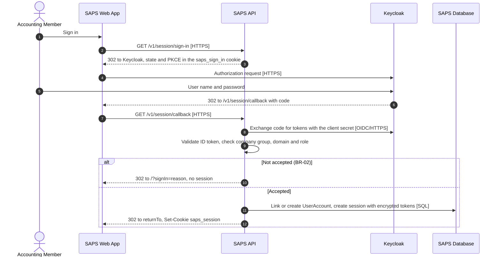
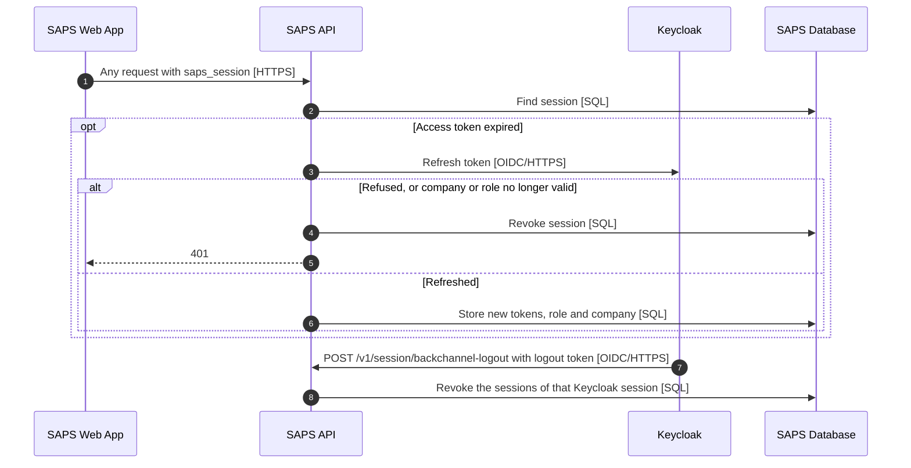

# SAPS-44 — Single Sign-On with Keycloak

## 1. Summary
Users stop typing a SAPS password: the SAPS Web App sends them to Keycloak, they sign in there, and the SAPS API creates its
own server-side session as before ([ADR-0011](../02-architecture/adr/0011-sign-in-through-keycloak-with-a-server-side-session.md),
backend for frontend). The company and the role of a user come from Keycloak (group per company, realm roles,
[ADR-0010](../02-architecture/adr/0010-use-one-keycloak-realm-with-company-groups.md)) and are checked on every sign-in and
token refresh. Passwords disappear from the SAPS Database. The group's Entra ID can later be put behind Keycloak without a
code change ([DEC-061](../01-requirements/decision-log.md#dec-061), [NFR-MAINT-001](../01-requirements/nfr.md#nfr-maint-001)).
Keycloak and the realm `saps` with the demo users exist since [SAPS-43](https://linear.app/jiringuyen/issue/SAPS-43).

| Item | Value |
|---|---|
| Linear | [SAPS-44](https://linear.app/jiringuyen/issue/SAPS-44) |
| Use cases | [UC-01 Sign in](../02-architecture/arc42/01-introduction-and-goals.md#use-cases) |
| Scope items | [SCP-IN-18](../01-requirements/scope.md#31-functional-capabilities) (replaces the password sign-in of SCP-IN-12) |
| Target release | Phase 2 demo 2027-08-30 |

## 2. Requirements

### 2.1 Business Rules
| ID | Rule | Source |
|---|---|---|
| BR-01 | Users sign in only through Keycloak; the SAPS API has no password sign-in and stores no passwords. | [NFR-SEC-001](../01-requirements/nfr.md#nfr-sec-001), [DEC-049](../01-requirements/decision-log.md#dec-049) |
| BR-02 | A user is accepted only with exactly one company group that belongs to an active company, an e-mail address in that company's domain, and exactly one of the roles Accounting Member and Accounting Manager. Otherwise no session is created and the Web App explains why. | [ADR-0010](../02-architecture/adr/0010-use-one-keycloak-realm-with-company-groups.md), [DEC-059](../01-requirements/decision-log.md#dec-059) |
| BR-03 | At each sign-in the SAPS API creates or updates the user's `UserAccount` (keyed by issuer and subject): e-mail, display name, company, role. A demo user that already exists with the same e-mail in the same company is linked to its Keycloak account at the first sign-in, so claims, approvals and history keep pointing to the same user. | [ADR-0011](../02-architecture/adr/0011-sign-in-through-keycloak-with-a-server-side-session.md) |
| BR-04 | The SAPS session keeps the PoC rules: random 256-bit value in the HttpOnly cookie `saps_session`, only its hash stored, idle timeout 30 min, absolute timeout 8 h, `Origin` check on state-changing requests. Tokens never reach the browser. | ADR-0011, [SAPS-27](SAPS-27-user-roles-sign-in.md) BR-04 – BR-06 |
| BR-05 | When the session's access token has expired, the next request refreshes it at Keycloak and re-checks BR-02 with the new token. A refused refresh, or a user whose company changed, ends the session (`401`). Changes made in Keycloak therefore apply within one access-token lifetime (5 min). | ADR-0011 |
| BR-06 | Sign-out ends the SAPS session and then the Keycloak session (the browser goes to Keycloak's end-session page and comes back to the Web App). | ADR-0011 |
| BR-07 | When an administrator signs a user out in Keycloak, Keycloak calls the SAPS API (back-channel logout) and the user's SAPS sessions end at once. | ADR-0011 |
| BR-08 | Role checks per operation (`x-roles`) and the company of every request stay as today; they now use the role and company taken from Keycloak. | SAPS-27 BR-07, BR-08, [SAPS-41](SAPS-41-tenant-isolation.md) |

### 2.2 Affected NFRs
| NFR | How this feature is affected |
|---|---|
| [NFR-SEC-001](../01-requirements/nfr.md#nfr-sec-001) | Implemented: sign-in only through Single Sign-On; no passwords in the SAPS Database. |
| [NFR-MAINT-001](../01-requirements/nfr.md#nfr-maint-001) | Only standard OpenID Connect; the issuer, client and claim names are configuration. |

### 2.3 Out of Scope
- Connecting the group's Entra ID to Keycloak (a later phase, [DEC-061](../01-requirements/decision-log.md#dec-061)).
- User and role administration screens (in the Keycloak admin console, [DEC-054](../01-requirements/decision-log.md#dec-054)).
- Bearer tokens for other clients (partners, tools) — a separate decision (ADR-0011).

## 3. Design

### 3.1 Affected Building Blocks
| Container | Change | Description |
|---|---|---|
| SAPS Web App | modified | The sign-in page shows one button "Sign in" that opens `/v1/session/sign-in`; sign-in errors are shown from a query parameter; sign-out follows the Keycloak end-session URL |
| SAPS API | modified | OpenID Connect client of Keycloak (authorization code with PKCE, `state`, `nonce`); session with encrypted tokens; refresh; back-channel logout; the password sign-in is removed |
| SAPS Database | modified | `user_account` gets the Keycloak identity and loses `password_hash`; `user_session` gets the Keycloak session ID and the encrypted tokens |
| Keycloak | none | Realm `saps` and client `saps-web` from [SAPS-43](https://linear.app/jiringuyen/issue/SAPS-43) |

Design rules:
- **Sign-in start** (`GET /v1/session/sign-in?returnTo=…`): creates `state`, `nonce` and a PKCE verifier, keeps them for 10 min in
  an encrypted, HttpOnly cookie `saps_sign_in` (`SameSite=Lax`, so it comes back with Keycloak's redirect), and redirects to
  Keycloak's authorization endpoint. `returnTo` must be a path of the Web App (starts with `/`, no `//`), otherwise `/`.
- **Callback** (`GET /v1/session/callback?code&state`): checks `state`, exchanges the code with the client secret, validates the
  ID token (signature from the realm's keys, issuer, audience, expiry, `nonce`), applies BR-02, links or creates the user
  (BR-03), creates the session, sets `saps_session`, clears `saps_sign_in`, redirects to `returnTo`. Any failure redirects to
  `/?signIn=<reason>` without a session.
- **Encryption at rest**: refresh token and ID token are stored encrypted (Fernet, key `SESSION_ENCRYPTION_KEY`); the
  `saps_sign_in` cookie uses the same key.
- **Endpoints**: the SAPS API reads Keycloak's discovery document at the internal URL (`http://keycloak:8080/realms/saps`);
  Keycloak returns its internal endpoints for server calls and the public authorization and end-session endpoints, with one
  issuer (`KC_HOSTNAME_BACKCHANNEL_DYNAMIC`, SAPS-43).
- **Origin check**: `sign-in` and `callback` are GET requests; `backchannel-logout` is called by Keycloak, not a browser, and
  is exempt from the `Origin` check — the signed logout token is its protection.
- **Library**: a maintained OpenID Connect / JOSE library (chosen in the plan), no hand-written token validation.
- **Web App texts** (Q1): the sign-in page shows the button **"Sign in with your company account"**. The reason in
  `?signIn=` selects the message below; an unknown reason shows the `unavailable` text.

  | Reason | Message |
  |---|---|
  | `cancelled` | Sign-in was cancelled. Try again. |
  | `expired` | Your sign-in took too long or was started in another tab. Try again. |
  | `no_company` | Your account is not assigned to exactly one company. Ask your administrator. |
  | `wrong_domain` | Your e-mail address does not belong to your company. Ask your administrator. |
  | `no_role` | Your account needs exactly one SAPS role. Ask your administrator. |
  | `unavailable` | Sign-in is not available at the moment. Try again later. |
- **Upgrade**: the migration drops `password_hash` and revokes all PoC sessions; users sign in again through Keycloak. The seed
  keeps creating companies, settings and demo users (without passwords); `SEED_USER_PASSWORD` stays the password of the demo
  users in Keycloak.

### 3.2 Main Flow

Refresh and logout:

### 3.3 Edge Cases & Error Handling
| ID | Case | Expected behavior | Response / signal |
|---|---|---|---|
| EC-01 | User cancels at Keycloak or Keycloak returns an error | Back to the sign-in page with a message | `302 /?signIn=cancelled` |
| EC-02 | `state` missing, wrong or older than 10 min (bookmarked callback, second tab) | No session; sign-in starts again | `302 /?signIn=expired` |
| EC-03 | No company group, two company groups, or an unknown or inactive company | No session | `302 /?signIn=no_company`; log `sign_in_refused` |
| EC-04 | E-mail domain does not belong to the company of the group | No session | `302 /?signIn=wrong_domain`; log |
| EC-05 | No role or both roles | No session | `302 /?signIn=no_role`; log |
| EC-06 | Same e-mail already used by a user of another company | No session; the conflict is logged for the administrator | `302 /?signIn=no_company`; log `sign_in_conflict` |
| EC-07 | Keycloak cannot be reached at sign-in | Sign-in fails with a message | `302 /?signIn=unavailable` |
| EC-08 | Keycloak cannot be reached at a token refresh | The request fails, the session stays; the next request tries again | `503` |
| EC-09 | Refresh refused (user disabled, Keycloak session ended) or company / role changed | Session ends | `401` |
| EC-10 | `returnTo` pointing to another site (`//evil.example`, `https://…`) | Ignored; goes to `/` | — |
| EC-11 | Back-channel logout token with a wrong signature, issuer, audience or event | Refused, nothing revoked | `400` |
| EC-12 | Back-channel logout for an unknown Keycloak session | Nothing to revoke | `200` |
| EC-13 | A browser still holds a PoC session cookie after the upgrade | Session revoked by the migration | `401` → sign-in page |

### 3.4 API Changes
Contract [saps-api.openapi.yaml](../02-architecture/api/saps-api.openapi.yaml) goes to **0.5.0** (breaking: the password sign-in is removed; the only client is the SAPS Web App, changed in the same release).

| operationId | Method & path | Change | Breaking | Spec |
|---|---|---|---|---|
| `createSession` | POST /v1/session | **removed** (password sign-in) | Yes | [saps-api.openapi.yaml](../02-architecture/api/saps-api.openapi.yaml) |
| `startSignIn` | GET /v1/session/sign-in | new: `302` to Keycloak; query `returnTo` | No | ″ |
| `completeSignIn` | GET /v1/session/callback | new: `302` to `returnTo` with the session cookie, or to `/?signIn=<reason>` | No | ″ |
| `deleteSession` | DELETE /v1/session | changed: `200` with `logoutUrl` (Keycloak end-session URL) instead of `204` | Yes | ″ |
| `backchannelLogout` | POST /v1/session/backchannel-logout | new: form field `logout_token`; `200`, `400`; no session, no `Origin` check | No | ″ |
| `getSession` | GET /v1/session | unchanged (`UserAccount.username` is the e-mail) | No | ″ |

### 3.5 Event Changes
None.

### 3.6 Data Model Changes
| Entity | Change | Migration | Backward compatible |
|---|---|---|---|
| [UserAccount](../02-architecture/data-model.md#useraccount) | add `idp_issuer`, `idp_subject` (unique pair, empty until the first sign-in), `email`; drop `password_hash` | `0008_single_sign_on` | No (passwords removed; rollback restores the column empty) |
| [UserSession](../02-architecture/data-model.md#usersession) | add `idp_session_id` (Keycloak `sid`), `refresh_token_encrypted`, `id_token_encrypted`, `access_token_expires_at`; existing sessions revoked | same | No (PoC sessions revoked) |

### 3.7 Security & Permissions
- Authorization code flow with PKCE (S256), `state` and `nonce`; confidential client; no implicit or password grant.
- Tokens are never logged or sent to the browser; refresh and ID tokens are encrypted at rest.
- Open redirect: `returnTo` accepts paths of the Web App only.
- Brute-force protection is Keycloak's (realm setting of SAPS-43); this resolves [TD-03](../02-architecture/arc42/11-risks-and-technical-debt.md#td-03).
- Audit: logs `sign_in_succeeded` (user, company), `sign_in_refused` (reason, no token content), `session_refreshed`, `session_ended` (reason), `backchannel_logout`.

### 3.8 Configuration & Feature Flags
| Key | Purpose | Default | Per environment |
|---|---|---|---|
| `OIDC_DISCOVERY_URL` | Keycloak discovery document as the SAPS API reaches it | `http://keycloak:8080/realms/saps/.well-known/openid-configuration` | per environment |
| `OIDC_ISSUER` | Expected issuer of the tokens (Keycloak's public URL) | `http://localhost:8080/realms/saps` | per environment |
| `OIDC_CLIENT_ID`, `OIDC_CLIENT_SECRET` | Client `saps-web` | `saps-web`, `KEYCLOAK_CLIENT_SECRET` | secret per environment |
| `OIDC_GROUPS_CLAIM`, `OIDC_ROLES_CLAIM` | Claim names (ADR-0010) | `groups`, `roles` | — |
| `SESSION_ENCRYPTION_KEY` | Fernet key for stored tokens and the `saps_sign_in` cookie | — (required) | secret per environment |

### 3.9 Observability
- Logs listed in §3.7; the reason of a refused sign-in is a code, never token content.

## 4. Rollout & Rollback
1. Add the new settings to `.env` (`.env.example` shows local values).
2. `docker compose up -d --build`: migration `0008` drops passwords and revokes PoC sessions; users sign in through Keycloak.

**Rollback:** downgrade `0008` restores an empty `password_hash` column; revert the pull request and run the seed again to set the
demo passwords.

## 5. Test Scenarios
| ID | Scenario | Level | Covers |
|---|---|---|---|
| TS-01 | Rules of BR-02 on token claims: one / no / two groups, unknown or inactive company, domain, role | Unit | BR-02, EC-03 – EC-05 |
| TS-02 | Sign-in start and callback against a test OpenID provider (own keys, discovery and token endpoints in the test): session created, cookie flags, user linked or created, `returnTo` guarded | Integration | BR-03, BR-04, EC-10 |
| TS-03 | Callback with wrong `state`, expired sign-in cookie, cancelled, wrong `nonce`, wrong signature, issuer or audience | Integration | EC-01, EC-02 |
| TS-04 | Refresh: expired access token refreshed; refused refresh → `401`; company changed → `401`; Keycloak down → `503`, session kept | Integration | BR-05, EC-08, EC-09 |
| TS-05 | Back-channel logout: valid token ends the sessions of that `sid`; invalid token `400`; unknown `sid` `200` | Integration | BR-07, EC-11, EC-12 |
| TS-06 | Sign-out returns Keycloak's end-session URL and revokes the session | Integration | BR-06 |
| TS-07 | Migration on a PoC database: passwords dropped, sessions revoked, demo users linked at first sign-in, history kept | Integration | BR-03, EC-13 |
| TS-08 | Web App: sign-in button, error messages per reason, sign-out follows `logoutUrl` | Unit (Web App) | BR-06 |
| TS-09 | Compose smoke: sign in through the real Keycloak (follow the redirects and post the login form), call the API, sign out; a user of another company sees none of the first company's invoices | E2E | BR-01 – BR-06 |

## 6. Decisions
| Decision | Rationale | ADR |
|---|---|---|
| Backend for frontend with the PoC session | Tokens stay out of the browser; the PoC cookie, CSRF and timeout rules stay | [ADR-0011](../02-architecture/adr/0011-sign-in-through-keycloak-with-a-server-side-session.md) |
| `state`, `nonce` and PKCE verifier in an encrypted short-lived cookie | No table for half-finished sign-ins; works with several SAPS API instances | — |
| Demo users linked by e-mail within their company at first sign-in | Keeps the history of the PoC users and the seeded demo data | — |
| No local password sign-in, not even for developers (Q2) | One sign-in path; tests use a test OpenID provider, local runs use the Keycloak container | — |
| Contract 0.5.0 with breaking changes, released together with the Web App (Q3) | The Web App is the only client of the session operations | — |
| Sign-out returns the end-session URL (`200`) instead of redirecting | The Web App calls the API with `fetch`; the browser then navigates to Keycloak | — |

## 7. Open Questions
| # | Question | Asked to | Due | Status |
|---|---|---|---|---|
| Q1 | Text of the sign-in page and of the error messages (reasons of §3.3)? Proposal: button "Sign in with your company account"; messages in plain English per reason, e.g. "Your account has no company. Ask your administrator." | Product Owner (Customer) | before implementation | answered: proposal accepted (2027-03-01) |
| Q2 | No local password sign-in kept as a fallback for developers (one sign-in path only)? Proposal: yes, none; tests use a test OpenID provider. | Solution Architect / Tech Lead | before implementation | answered: proposal accepted (2027-03-01) |
| Q3 | Breaking contract change 0.5.0 (`createSession` removed, `deleteSession` returns `200`) in one release with the Web App? Proposal: yes. | Solution Architect / Tech Lead | before implementation | answered: proposal accepted (2027-03-01) |

## 8. Documentation Checklist
- [ ] API spec 0.5.0
- [ ] Data model (UserAccount, UserSession)
- [ ] SAPS-27 spec: password rules superseded by SAPS-44 (note)
- [ ] Developer Guide: sign-in through Keycloak, new settings, troubleshooting
- [ ] arc42 §6 runtime view: sign-in scenario; §8 security concept
- [ ] TD-03 resolved
- [ ] Release notes entry prepared
