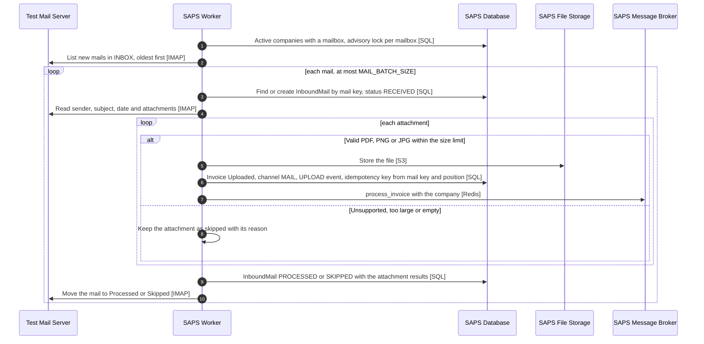
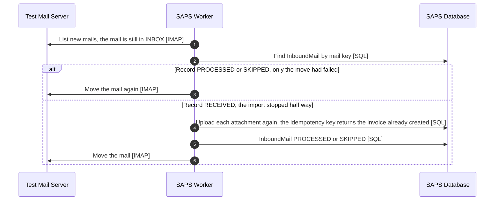

# SAPS-45 — Invoice intake from company mailboxes

## 1. Summary
Vendors can e-mail invoices to the mailbox of a company. The SAPS Worker reads each company's mailbox every minute through
a mail port ([ADR-0012](../02-architecture/adr/0012-read-invoice-mailboxes-through-a-mail-port.md)). Every PDF, PNG or JPG
attachment becomes one invoice of that company and follows the upload path of
[SAPS-17](SAPS-17-invoice-upload.md): same checks, storage, status Uploaded, processing, duplicate detection and
notifications ([DEC-055](../01-requirements/decision-log.md#dec-055)). A mail without a valid attachment is skipped and
logged. The demo uses a local test mail server (GreenMail, IMAP); Outlook through Microsoft Graph comes later behind the same
port ([DEC-053](../01-requirements/decision-log.md#dec-053), [NFR-MAINT-001](../01-requirements/nfr.md#nfr-maint-001)).

| Item | Value |
|---|---|
| Linear | [SAPS-45](https://linear.app/jiringuyen/issue/SAPS-45) (ADR: [SAPS-40](https://linear.app/jiringuyen/issue/SAPS-40)) |
| Use cases | UC-02 Upload invoice — new intake channel "mail" ([§1](../02-architecture/arc42/01-introduction-and-goals.md#use-cases)) |
| Scope items | [SCP-IN-19](../01-requirements/scope.md#31-functional-capabilities) |
| Target release | Phase 2 demo 2027-08-30 |

## 2. Requirements

### 2.1 Business Rules
| ID | Rule | Source |
|---|---|---|
| BR-01 | The mailbox that receives a mail sets the company of its invoices: the company whose `mailbox_address` it is. Only the mailboxes of active companies are read. The sender is not checked. | [DEC-055](../01-requirements/decision-log.md#dec-055), [SAPS-42](SAPS-42-companies-and-demo-data.md) |
| BR-02 | Each attached PDF, PNG or JPG file is one invoice. The type is checked by content (magic bytes) and the size against `MAX_UPLOAD_SIZE_MB`, as for uploads (SAPS-17 BR-02, BR-03). Images embedded in the mail body (inline, e.g. a signature logo) are not attachments and are ignored. ZIP files and forwarded mails (`.eml`) are unsupported attachments. | DEC-055, SAPS-17, [MTG-20270301-6](../01-requirements/meetings/2027-03-01-mailbox-intake.md) R1 |
| BR-03 | A valid attachment enters the flow like an upload: file stored, invoice in status Uploaded with the `UPLOAD` event, `process_invoice` sent (SAPS-17 BR-05). Duplicate detection, matching, exceptions and notifications are unchanged. | [ADR-0012](../02-architecture/adr/0012-read-invoice-mailboxes-through-a-mail-port.md) |
| BR-04 | A mail invoice has no uploading user; it records the channel `MAIL` and the mail's sender, subject and date. The invoice detail in the SAPS Web App shows them; the invoice lists are unchanged. | ADR-0012, [MTG-20270301-6](../01-requirements/meetings/2027-03-01-mailbox-intake.md) R2 |
| BR-05 | Each mail is imported at most once: a record per mail (company, mail key) with a unique key, and an idempotency key per attachment derived from the mail key and the attachment's position. A crash at any point creates no second invoice and loses no mail. | ADR-0012, [ADR-0004](../02-architecture/adr/0004-process-invoices-in-background-worker.md) |
| BR-06 | After its invoices are committed, a mail is moved to the folder `Processed`. A mail without any valid attachment is recorded as skipped with the reason, logged, and moved to the folder `Skipped`. Nobody is notified. | DEC-055 |
| BR-07 | An attachment that fails the checks (type, size, empty) is skipped with its reason; the other attachments of the same mail go on. A mail with at least one invoice counts as processed. | ADR-0012 |
| BR-08 | One SAPS Worker process reads a given mailbox at a time; every process runs the timer, `MAIL_POLL_SECONDS` apart (default 60 s). Each tick reads at most `MAIL_BATCH_SIZE` mails per mailbox (default 50), oldest first. | ADR-0012, [SAPS-37](SAPS-37-stuck-invoice-sweeper.md) |

### 2.2 Affected NFRs
| NFR | How this feature is affected |
|---|---|
| [NFR-MAINT-001](../01-requirements/nfr.md#nfr-maint-001) | The intake logic sees only the mail port; IMAP for the demo, Microsoft Graph later, chosen by configuration. |
| [NFR-SCAL-001](../01-requirements/nfr.md#nfr-scal-001) | About 1,000 invoices per company and day = about 1 mail per minute per mailbox in business hours; one 60 s tick with up to 50 mails per mailbox keeps up. |

### 2.3 Out of Scope
- The Microsoft Graph adapter for Outlook: backlog issue [SAPS-53](https://linear.app/jiringuyen/issue/SAPS-53), started when the group IT gives access (Q3).
- Checking or allow-listing senders (DEC-055); malware scanning ([RSK-03](../02-architecture/arc42/11-risks-and-technical-debt.md#rsk-03)).
- A screen that lists skipped mails (they are logged; DEC-055).
- Files inside archives (ZIP) or forwarded mails (`.eml`); such attachments are skipped as unsupported (R1).
- The processing calendar ([SAPS-52](https://linear.app/jiringuyen/issue/SAPS-52)) — it decides later when imported invoices are processed.

## 3. Design

### 3.1 Affected Building Blocks
| Container | Change | Description |
|---|---|---|
| SAPS Worker | modified | Mail intake timer (started like the sweeper); reads each company mailbox through the Mailbox Port, imports attachments with the upload use case |
| SAPS API | modified | Invoice read model returns the intake channel and the mail details; the upload use case is shared with the worker |
| SAPS Database | modified | New table `inbound_mail`; `invoice` gets `channel` and `inbound_mail_id`; `uploaded_by` becomes optional |
| SAPS Web App | modified | Invoice detail shows "Received by mail from … · subject · date" (R2) |
| Test Mail Server | new | GreenMail container (SMTP and IMAP) in Docker Compose for the demo and the tests; mailboxes are created on first use |

Design rules:
- **Mailbox Port** (`ports/mailbox.py`), as in ADR-0012: `list_new(mailbox, limit)` → mail headers with a stable mail key,
  `read(mailbox, mail)` → sender, subject, date and the attachments (name, declared type, content), `move(mailbox, mail, folder)`.
  The adapter decides the mail key: the `Message-ID` header, or `sha256:` + the hash of the raw mail when there is none.
- **IMAP Mail Adapter** (`adapters/mail/imap_mailbox.py`): reads `INBOX`; signs in as the mailbox address with
  `IMAP_PASSWORD` (GreenMail accepts any user; one shared demo password, never a real one); creates `Processed` and
  `Skipped` when missing; parts with `Content-Disposition: inline` or a `Content-ID` referenced from the body are not
  attachments. `MAIL_ADAPTER=none` turns the intake off (default in tests and when no mail server is configured).
- **Mail intake use case** (`application/mail_intake.py`), per mailbox and mail:
  1. find or create the `InboundMail` record (status `RECEIVED`); a record that is already `PROCESSED` or `SKIPPED` means only
     the move failed last time → move again;
  2. for each attachment, in order: check it (BR-02); a valid one goes through the upload use case with the idempotency key
     `mail:<first 40 hex of sha256(mail key)>:<position>`; the result (invoice, or skipped with reason) is kept per attachment;
  3. set the record to `PROCESSED` (≥ 1 invoice) or `SKIPPED` (none, with the reason), commit;
  4. move the mail to `Processed` / `Skipped`.
- **Upload use case shared:** `UploadInvoiceService` takes an intake source (user upload, or mail with the record id) instead
  of the `CurrentUser`; the event actor of a mail invoice is `mail`, the event details hold the mail's sender and subject.
- **Company:** the worker connects as `saps_app` and sets the company of the mailbox on each transaction
  ([ADR-0009](../02-architecture/adr/0009-isolate-tenant-data-in-a-shared-database.md)); the tenant list (mailbox
  addresses) has no row-level security.
- **Locking:** `pg_try_advisory_lock(3700045, hashtext(mailbox address))` on a dedicated connection per tick, like the
  sweeper's key 3700037; a busy mailbox is skipped for this tick.
- **Large mails:** an attachment over the size limit is skipped without reading the rest of it into memory where the adapter
  can tell the size first (IMAP `BODYSTRUCTURE`).

### 3.2 Main Flow

Recovery after a crash or a failed step:

### 3.3 Edge Cases & Error Handling
| ID | Case | Expected behavior | Response / signal |
|---|---|---|---|
| EC-01 | Mail with two PDFs and one JPG | Three invoices of the mailbox's company | log `mail_imported` (invoices: 3) |
| EC-02 | Mail without attachments, or only unsupported ones (DOCX, ZIP, `.eml`) | Record `SKIPPED` (`no_valid_attachment`), mail moved to `Skipped`, nobody notified | log `mail_skipped` |
| EC-03 | A `.pdf` name with other content, an empty file, or a file over the size limit | That attachment skipped with its reason (`unsupported_type`, `empty`, `too_large`); other attachments go on | attachment results on the record |
| EC-04 | Signature logo or other inline image | Ignored, not counted as an attachment (R1) | — |
| EC-05 | Same PDF sent again in a new mail | New invoice; duplicate detection decides (EX7, [SAPS-23](SAPS-23-duplicate-invoice-detection.md)) | as for uploads |
| EC-06 | Worker crashes after some invoices are committed | Next tick finds the mail and the `RECEIVED` record; the idempotency keys return the invoices already created; no duplicates | — |
| EC-07 | Moving the mail fails (mail server error) | Record already final; next tick moves it again without importing | log `mail_move_failed` |
| EC-08 | Mail server unreachable or sign-in refused | Tick skips that mailbox, others go on; next tick tries again | log `mail_poll_failed` (mailbox, error class) |
| EC-09 | SAPS File Storage or the SAPS Database fails during an attachment | Mail stays `RECEIVED` in `INBOX`; next tick tries again | log `mail_import_failed` |
| EC-10 | `process_invoice` cannot be sent | Invoice stays Uploaded; the sweeper re-sends it (SAPS-37) | as for uploads |
| EC-11 | Two worker processes tick at the same time | Advisory lock: one reads the mailbox, the other skips it | — |
| EC-12 | A mail without `Message-ID` | Mail key = hash of the raw mail | — |
| EC-13 | The same mail delivered to two company mailboxes | One import per company (the record is unique per company and mail key) | — |
| EC-14 | Company inactive or without a mailbox | Its mailbox is not read | — |

### 3.4 API Changes
Contract [saps-api.openapi.yaml](../02-architecture/api/saps-api.openapi.yaml) goes to **0.6.0** (the only client is the
SAPS Web App, changed in the same release).

| operationId | Method & path | Change | Breaking | Spec |
|---|---|---|---|---|
| `getInvoice`, `listInvoices` and the other operations returning `Invoice` / `InvoiceSummary` | — | `uploadedBy` becomes nullable (null for mail invoices); new `source`: `channel` (`UPLOAD`, `MAIL`) and, for mail, `mailFrom`, `mailSubject`, `mailReceivedAt` | Yes (nullable field) | [saps-api.openapi.yaml](../02-architecture/api/saps-api.openapi.yaml) |

### 3.5 Event Changes
None. `process_invoice` is unchanged; the `UPLOAD` invoice event of a mail invoice has actor `mail` and details
`{channel, inboundMailId}`.

### 3.6 Data Model Changes
| Entity | Change | Migration | Backward compatible |
|---|---|---|---|
| InboundMail (new) | `id`, `tenant_id`, `mailbox_address`, `mail_key` (unique with `tenant_id`), `sender`, `subject`, `received_at`, `status` (`RECEIVED`, `PROCESSED`, `SKIPPED`), `skip_reason`, `attachments` (JSONB: name, size, result, reason, invoice id), `processed_at`; row-level security like every tenant table | `0009_mailbox_intake` | Yes |
| [Invoice](../02-architecture/data-model.md#invoice) | add `channel` (`UPLOAD` default for existing rows, `MAIL`), `inbound_mail_id` (FK, null for uploads); `uploaded_by` nullable, with a check: `uploaded_by` set for `UPLOAD`, `inbound_mail_id` set for `MAIL` | same | Yes |

### 3.7 Security & Permissions
- Mail content and attachments are untrusted: only the checked file types, size limit, files stored with their checked
  content type, never opened or executed by the server ([RSK-03](../02-architecture/arc42/11-risks-and-technical-debt.md#rsk-03)).
- Sender and subject are shown as text, never as HTML; stored at most 320 and 500 characters.
- Mail content and attachment bytes are never logged; logs hold the mailbox, the mail key hash and counts.
- `IMAP_PASSWORD` is a secret setting; the demo value is local only. Graph credentials come later with the Graph adapter.
- Every mail invoice belongs to exactly one company, set by the mailbox (row-level security, ADR-0009).

### 3.8 Configuration & Feature Flags
| Key | Purpose | Default | Per environment |
|---|---|---|---|
| `MAIL_ADAPTER` | `imap` or `none` (`graph` later) | `none` | `imap` in Docker Compose |
| `MAIL_POLL_SECONDS` | Timer interval of the mail intake | `60` (ADR-0012) | — |
| `MAIL_BATCH_SIZE` | Mails read per mailbox and tick | `50` | — |
| `IMAP_HOST`, `IMAP_PORT`, `IMAP_SSL` | Mail server of the IMAP adapter | `localhost`, `3143`, `false` | `mail`, `3143` in Docker Compose |
| `IMAP_PASSWORD` | Password used for every company mailbox (demo server only) | — | secret |

### 3.9 Observability
- Logs: `mail_imported` (mailbox, invoices, skipped attachments), `mail_skipped` (mailbox, reason), `mail_move_failed`,
  `mail_poll_failed`, `mail_import_failed`; each with `tenant_id` and the hash of the mail key.

## 4. Rollout & Rollback
1. `docker compose up -d --build`: migration `0009`; the `mail` (GreenMail) container starts; the worker polls the three demo
   mailboxes (`ap@vn.example.com`, `ap@sg.example.com`, `ap@my.example.com`).
2. Send a test mail with `backend/tools/send_test_mail.py` (SMTP to GreenMail) — documented in the Developer Guide; used by
   the demo scenarios of [SAPS-47](https://linear.app/jiringuyen/issue/SAPS-47).

**Rollback:** `MAIL_ADAPTER=none` stops the intake at once. Downgrade `0009` only when no mail invoice exists (the column
`uploaded_by` becomes required again).

## 5. Test Scenarios
| ID | Scenario | Level | Covers |
|---|---|---|---|
| TS-01 | Attachment selection: PDF/PNG/JPG by content, inline images ignored, unsupported and oversized files skipped with reason | Unit | BR-02, BR-07, EC-03, EC-04 |
| TS-02 | Intake use case with fakes: processed, skipped, already final (move only), half-done (idempotency), file storage failure | Unit | BR-05, BR-06, EC-06, EC-07, EC-09 |
| TS-03 | GreenMail (Testcontainers): a mail with two PDFs to `ap@<company>` becomes two Uploaded invoices of that company, channel `MAIL`, mail moved to `Processed` | Integration | BR-01, BR-03, BR-04, EC-01 |
| TS-04 | GreenMail: mail without a valid attachment → `SKIPPED`, moved to `Skipped`, no notification | Integration | BR-06, EC-02 |
| TS-05 | Crash between import and move (fault injected) → no second invoice; two workers at once → one reads | Integration | BR-05, BR-08, EC-06, EC-11 |
| TS-06 | Same mail to two company mailboxes → one invoice in each; row-level security on `inbound_mail` | Integration | BR-01, EC-13 |
| TS-07 | API returns `source` and nullable `uploadedBy`; Web App shows the mail details on the invoice | Integration, Unit (Web App) | BR-04 |
| TS-08 | Compose smoke: a test mail to the demo mailbox of Demo Vietnam reaches Pending review; a mail without attachment is skipped | E2E | BR-01 – BR-06 |

## 6. Decisions
| Decision | Rationale | ADR |
|---|---|---|
| Mailbox Port polled by a timer in the SAPS Worker; IMAP + GreenMail for the demo | No public endpoint; Outlook later behind the same port | [ADR-0012](../02-architecture/adr/0012-read-invoice-mailboxes-through-a-mail-port.md) |
| IMAP sign-in with one shared `IMAP_PASSWORD` for the demo mailboxes (Q4) | GreenMail only; Outlook will use the Graph app registration (ADR-0012) | — |
| `uploaded_by` optional plus `channel`, instead of a technical "mail" user per company | A technical user could be selected, assigned or notified like a person; the channel is explicit | — |
| Upload use case shared by API and worker | Same checks, storage order and idempotency for both channels (BR-03) | — |
| Record per mail plus idempotency key per attachment | Exactly-once import without a distributed transaction between the mail server and the database | ADR-0012 |

## 7. Open Questions
| # | Question | Asked to | Due | Status |
|---|---|---|---|---|
| Q1 | Which parts of a mail are invoices? Proposal: only attached PDF, PNG and JPG files; images inside the mail body (signature logos) are ignored; ZIP files and forwarded mails attached as `.eml` are skipped as unsupported (vendors attach the invoice file directly). | Product Owner (Customer) | before implementation | answered: proposal accepted ([MTG-20270301-6](../01-requirements/meetings/2027-03-01-mailbox-intake.md)) |
| Q2 | What does a user see of the mail? Proposal: the invoice detail shows "Received by mail from {sender} · {subject} · {date}"; the invoice lists show nothing new (search by channel can come with [SAPS-46](https://linear.app/jiringuyen/issue/SAPS-46)). | Product Owner (Customer) | before implementation | answered: proposal accepted ([MTG-20270301-6](../01-requirements/meetings/2027-03-01-mailbox-intake.md)) |
| Q3 | Microsoft Graph adapter now (tested only against recorded responses) or later? Proposal: later, as a new backlog issue **SAPS-53** "Outlook mailbox adapter (Microsoft Graph)", started when the group IT gives access; SAPS-45 delivers the port, the IMAP adapter and GreenMail. | Solution Architect / Tech Lead | before implementation | answered: proposal accepted (2027-03-01) |
| Q4 | IMAP sign-in: one shared `IMAP_PASSWORD` for all demo mailboxes (GreenMail only)? Proposal: yes; per-mailbox credentials are not needed because Outlook will use the Graph app registration (ADR-0012). | Solution Architect / Tech Lead | before implementation | answered: proposal accepted (2027-03-01) |

## 8. Documentation Checklist
- [x] API spec 0.6.0 (`source`, nullable `uploadedBy`)
- [x] Data model (InboundMail, Invoice changes, ERD)
- [x] SAPS-17 spec: BR-01 "only intake channel" superseded by SAPS-45 (note)
- [x] Glossary: Mailbox Port, IMAP Mail Adapter, Test Mail Server, Inbound mail, Intake channel
- [x] C4 L2 diagram: Test Mail Server container and "Reads company mailboxes [IMAP]"
- [x] arc42 §6 runtime view: scenario index row linking §3.2
- [x] Developer Guide: mail settings, sending a test mail, troubleshooting
- [x] Test strategy: GreenMail in integration tests
- [ ] Release notes entry prepared
