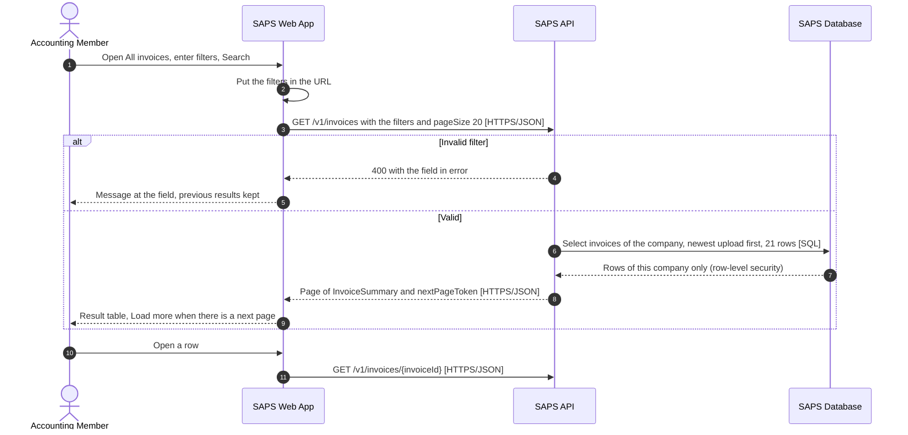

# SAPS-46 — Invoice list and search

## 1. Summary
Today an invoice leaves the SAPS Web App once it is Completed or Rejected: the screens show only the work queues
([DEC-048](../01-requirements/decision-log.md#dec-048)). This feature adds one screen, **All invoices**, where Accounting
Members and Accounting Managers see every invoice of their own company in every status and search it with filters
([DEC-057](../01-requirements/decision-log.md#dec-057)). The SAPS API extends the existing `listInvoices` operation with
the filters; row-level security keeps each company to its own invoices
([ADR-0009](../02-architecture/adr/0009-isolate-tenant-data-in-a-shared-database.md)). There is no export.

| Item | Value |
|---|---|
| Linear | [SAPS-46](https://linear.app/jiringuyen/issue/SAPS-46) |
| Use cases | UC-09 Search invoices (new, [§1](../02-architecture/arc42/01-introduction-and-goals.md#use-cases)) |
| Scope items | [SCP-IN-22](../01-requirements/scope.md#31-functional-capabilities) |
| Target release | Phase 2 demo 2027-08-30 |

## 2. Requirements

### 2.1 Business Rules
| ID | Rule | Source |
|---|---|---|
| BR-01 | Accounting Members and Accounting Managers see all invoices of their own company, in every status, on the screen **All invoices**. Nobody sees invoices of another company. | [DEC-057](../01-requirements/decision-log.md#dec-057), [ADR-0009](../02-architecture/adr/0009-isolate-tenant-data-in-a-shared-database.md) |
| BR-02 | Filters, all optional and combined with AND: status (one or more), vendor, invoice number, invoice date range, upload date range, total amount range, PO number, intake channel (upload or mail). | DEC-057 |
| BR-03 | How each filter matches (Q1): **vendor** — part of the vendor name or the vendor code, case-insensitive; **invoice number** — part of the number, ignoring case, spaces, `-`, `.` and `/` (the normalization of [DEC-042](../01-requirements/decision-log.md#dec-042)); **PO number** — the exact 7-digit number on any line of the invoice; **ranges** — both ends included, either end may be left open. | DEC-057, [MTG-20270301-7](../01-requirements/meetings/2027-03-01-invoice-search.md) R1 |
| BR-04 | The upload date is the day the invoice entered the system (upload, or mail intake of [SAPS-45](SAPS-45-mailbox-intake.md)) in the company's time zone (`tenant.time_zone`, [SAPS-42](SAPS-42-companies-and-demo-data.md)). | [MTG-20270301-7](../01-requirements/meetings/2027-03-01-invoice-search.md) R2 |
| BR-05 | Results: newest upload first, 20 per page, "Load more" for the next page. No other sort order and no export. | DEC-057 |
| BR-06 | Each result row shows invoice number, vendor, invoice date, total amount, status, intake channel and upload date; open exception codes and the claiming member as in the queues. A row opens the invoice detail; from there "← All invoices" returns to the same filters and results. | [MTG-20270301-7](../01-requirements/meetings/2027-03-01-invoice-search.md) R3 |
| BR-07 | Invalid filters are refused with a message, nothing is searched: a "from" after its "to", a negative amount, a PO number that is not 7 digits, an unknown status or channel. | proposal |
| BR-08 | The work queues (exception, approval, review) are unchanged; they keep their own screens and filters. | DEC-057 |

### 2.2 Affected NFRs
| NFR | How this feature is affected |
|---|---|
| [NFR-SCAL-001](../01-requirements/nfr.md#nfr-scal-001) | About 1,000 invoices per company and day: about 365,000 rows per company and year in the searched table; indexes in §3.6. No performance target exists for search; TS-07 measures and reports (Q4). |

### 2.3 Out of Scope
- Export (CSV, Excel) and printing (DEC-057).
- Full-text search in invoice files or line descriptions; free sorting by column.
- Saved searches; search across companies (one company per user, [DEC-056](../01-requirements/decision-log.md#dec-056)).
- Filters for the processing calendar of [SAPS-52](https://linear.app/jiringuyen/issue/SAPS-52) (added with that feature if needed).

## 3. Design

### 3.1 Affected Building Blocks
| Container | Change | Description |
|---|---|---|
| SAPS Web App | modified | New menu item and screen **All invoices** (`#/invoices`): filter form, result table, "Load more"; the filters live in the URL, so reload, back and links keep them |
| SAPS API | modified | `listInvoices` gets the filters of BR-02 and three more fields in `InvoiceSummary`; validation of BR-07 |
| SAPS Database | modified | Indexes for the default order and the range filters (§3.6) |

Design rules:
- **One operation:** the search extends `listInvoices` (already newest first, cursor paging, `x-roles` both roles), so the
  queues and the search share one query and one access rule. The filters are query parameters (bookmarkable, no body).
- **Company:** the query runs in the company's transaction; row-level security is the guard, the `tenant_id` filter
  stays as today ([SAPS-41](SAPS-41-tenant-isolation.md)).
- **Upload date range:** the API turns the company's local days into UTC instants with `tenant.time_zone`
  (`from 00:00` included, `to + 1 day 00:00` excluded).
- **Invoice number:** the filter value is normalized like `invoice_number_normalized` before matching.
- **PO number:** `EXISTS` on `invoice_line` (the index `ix_invoice_line_po_line` starts with `tenant_id, po_number`).
- **Cursor:** unchanged (`created_at`, `id`); a cursor from another filter set gives the next page of the new filters,
  never another company's rows.

### 3.2 Main Flow

### 3.3 Edge Cases & Error Handling
| ID | Case | Expected behavior | Response / signal |
|---|---|---|---|
| EC-01 | No filter | All invoices of the company, newest first | `200` |
| EC-02 | Nothing matches | "No invoices match these filters." | `200`, empty page |
| EC-03 | `invoiceDateFrom` after `invoiceDateTo` (same for upload date, amounts) | Refused, field named | `400` |
| EC-04 | PO number with letters or not 7 digits | Refused | `400` |
| EC-05 | Invoice without extracted data yet (Uploaded, Matching, EX1) | Listed when no data filter applies; a vendor, number, date or amount filter does not match empty values | `200` |
| EC-06 | Invoice number typed with other spaces or dashes (`AOS 2026-1013` vs `AOS-2026-1013`) | Matches (normalized) | `200` |
| EC-07 | Upload just before midnight in the company's time zone | Counted on the company's local day, not the UTC day | `200` |
| EC-08 | An id of another company opened from a shared link | Not found, as today | `404` |
| EC-09 | The list changes between two pages (new upload) | The next page continues after the last row shown; the new invoice appears on a new search | `200` |
| EC-10 | A filter value with `%` or `_` | Matched as plain text, not as a pattern | `200` |

### 3.4 API Changes
Contract [saps-api.openapi.yaml](../02-architecture/api/saps-api.openapi.yaml) goes to **0.7.0** (additive).

| operationId | Method & path | Change | Breaking | Spec |
|---|---|---|---|---|
| `listInvoices` | GET /v1/invoices | New query parameters: `vendor` (≤ 200), `invoiceNumber` (≤ 50), `poNumber` (7 digits), `invoiceDateFrom`, `invoiceDateTo`, `uploadedFrom`, `uploadedTo` (dates), `totalMin`, `totalMax` (decimal strings ≥ 0), `channel` (`UPLOAD`, `MAIL`); `status` unchanged (repeatable). `400` for BR-07. | No | [saps-api.openapi.yaml](../02-architecture/api/saps-api.openapi.yaml) |
| — | `InvoiceSummary` | New fields `invoiceDate`, `channel`, `uploadedAt` | No | ″ |

### 3.5 Event Changes
None.

### 3.6 Data Model Changes
| Entity | Change | Migration | Backward compatible |
|---|---|---|---|
| [Invoice](../02-architecture/data-model.md#invoice) | Indexes: (`tenant_id`, `created_at` desc, `id` desc) for the default order; (`tenant_id`, `invoice_date`); (`tenant_id`, `total_amount`). Text filters (vendor, invoice number) use a trigram index (`pg_trgm`) if the volume check of §5 TS-07 needs it (decided in the plan). | `0010_invoice_search_indexes` | Yes |

### 3.7 Security & Permissions
- `x-roles: [ACCOUNTING_MEMBER, ACCOUNTING_MANAGER]` as today; row-level security limits every query to the caller's
  company.
- Filter values are bound parameters; `%` and `_` are escaped for the "contains" matches (EC-10).
- No file content and no personal data beyond what the queues show.

### 3.8 Configuration & Feature Flags
None. The page size stays 20 (DEC-057; the API keeps its maximum of 100).

### 3.9 Observability
- Log `invoices_searched` with the names of the filters used (not their values), the result count of the page and the
  duration in ms.

## 4. Rollout & Rollback
1. Migration `0010` creates the indexes (the table is small in the demo; `CREATE INDEX CONCURRENTLY` is not needed yet).
2. The menu item appears for both roles.

**Rollback:** revert the pull request; the indexes can stay.

## 5. Test Scenarios
| ID | Scenario | Level | Covers |
|---|---|---|---|
| TS-01 | Filter parsing and validation: ranges, PO number, amounts, unknown values | Unit | BR-07, EC-03, EC-04 |
| TS-02 | Each filter alone and combined on PostgreSQL: vendor name/code, normalized invoice number, PO number on any line, dates, amounts, channel, statuses | Integration | BR-02, BR-03, EC-05, EC-06, EC-10 |
| TS-03 | Upload date in the company's time zone around midnight | Integration | BR-04, EC-07 |
| TS-04 | Newest first, 20 per page, cursor continues with the same filters | Integration | BR-05, EC-09 |
| TS-05 | Two companies: a search never returns the other company's invoices (row-level security) | Integration | BR-01 |
| TS-06 | Web App: filters in the URL, results, Load more, messages, back from the detail keeps the filters | Unit (Web App) | BR-06 |
| TS-07 | Volume check: one company with one year of invoices (~365,000, generated) — default page and each filter, `EXPLAIN` uses the indexes; times reported (no target, Q4) | Integration (manual run) | NFR-SCAL-001 |
| TS-08 | Compose smoke: search by invoice number and by channel `MAIL` finds the invoices of the earlier steps, a Completed one included | E2E | BR-01, BR-02 |

## 6. Decisions
| Decision | Rationale | ADR |
|---|---|---|
| Extend `listInvoices` instead of a new search operation | Same access rule, paging and summary as the queues; additive change | — |
| Filters in the URL of the Web App | Reload, back and shared links keep the search | — |
| No performance target for search in the demo (Q4) | Not needed at demo scale; TS-07 reports measured times and a target is set with the AWS move | — |
| Upload date in the company's time zone | Users think in their local days; the time zone is already on the company (SAPS-42) | — |

## 7. Open Questions
| # | Question | Asked to | Due | Status |
|---|---|---|---|---|
| Q1 | How should the text filters match? Proposal: vendor — part of the name or code, case-insensitive; invoice number — part of the number ignoring case, spaces and `-` `.` `/`; PO number — exact 7 digits on any line. | Product Owner (Customer) | before implementation | answered: proposal accepted ([MTG-20270301-7](../01-requirements/meetings/2027-03-01-invoice-search.md)) |
| Q2 | Upload date in the company's local time (e.g. Singapore for Demo Singapore)? Proposal: yes. | Product Owner (Customer) | before implementation | answered: proposal accepted ([MTG-20270301-7](../01-requirements/meetings/2027-03-01-invoice-search.md)) |
| Q3 | Columns of the result list? Proposal: invoice number, vendor, invoice date, total, status, channel (upload/mail), upload date, open exceptions, claimed by. | Product Owner (Customer) | before implementation | answered: proposal accepted ([MTG-20270301-7](../01-requirements/meetings/2027-03-01-invoice-search.md)) |
| Q4 | A performance target for search (NFR-PERF)? Proposal: none for the demo; TS-07 measures with one year of data and reports the times; a target is set with the AWS move. | Solution Architect / Tech Lead | before implementation | answered: proposal accepted (2027-03-01) |

## 8. Documentation Checklist
- [ ] API spec 0.7.0 (`listInvoices` filters, `InvoiceSummary` fields)
- [ ] Data model: indexes of `invoice`
- [ ] arc42 §1: UC-09 Search invoices
- [ ] Glossary: "All invoices" screen if needed
- [ ] Developer Guide: how to search in the demo
- [ ] Release notes entry prepared
