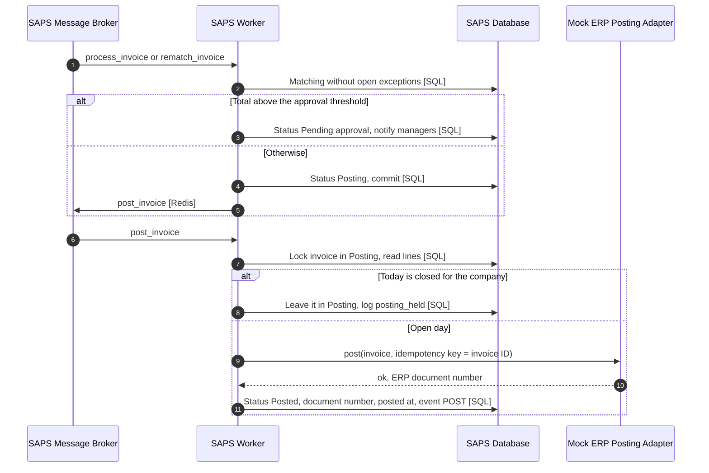
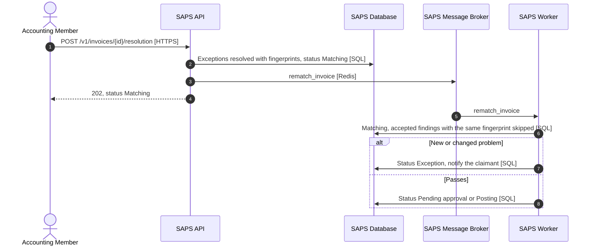

# SAPS-49 — Straight-through posting to the ERP

## 1. Summary
Invoices are posted to the ERP at the end of the workflow, without a final review
([DEC-063](../01-requirements/decision-log.md#dec-063)). An invoice whose workflow passes is posted automatically;
above the approval threshold it is posted after the Accounting Manager approves. When an Accounting Member closes the last
exception, the workflow (without extraction) runs again and the invoice is posted if it passes. Posting goes through an
**ERP posting port**; until MuleSoft and the ERP exist, a mock adapter answers "ok" with a mock ERP document number
([DEC-064](../01-requirements/decision-log.md#dec-064)). New statuses **Posting** and **Posted**. The final review screen,
its notification and its rejection point are removed.

| Item | Value |
|---|---|
| Linear | [SAPS-49](https://linear.app/jiringuyen/issue/SAPS-49) |
| Use cases | UC-03 Handle exception, UC-04 Approve invoice, UC-05 Reject invoice; UC-06 Review final result is withdrawn ([§1](../02-architecture/arc42/01-introduction-and-goals.md#use-cases)) |
| Scope items | [SCP-IN-17](../01-requirements/scope.md#32-integrations), [SCP-IN-04](../01-requirements/scope.md#31-functional-capabilities), SCP-IN-05 (withdrawn), SCP-IN-06, SCP-IN-08, SCP-IN-14 |
| Target release | Phase 2 demo 2027-08-30 |

## 2. Requirements

### 2.1 Business Rules
| ID | Rule | Source |
|---|---|---|
| BR-01 | **End of the workflow.** A matching run without open exceptions: total above the approval threshold → Pending approval; otherwise → **Posting**. An approval (APPROVED) → Posting. There is no Pending review for new invoices. | DEC-063, DEC-009 |
| BR-02 | **Posting.** An invoice in Posting is sent to the ERP through the ERP posting port, with its header, its lines (PO, PO line, matched lot) and the invoice ID as idempotency key. The answer "ok" sets **Posted** with the ERP document number and the posting time. Posted is final. | DEC-064, ADR-0013 |
| BR-03 | **Mock posting.** Until MuleSoft and the ERP exist, the mock adapter accepts every posting and returns the document number `MOCK-` + 10 characters derived from the invoice ID, so the same invoice always gets the same number. | DEC-064 |
| BR-04 | **Re-run after the last exception.** When an Accounting Member accepts the open exceptions as is, the invoice goes to Matching and the workflow runs again (duplicate check, type, matching, approval decision; never extraction) with fresh ERP data. A correction of a matching field already re-runs it (DEC-010). A re-run that passes ends as in BR-01. | DEC-063 |
| BR-05 | **Accepted exceptions stay accepted.** On acceptance each open exception keeps a fingerprint of the values it was raised on: its line's PO number, PO line, DO number, quantity and unit price (a header-level exception: vendor code, invoice number and all line values). On a re-run, a finding with the same code, the same line and the same fingerprint as an accepted exception is not raised again. A changed value or a new problem raises a new exception. | DEC-063, DEC-035 |
| BR-06 | **Non-PO invoices.** EX2 is accepted after the manual review; the re-run keeps it accepted (BR-05); the invoice is posted (or approved first). | DEC-063 |
| BR-07 | **Rejection points.** An invoice can be rejected during exception handling (claimant, SAPS-20) and at approval (SAPS-22). Posting and Posted invoices cannot be rejected. | DEC-063, DEC-014 |
| BR-08 | **Notifications.** Exception → Accounting Members (claimant only after a re-run, DEC-037); Pending approval → Accounting Managers. No "ready for final review" notification; no notification on posting (Q2). | DEC-063, DEC-021 |
| BR-09 | **Invoiced quantities and duplicates.** Posting and Posted count as invoiced (DEC-023) and are compared by the duplicate check (SAPS-23). | DEC-064 |
| BR-10 | **Upgrade.** Invoices in Pending review at the upgrade go to Posting once (event `UPGRADE_TO_POSTING`) and are posted by the sweeper's re-send (BR-12). Completed invoices stay Completed and are not posted (Q3). | DEC-063 |
| BR-11 | **Processing calendar.** On a closed day an invoice that reaches Posting waits; it is posted on the first open day by the hold release timer (Q1). | DEC-062, proposal Q1 |
| BR-12 | **Recovery.** An invoice in Posting longer than `SWEEPER_STUCK_AFTER_SECONDS` gets `post_invoice` again from the sweeper, with the same limit of re-sends as Uploaded and Matching (SAPS-37, SAPS-38). | ADR-0004, ADR-0013 |

### 2.2 Affected NFRs
| NFR | How this feature is affected |
|---|---|
| [NFR-MAINT-001](../01-requirements/nfr.md#nfr-maint-001) | Posting goes through a port; the MuleSoft adapter ([SAPS-48](https://linear.app/jiringuyen/issue/SAPS-48)) replaces the mock without changes to the workflow. |
| [NFR-SCAL-001](../01-requirements/nfr.md#nfr-scal-001) | One posting call per invoice, in its own job; postings run in parallel on the SAPS Worker like matching. |

### 2.3 Out of Scope
- The MuleSoft adapter and the real ERP; the exception "Posting failed" for a posting the ERP rejects (DEC-064, later).
- Export of results to a file (SCP-IN-17 says "or exporting"; not requested).
- Payment (SCP-OUT-03); reversing or cancelling a posted invoice.
- Posting invoices that were Completed before the upgrade (Q3).

## 3. Design

### 3.1 Affected Building Blocks
| Container | Change | Description |
|---|---|---|
| SAPS Worker | modified | New actor `post_invoice`; matching ends in Posting; re-run after acceptance keeps accepted exceptions; sweeper and hold release also cover Posting |
| SAPS API | modified | Acceptance queues a re-run (202); approval → Posting; `confirmInvoice` removed; rejection only in Exception; new statuses and posting fields |
| SAPS Web App | modified | Review queue and final review actions removed; statuses Posting and Posted; ERP document number and posting time on the invoice |
| SAPS Database | modified | `invoice.erp_document_number`, `invoice.posted_at`; `invoice_exception.accepted_fingerprint`; migration moves Pending review to Posting |
| ERP Posting Port, Mock ERP Posting Adapter | new | Port in the SAPS Worker codebase (ADR-0013); mock adapter now, MuleSoft adapter later |

### 3.2 Main Flow
Matching passes and the invoice is posted:

The Accounting Member accepts the last exceptions:

### 3.3 Edge Cases & Error Handling
| ID | Case | Expected behavior | Response / signal |
|---|---|---|---|
| EC-01 | `post_invoice` twice for one invoice | The second finds the invoice Posted and does nothing; the port is idempotent on the invoice ID anyway | Log `posting_skipped` |
| EC-02 | The worker stops after the ERP answered but before the commit | The sweeper re-sends; the port returns the same document number for the same idempotency key | — |
| EC-03 | The posting port fails (MuleSoft later; the mock does not fail) | Dramatiq retries with back-off (ADR-0004 S4); after the last retry the invoice stays in Posting and the sweeper re-sends up to its limit | Log `posting_failed` |
| EC-04 | Sending `post_invoice` fails after the commit | The invoice stays in Posting; the sweeper re-sends (BR-12) | Log `posting_not_sent` |
| EC-05 | Acceptance, then the re-run finds the same EX7 with the same values | Not raised again (BR-05); the invoice goes on | — |
| EC-06 | Acceptance, then the re-run finds EX7 after another invoice took the lot | Same code, line and values → still accepted. A different quantity or DO number → new EX7 | — |
| EC-07 | Acceptance, then the re-run finds a new code (e.g. EX4 because the PO was closed meanwhile) | New exception; back to Exception; the claim stays; only the claimant is notified (DEC-037) | Notification EXCEPTION_RAISED |
| EC-08 | A matching field is changed after an acceptance | The fingerprint no longer fits; the exception can be raised again | — |
| EC-09 | Two members act at once on an invoice in Exception | Unchanged: ETag and claim (SAPS-20) | 412 / 409 |
| EC-10 | Reject or approve an invoice in Posting or Posted | Refused | 409 |
| EC-11 | Old notification "ready for final review" | Still listed; it opens an invoice that is now Posting or Posted | — |
| EC-12 | Closed day: an approval or a re-run ends in Posting | The invoice waits in Posting; posted on the first open day (BR-11); the sweeper does not re-send on closed days | Log `posting_held` |

### 3.4 API Changes
Contract version 0.9.0 → **0.10.0** ([saps-api.openapi.yaml](../02-architecture/api/saps-api.openapi.yaml)).

| operationId | Method & path | Change | Breaking | Spec |
|---|---|---|---|---|
| — | `InvoiceStatus` | Adds `POSTING`, `POSTED` | No (new values) | saps-api.openapi.yaml |
| getInvoice, listInvoices | GET /v1/invoices… | `Invoice.erpDocumentNumber` (string ≤ 50, null), `Invoice.postedAt` (date-time, null); summaries show the new statuses | No | saps-api.openapi.yaml |
| resolveInvoiceExceptions | POST /v1/invoices/{invoiceId}/resolution | Answers `202` with status `MATCHING` and queues the re-run (was `200` with the next status) | Yes, for the Web App only (§6) | saps-api.openapi.yaml |
| decideInvoiceApproval | POST /v1/invoices/{invoiceId}/approval | APPROVED → `POSTING` (was `PENDING_REVIEW`) | No (status value) | saps-api.openapi.yaml |
| confirmInvoice | POST /v1/invoices/{invoiceId}/confirmation | **Removed** | Yes, for the Web App only (§6) | saps-api.openapi.yaml |
| rejectInvoice | POST /v1/invoices/{invoiceId}/rejection | Only in `EXCEPTION` (claimant); `PENDING_REVIEW` no longer accepted | No | saps-api.openapi.yaml |

### 3.5 Event Changes
New Dramatiq message `post_invoice(invoice_id, tenant_id)` (SAPS Worker → SAPS Worker, like `rematch_invoice`).
New InvoiceEvent actions: `POST` (Posting → Posted, actor `system`, details: document number), `UPGRADE_TO_POSTING`
(migration). `RESOLVE` now moves Exception → Matching.

### 3.6 Data Model Changes
| Entity | Change | Migration | Backward compatible |
|---|---|---|---|
| [Invoice](../02-architecture/data-model.md#invoice) | Status values `POSTING`, `POSTED`; new `erp_document_number` string(50) null, `posted_at` timestamptz null | `0013_straight_through_posting` | Yes (nullable; string enum) |
| [Invoice](../02-architecture/data-model.md#invoice) | Rows in `PENDING_REVIEW` → `POSTING`, with an InvoiceEvent `UPGRADE_TO_POSTING` (BR-10) | same | No: the downgrade refuses while invoices are Posting or Posted |
| [InvoiceException](../02-architecture/data-model.md#invoiceexception) | New `accepted_fingerprint` string(64) null (SHA-256 hex of the values, BR-05) | same | Yes |
| Invoice lifecycle | Matching → Posting; Pending approval → Posting; Exception → Matching on acceptance; Posting → Posted; Pending review → Posting (upgrade only) | — | — |

### 3.7 Security & Permissions
- Roles: unchanged for exception handling and approval. Nobody posts by hand; posting is done by the SAPS Worker.
- Authorization check: `resolveInvoiceExceptions` as today (claimant, Accounting Member); `confirmInvoice` is gone.
- Sensitive data: the posting request carries invoice data (Confidential); it is not logged; the document number is logged.
- Audit: events `POST`, `UPGRADE_TO_POSTING`; `RESOLVE` keeps the accepted codes.

### 3.8 Configuration & Feature Flags
| Key | Purpose | Default | Per environment |
|---|---|---|---|
| `ERP_POSTING_ADAPTER` | Selects the ERP posting adapter (`mock`; `mulesoft` later) | `mock` | Demo: `mock` |

### 3.9 Observability
- Logs: `invoice_posted` (invoice ID, document number), `posting_held`, `posting_skipped`, `posting_failed`,
  `posting_not_sent`; the sweeper's `invoice_resent` with message `post_invoice`.
- Metrics, alerts: none in Phase 2.

## 4. Rollout & Rollback
1. Migration 0013 adds the columns and moves Pending review to Posting.
2. API, worker and Web App are deployed together (one Docker Compose stack).
3. After start, the sweeper re-sends `post_invoice` for the moved invoices once they are older than the stuck limit.

**Rollback:** the downgrade refuses while invoices are Posting or Posted; posted invoices cannot return to an earlier
state without the ERP (a real ERP would need a reversal).

## 5. Test Scenarios
| ID | Scenario | Level | Covers |
|---|---|---|---|
| TS-01 | Decision: no exception and below threshold → Posting; above → Pending approval; approval → Posting | Unit | BR-01 |
| TS-02 | Fingerprints: same values skipped; changed quantity, price, PO, line or DO raises again; header-level codes (EX2, EX9) | Unit | BR-05, EC-05 – EC-08 |
| TS-03 | Lifecycle: allowed and refused transitions; reject only in Exception and at approval | Unit | BR-07, EC-10 |
| TS-04 | `post_invoice` with PostgreSQL and the mock: Posted, document number, posted at, event; twice → once; a closed day → stays Posting | Integration | BR-02, BR-03, BR-11, EC-01, EC-12 |
| TS-05 | Acceptance → 202, Matching, re-run → Posting or Pending approval or back to Exception with the claim kept | Integration | BR-04, EC-07 |
| TS-06 | Non-PO invoice: EX2 accepted, re-run keeps it accepted, approval above threshold, posted | Integration | BR-06 |
| TS-07 | Sweeper re-sends `post_invoice` for an old Posting invoice; not on a closed day | Integration | BR-12, EC-04 |
| TS-08 | Migration 0013: Pending review → Posting with event; Completed unchanged; downgrade guard | Integration | BR-10 |
| TS-09 | Duplicate check and invoiced quantity count Posting and Posted | Integration | BR-09 |
| TS-10 | Web App: no Review menu; statuses Posting and Posted; document number shown; acceptance shows "Matching again" | Unit (Vitest) | §3.1 |
| TS-11 | CI smoke: DS-01 → Posted with a `MOCK-` number; DS-12 corrected → Posted; DS-08 accepted, approved → Posted; DS-03 approved → Posted | E2E | BR-01 – BR-06 |

Demo scenarios change ([SAPS-47](https://linear.app/jiringuyen/issue/SAPS-47)): end state Posted instead of Completed;
DS-17 (rejection at final review) is withdrawn.

## 6. Decisions
| Decision | Rationale | ADR |
|---|---|---|
| Separate `post_invoice` job after commit, status Posting, idempotency key = invoice ID | No external call inside the matching transaction; recovery by the existing sweeper | [ADR-0013](../02-architecture/adr/0013-post-invoices-through-an-erp-posting-port.md) |
| Remove `confirmInvoice` and change `resolveInvoiceExceptions` to 202 in 0.10.0 instead of a `/v2` | The only client is the SAPS Web App, deployed in the same release; the API is pre-1.0 | [ADR-0013](../02-architecture/adr/0013-post-invoices-through-an-erp-posting-port.md) |
| Fingerprint stored on the accepted exception, not a list of "accepted codes" on the invoice | Ties the acceptance to the values the member saw (BR-05) | — |
| Keep `PENDING_REVIEW`, `COMPLETED` and `REVIEW_REQUESTED` as values | Old invoices and notifications stay readable and searchable | — |
| The mock document number is derived from the invoice ID | Idempotent without state in the mock | — |

## 7. Open Questions
| # | Question | Proposal | Asked to | Due | Status |
|---|---|---|---|---|---|
| Q1 | The processing calendar holds new invoices on closed days (DEC-062). Should posting to the ERP wait on closed days too (for example during month-end closing)? | Yes: an invoice that reaches Posting on a closed day waits and is posted on the first open day (BR-11) | Product Owner (Customer) | next meeting | open |
| Q2 | Should anybody be notified when an invoice is posted? | No; the status and the document number are visible in All invoices and the invoice detail | Product Owner (Customer) | next meeting | open |
| Q3 | Invoices that were Completed before the upgrade were "ready for posting" outside the system. Should they be posted too? | No; they stay Completed (only Pending review invoices are posted at the upgrade, MTG-20270301-9 Q13) | Product Owner (Customer) | next meeting | open |
| Q4 | What should the Accounting Member see after posting? | The status Posted, the ERP document number and the posting time on the invoice detail; the status in All invoices | Product Owner (Customer) | next meeting | open |

## 8. Documentation Checklist
- [ ] API spec updated (`api/*.yaml`, 0.10.0)
- [ ] Data model updated (Invoice, InvoiceException, lifecycle diagram and table)
- [ ] Glossary: Posting, Posted, ERP posting port, ERP document number; Completed and Final review marked as PoC terms
- [ ] arc42 §1: UC-06 withdrawn; arc42 §5: ERP Posting Port in the C4 L3 component list; arc42 §6: flow index row
- [ ] ADR-0013 accepted and listed in arc42 §9
- [ ] SAPS-20, SAPS-21, SAPS-22 specs: notes on acceptance → re-run, final review withdrawn, approval → Posting
- [ ] Test strategy: demo scenarios with end state Posted, DS-17 withdrawn
- [ ] Developer Guide: how to see a posted invoice; `ERP_POSTING_ADAPTER`
- [ ] Release notes entry prepared
