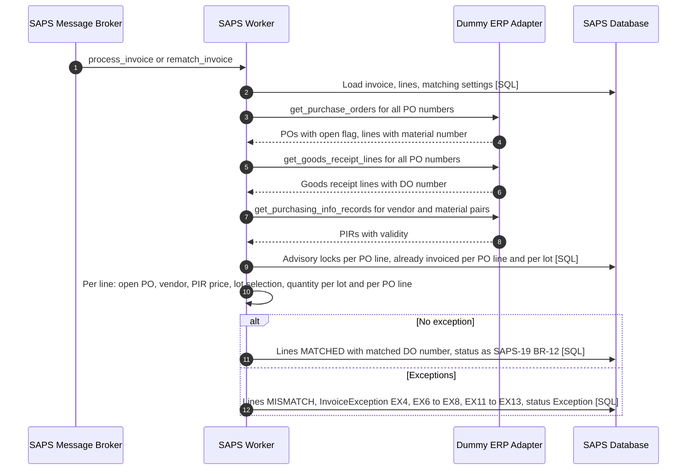

# SAPS-51 — Trade PO matching per received lot and PIR price check

## 1. Summary
Trade PO invoices are matched 3-way against **one received lot** instead of the sum of all goods receipts of a PO line
([DEC-065](../01-requirements/decision-log.md#dec-065)). A PO line with one goods receipt is matched by PO number; a
PO line with several goods receipts needs the **DO number** (delivery order) of one of them on the invoice line. The
unit price of a trade PO invoice line is checked against the **purchasing info record** (PIR) valid on the invoice
date ([DEC-066](../01-requirements/decision-log.md#dec-066)). Only **open** POs are matched. The dummy ERP data gets
the open PO list, DO numbers on goods receipts and PIRs until the ERP integration
([DEC-067](../01-requirements/decision-log.md#dec-067)). Three new exception types EX11 – EX13
([DEC-068](../01-requirements/decision-log.md#dec-068)).

| Item | Value |
|---|---|
| Linear | [SAPS-51](https://linear.app/jiringuyen/issue/SAPS-51) |
| Use cases | UC-02 Upload invoice, UC-03 Handle exception ([§1](../02-architecture/arc42/01-introduction-and-goals.md#use-cases)) |
| Scope items | [SCP-IN-21](../01-requirements/scope.md#31-functional-capabilities), [SCP-IN-03](../01-requirements/scope.md#31-functional-capabilities), [SCP-IN-09](../01-requirements/scope.md#32-integrations) |
| Target release | Phase 2 demo 2027-08-30 |

## 2. Requirements

### 2.1 Business Rules
Rules of [SAPS-19](SAPS-19-invoice-matching.md) stay unless a rule here replaces them. Non-trade PO invoices (2-way)
and non-PO invoices are unchanged.

| ID | Rule | Source |
|---|---|---|
| BR-01 | **Open PO.** The ERP Data Port returns each requested PO with its open flag. A PO is **not open** when the ERP marks it closed, or when every line of the PO is fully invoiced (already invoiced quantity ≥ ordered quantity, [DEC-023](../01-requirements/decision-log.md#dec-023)). A line referring to a PO that is not open raises EX4 "PO {n} is not open"; its other checks are skipped. Applies to trade and non-trade POs. | DEC-067, [MTG-20270301-10](../01-requirements/meetings/2027-03-01-trade-po-lot-matching-details.md) R5 |
| BR-02 | **Lot.** A received lot is identified by (PO number, PO line number, DO number). Its received quantity is the sum of the goods receipt lines of that PO line whose goods receipt carries that DO number . | DEC-065, [MTG-20270301-10](../01-requirements/meetings/2027-03-01-trade-po-lot-matching-details.md) R3 |
| BR-03 | **Lot selection (trade PO lines).** The PO line has no goods receipt → EX8. The PO line has exactly one lot: the line is matched against it; a DO number on the invoice line must be the DO number of that lot, else EX13. The PO line has several lots: the invoice line must carry a DO number (none → EX11) that is the DO number of one lot (none matches → EX13). | DEC-065, DEC-068 |
| BR-04 | **DO number comparison.** DO numbers are compared after the normalization of [DEC-042](../01-requirements/decision-log.md#dec-042): case ignored; spaces, `-`, `.` and `/` removed; leading zeros kept. | [MTG-20270301-10](../01-requirements/meetings/2027-03-01-trade-po-lot-matching-details.md) R4 |
| BR-05 | **Matched lot.** When a lot is selected, matching stores its DO number on the invoice line (`matchedDoNumber`), whether the DO number came from the invoice or from the only lot. The extracted or edited DO number (`doNumber`) is not changed. | DEC-065 |
| BR-06 | **Quantity per lot.** Expected quantity = received quantity of the lot − already invoiced quantity of the lot. Already invoiced quantity of a lot = sum of line quantities on **other** invoices of the company with the same PO line and the same `matchedDoNumber`, in the statuses of DEC-023 (Posted is added with [SAPS-49](https://linear.app/jiringuyen/issue/SAPS-49)). The invoice quantity must not exceed the expected quantity; above → EX7; smaller passes. Lines of the same invoice on the same lot are added up (SAPS-19 EC-01). | DEC-065, DEC-032 |
| BR-07 | **Quantity per PO line.** The PO line check of SAPS-19 BR-07 stays as a second check: the sum of the invoice lines on the PO line must not exceed all goods receipts of the PO line minus its already invoiced quantity; above → EX7. It covers invoices matched before this feature, which have no matched lot. One EX7 per line at most. | DEC-032, §6 |
| BR-08 | **PIR price.** For a trade PO line, the reference price is the PIR of (company, vendor of the PO, material number of the PO line) valid on the invoice date (`valid_from` ≤ invoice date ≤ `valid_to`; no `valid_to` = open-ended). `abs(invoice unit price − PIR price) ≤ price tolerance`, else EX6 (inclusive bound, tolerance from MatchingSettings, default 0.5 USD). The PO unit price is no longer checked for trade PO lines. | DEC-066, DEC-015 |
| BR-09 | **No PIR.** No PIR valid on the invoice date, a PO line without a material number, or an invoice without an invoice date → EX12 on the line, with the reason in the message; the price check of that line is skipped. | DEC-066, DEC-068, [MTG-20270301-10](../01-requirements/meetings/2027-03-01-trade-po-lot-matching-details.md) R2 |
| BR-10 | **Non-trade PO lines** keep SAPS-19: 2-way, PO unit price, PO quantity not yet invoiced. A DO number on a non-trade line is ignored by matching. | DEC-065, DEC-066 |
| BR-11 | **Order of the checks per line:** EX3 → EX4 (not found, not open) → EX10 vendor → price (EX12 / EX6) → lot (EX8 / EX11 / EX13) → quantity (EX7). EX4 and EX10 skip the later checks (as SAPS-19 BR-15); EX8, EX11 and EX13 skip the quantity check of that line. All other problems are reported together. | SAPS-19 EC-10 |
| BR-12 | **Matching fields.** The DO number of a line and the invoice date become matching fields: changing them during exception handling re-runs matching. | [DEC-069](../01-requirements/decision-log.md#dec-069) (refines DEC-024) |
| BR-13 | **Acceptance.** EX11, EX12 and EX13 cannot be accepted as is; the Accounting Member corrects the DO number, the invoice date or rejects the invoice. | DEC-068 |
| BR-14 | **Extraction.** The extracted invoice line gets an optional DO number. The dummy sample set provides it where a demo scenario needs it. | DEC-065 |

### 2.2 Affected NFRs
| NFR | How this feature is affected |
|---|---|
| [NFR-SCAL-001](../01-requirements/nfr.md#nfr-scal-001) | Still one ERP call of each kind per invoice for all its PO numbers (POs, goods receipts, PIRs), and one query for the already invoiced quantities per PO line and per lot. |
| [NFR-MAINT-001](../01-requirements/nfr.md#nfr-maint-001) | The open flag, DO numbers and PIRs come through the ERP Data Port, so the MuleSoft adapter ([SAPS-48](https://linear.app/jiringuyen/issue/SAPS-48)) replaces the dummy adapter without changes to matching. |

### 2.3 Out of Scope
- Posting, the re-run after the last exception and the status Posted: [SAPS-49](https://linear.app/jiringuyen/issue/SAPS-49).
- Writing anything to the ERP. The DO number is recorded on the goods receipt in the ERP and only read (DEC-065).
- PIR conditions such as scales, discounts or surcharges; prices in other currencies (SCP-OUT-06).
- GR-based matching for non-trade PO invoices; services (entry sheets).
- A screen to maintain dummy ERP data; it lives in the fixture files.

## 3. Design

### 3.1 Affected Building Blocks
| Container | Change | Description |
|---|---|---|
| SAPS Worker | modified | Matching per lot, PIR price, open PO, EX11 – EX13; reads the new ERP data through the ERP Data Port |
| SAPS API | modified | `doNumber`, `matchedDoNumber` and `pirUnitPrice` on invoice lines; `doNumber` editable in `updateInvoice`; new exception codes |
| SAPS Web App | modified | Invoice detail: DO number column (editable during exception handling), matched lot, PIR price for trade PO lines; labels of EX11 – EX13 |
| SAPS Database | modified | `invoice_line.do_number`, `matched_do_number`, `pir_unit_price` (migration 0012) |
| Dummy ERP Adapter | modified | Fixture schema: PO `status`, PO line `material_number`, goods receipt `do_number`, `purchasing_info_records` |

ERP Data Port changes ([ADR-0001](../02-architecture/adr/0001-isolate-extraction-and-erp-behind-ports.md)):
- `PurchaseOrder` gets `is_open`; `PurchaseOrderLine` gets `material_number` (optional).
- `GoodsReceiptLine` gets `do_number`.
- New `get_purchasing_info_records(company_code, keys)` → PIRs for the (vendor, material) pairs of the invoice, with
  `unit_price`, `currency`, `valid_from`, `valid_to`. One call per invoice.

### 3.2 Main Flow

### 3.3 Edge Cases & Error Handling
| ID | Case | Expected behavior | Response / signal |
|---|---|---|---|
| EC-01 | PO line with one goods receipt, invoice line without DO number | Matched against that lot; `matchedDoNumber` = its DO number | Line MATCHED |
| EC-02 | PO line with one goods receipt, invoice DO number differs | EX13 (MTG-20270301-9 R13) | InvoiceException EX13 |
| EC-03 | A second goods receipt arrives after an invoice was matched against the first lot | The earlier invoice keeps its matched lot; the next invoice for the PO line needs a DO number | — |
| EC-04 | Two lines of one invoice on the same lot | Quantities added up for the lot check (BR-06) | EX7 on both lines if the sum fails |
| EC-05 | Two lines of one invoice on two lots of the same PO line | Each lot checked on its own; the PO line check (BR-07) adds both | — |
| EC-06 | Invoice matched before this feature (no matched lot) | Counts only in the PO line check (BR-07), not against a lot | — |
| EC-07 | Two goods receipts of a PO line with the same DO number | One lot; quantities added up (BR-02) | — |
| EC-08 | DO numbers "do-001 " and "DO001" | Equal after normalization (BR-04) | — |
| EC-09 | Two PIRs of the same vendor and material valid on the same day | Rejected when the fixtures are loaded (overlapping validity) | Worker fails to start: `ErpFixtureError` |
| EC-10 | PIR price exactly at the tolerance | Passes (inclusive bound) | Line MATCHED |
| EC-11 | Invoice date changed during exception handling | Re-matching with the PIR valid on the new date (BR-12) | 202, `rematch_invoice` |
| EC-12 | PO closed in the ERP, line also over-invoiced | Only EX4 "not open"; later checks skipped (BR-11) | InvoiceException EX4 |
| EC-13 | All lines of a PO fully invoiced by other invoices | PO not open → EX4 (BR-01) instead of EX7 | InvoiceException EX4 |
| EC-14 | Rejected or Exception invoice had a matched lot | Does not count as invoiced (DEC-023); its lot quantity is free | — |
| EC-15 | A message for the same invoice twice | Unchanged: idempotent (SAPS-19 EC-03) | Log `matching_skipped` |

### 3.4 API Changes
Contract version 0.8.0 → **0.9.0** ([saps-api.openapi.yaml](../02-architecture/api/saps-api.openapi.yaml)). No
breaking change: new optional fields and new enum values.

| operationId | Method & path | Change | Breaking | Spec |
|---|---|---|---|---|
| getInvoice | GET /v1/invoices/{invoiceId} | `InvoiceLine`: `doNumber` (string, ≤ 50, null), `matchedDoNumber` (read-only, null), `pirUnitPrice` (read-only, null); `ExceptionCode` adds EX11, EX12, EX13 | No | saps-api.openapi.yaml |
| updateInvoice | PATCH /v1/invoices/{invoiceId} | `InvoiceLineUpdate.doNumber`; a change of `doNumber` or `invoiceDate` re-matches (BR-12) | No | saps-api.openapi.yaml |
| listInvoices | GET /v1/invoices | Unchanged; new exception codes appear in summaries | No | saps-api.openapi.yaml |

### 3.5 Event Changes
None. The audit events of matching and corrections are unchanged; a DO number change appears in the `UPDATE` event
details like other line fields.

### 3.6 Data Model Changes
| Entity | Change | Migration | Backward compatible |
|---|---|---|---|
| [InvoiceLine](../02-architecture/data-model.md#invoiceline) | New `do_number` string(50) null, `matched_do_number` string(50) null, `pir_unit_price` decimal(18,4) null | `0012_trade_po_lot_matching` | Yes (nullable columns) |
| [InvoiceLine](../02-architecture/data-model.md#invoiceline) | `expected_quantity` means the lot quantity for trade PO lines | — | Yes |
| [External entities §4.2](../02-architecture/data-model.md#42-external-entities-read-through-ports-not-stored) | PurchaseOrder `is_open`; PurchaseOrderLine `material_number`; GoodsReceipt `do_number`; new PurchasingInfoRecord; derived lot values | — | — |

The existing index (`tenant_id`, `po_number`, `po_line_number`) serves the already invoiced query per lot too.

### 3.7 Security & Permissions
- Roles: unchanged. Accounting Members edit the DO number during exception handling, as other line fields.
- Authorization check: unchanged (`updateInvoice`, claim required).
- Sensitive data: DO numbers and PIR prices are Confidential, as PO data; not logged.
- Audit: unchanged events; DO number changes are in the `UPDATE` details.

### 3.8 Configuration & Feature Flags
None. Dummy ERP fixture schema (`backend/fixtures/*/erp/*.json`):

| Field | Change |
|---|---|
| `purchase_orders[].status` | New, `OPEN` (default) or `CLOSED` |
| `purchase_orders[].lines[].material_number` | New; required for trade POs (`0…`), optional for non-trade |
| `goods_receipts[].do_number` | New, required |
| `purchasing_info_records[]` | New list: `vendor_code`, `material_number`, `unit_price`, `currency` (`USD`), `valid_from`, `valid_to` (optional) |

Existing trade fixtures get material numbers, DO numbers and PIRs at the prices they use today, so DS-01 … DS-20 keep
their results. DS-04 (two deliveries) gets DO numbers on both invoices.

### 3.9 Observability
- Logs: `matching_completed` adds the counts of EX11 – EX13; `erp_fixture_loaded` adds the number of PIRs per company.
- Metrics, alerts: none ([NFR-OBS](../01-requirements/nfr.md) unchanged).

## 4. Rollout & Rollback
1. Migration 0012 adds the nullable columns; no backfill.
2. Fixtures and the Dummy ERP Adapter change together with the worker; the API and the Web App are deployed in the same
   release (one Docker Compose stack).
3. Invoices already in Exception are re-matched with the new rules only when an Accounting Member changes a matching
   field (as today).

**Rollback:** the downgrade drops the three columns; matched lots are lost, so invoices matched per lot fall back to the
PO line rule of SAPS-19. EX11 – EX13 exceptions cannot be read by the old version: the downgrade refuses while such
exceptions exist.

## 5. Test Scenarios
| ID | Scenario | Level | Covers |
|---|---|---|---|
| TS-01 | Lot selection: one lot with and without DO number, wrong DO number on one lot, several lots with a valid, a missing and an unknown DO number, no goods receipt | Unit | BR-03, EC-01, EC-02 |
| TS-02 | DO normalization; two goods receipts with the same DO number | Unit | BR-02, BR-04, EC-07, EC-08 |
| TS-03 | Quantity per lot and per PO line: partial lot, over the lot, over the PO line with older unmatched invoices, two lines on one lot and on two lots | Unit | BR-06, BR-07, EC-04 – EC-06 |
| TS-04 | PIR: valid on the date, before `valid_from`, after `valid_to`, open-ended, at the tolerance, outside, no material number, no invoice date | Unit | BR-08, BR-09, EC-10 |
| TS-05 | Open PO: closed in the ERP, all lines fully invoiced, one line fully invoiced (still open); order of the checks | Unit | BR-01, BR-11, EC-12, EC-13 |
| TS-06 | Fixture loading: new fields, overlapping PIRs, goods receipt without DO number, trade PO line without material number | Unit | §3.8, EC-09 |
| TS-07 | End to end in the worker with PostgreSQL: matched lot stored; a second invoice on the same lot gets EX7; a rejected invoice frees its lot | Integration | BR-05, BR-06, EC-03, EC-14 |
| TS-08 | `updateInvoice` with a new DO number or invoice date re-matches; EX11 – EX13 cannot be accepted as is | Integration | BR-12, BR-13, EC-11 |
| TS-09 | Non-trade PO invoices and the existing scenarios DS-01 … DS-20 give the same results as before | Integration / E2E | BR-10, §3.8 |
| TS-10 | Web App: DO number column and edit, matched lot, PIR price, labels of EX11 – EX13 | Unit (Vitest) | §3.1 |
| TS-11 | CI smoke: upload invoices for a two-lot PO (valid DO, missing DO → EX11, wrong DO → EX13 then corrected → matched) and a PIR outside tolerance (EX6) | E2E | BR-03, BR-08 |

New demo scenarios (fixtures `ds-21` … `ds-25`, catalog with [SAPS-47](https://linear.app/jiringuyen/issue/SAPS-47)):
lot matched by DO number; EX11; EX13 corrected; EX12; PO not open (EX4).

## 6. Decisions
| Decision | Rationale | ADR |
|---|---|---|
| The matched lot is stored on the invoice line (`matched_do_number`), separate from the DO number on the invoice | The already invoiced quantity per lot needs the lot also when the invoice had no DO number (EC-01); the user's data stays as entered | — |
| Keep the PO line quantity check next to the lot check (BR-07) | Invoices matched before this feature have no lot; the PO line check still prevents over-invoicing | — |
| Fully invoiced POs are computed by SAPS from its own invoices, the closed flag comes from the ERP | The dummy ERP does not know the invoices of SAPS; with the real ERP both signals stay valid | — |
| PIR lookup is a new ERP Data Port operation, one call per invoice | Same pattern as POs and goods receipts (NFR-SCAL-001); the MuleSoft adapter implements it later | [ADR-0001](../02-architecture/adr/0001-isolate-extraction-and-erp-behind-ports.md) |
| The Web App shows the PIR price for trade PO lines and the PO price for non-trade lines in one "Reference price" column | One column, the price the check used | — |

## 7. Open Questions
| # | Question | Proposal | Asked to | Due | Status |
|---|---|---|---|---|---|
| Q1 | The DO number and the invoice date now change the matching result. Should changing them during exception handling re-run matching, like the other matching fields (DEC-024)? | Yes; DEC-024 gets the two fields (BR-12) | Product Owner (Customer) | — | answered: yes → DEC-069 ([MTG-20270301-10](../01-requirements/meetings/2027-03-01-trade-po-lot-matching-details.md)) |
| Q2 | A trade PO invoice without an invoice date: which exception? | EX12 with the message "no invoice date to select the PIR"; the member enters the date (BR-09) | Product Owner (Customer) | — | answered: yes → BR-09 ([MTG-20270301-10](../01-requirements/meetings/2027-03-01-trade-po-lot-matching-details.md)) |
| Q3 | Two goods receipts of the same PO line with the same DO number (one delivery received in two steps): one lot? | Yes, their quantities are added up (BR-02) | Product Owner (Customer) | — | answered: yes → BR-02 ([MTG-20270301-10](../01-requirements/meetings/2027-03-01-trade-po-lot-matching-details.md)) |
| Q4 | Compare DO numbers exactly, or with the normalization used for invoice numbers (DEC-042)? | Same normalization as DEC-042 (BR-04) | Product Owner (Customer) | — | answered: yes → BR-04 ([MTG-20270301-10](../01-requirements/meetings/2027-03-01-trade-po-lot-matching-details.md)) |
| Q5 | When every line of a PO is fully invoiced, EX4 "PO is not open" replaces EX7 (BR-01). Is that the intended message for the Accounting Member? | Yes, as agreed in MTG-20270301-9 Q11 | Product Owner (Customer) | — | answered: yes → BR-01 ([MTG-20270301-10](../01-requirements/meetings/2027-03-01-trade-po-lot-matching-details.md)) |

## 8. Documentation Checklist
- [ ] API spec updated (`api/*.yaml`, 0.9.0)
- [ ] Data model updated (`data-model.md`: InvoiceLine, §4.2 external entities and derived values)
- [ ] Glossary updated for new terms (Delivery order (DO), Received lot, Purchasing info record (PIR), Open PO, EX11 – EX13)
- [ ] SAPS-19 spec: note that BR-06 and BR-07 are refined by SAPS-51 for trade PO invoices
- [ ] SAPS-20 spec: EX11 – EX13 not acceptable as is; DO number and invoice date are matching fields (DEC-069)
- [ ] Test strategy: new demo scenarios DS-21 … DS-25
- [ ] Developer Guide: fixture fields of the dummy ERP
- [ ] Release notes entry prepared
