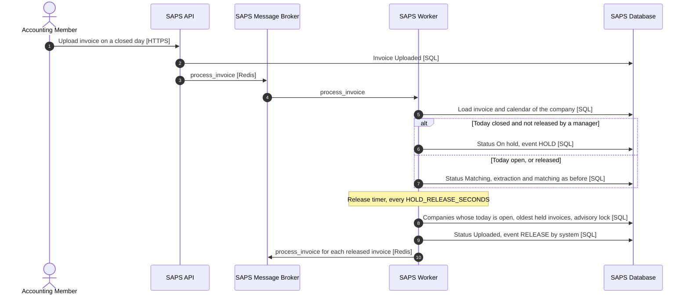
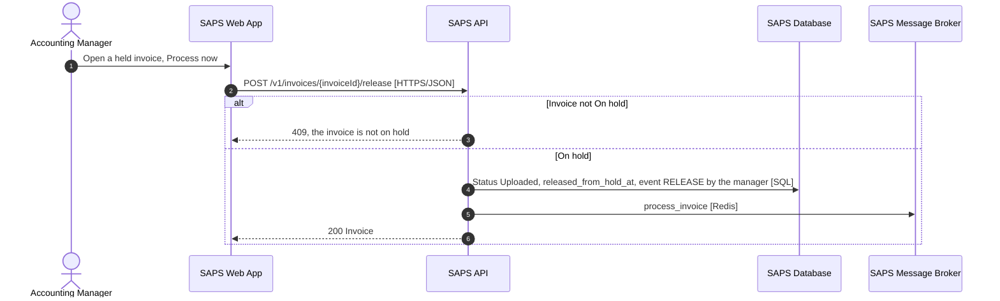

# SAPS-52 — Processing calendar per company

## 1. Summary
An Accounting Manager sets a **processing calendar** for the company: days on which invoices are not processed, for
example from the 25th of a month to the 5th of the next month, on weekends, and on public holidays
([DEC-062](../01-requirements/decision-log.md#dec-062)). On a closed day, new invoices (upload or mail) are still
received but wait in the new status **On hold**; when the company is open again they are processed automatically, oldest
first. A manager can let one held invoice through at once ("Process now"). Invoices already in exception handling,
approval or final review are worked on as usual. The Web App shows a banner while the company is closed.

| Item | Value |
|---|---|
| Linear | [SAPS-52](https://linear.app/jiringuyen/issue/SAPS-52) |
| Use cases | UC-10 Set processing calendar (new, [§1](../02-architecture/arc42/01-introduction-and-goals.md#use-cases)) |
| Scope items | [SCP-IN-23](../01-requirements/scope.md#31-functional-capabilities) |
| Target release | Phase 2 demo 2027-08-30 |

## 2. Requirements

### 2.1 Business Rules
| ID | Rule | Source |
|---|---|---|
| BR-01 | A company's calendar has rules of three kinds: a **monthly day range** (from day *a* to day *b* of every month; when *a* > *b* the range runs into the next month, e.g. 25 → 5), a **weekday** (e.g. Saturday), a **specific date** (e.g. a public holiday). A day matching any rule is **closed**; all other days are open. No times of day. | DEC-062 |
| BR-02 | Days are days of the company's time zone (`tenant.time_zone`, [SAPS-42](SAPS-42-companies-and-demo-data.md)). In a monthly range both ends are included; a day number after the end of a month means its last day (31 in February = 28 or 29) (Q1). | DEC-062, proposal |
| BR-03 | When automatic processing of a new invoice would start (status Uploaded) on a closed day, the invoice goes to **On hold** instead; it is not extracted or matched. This holds every way an invoice arrives: upload, mail ([SAPS-45](SAPS-45-mailbox-intake.md)), and invoices received before the period that were not processed yet (Q2). | DEC-062, proposal |
| BR-04 | Only automatic processing is held. Invoices in Exception, Pending approval or Pending review are worked on as usual, re-matching after a correction included; approvals and notifications are unchanged. | DEC-062 (Q9 of MTG-20270301-4) |
| BR-05 | On the first open day, held invoices of the company return to Uploaded and are processed automatically, oldest first. | DEC-062 |
| BR-06 | An Accounting Manager can release one held invoice at once ("Process now"): it is processed although the day is closed, and it is not held again. | DEC-062 |
| BR-07 | Only the Accounting Manager of the company changes its calendar. A change applies at once: removing the rule of today releases the held invoices (BR-05); a new rule for today holds new invoices from then on. | DEC-062 |
| BR-08 | On a closed day every user of the company sees a banner: "{Company} is in a closed period until {first open day}: new invoices are held." No notification when a period starts or ends. | DEC-062 |
| BR-09 | An invoice On hold can be opened (file, history) and found in All invoices ([SAPS-46](SAPS-46-invoice-search.md)) with status On hold. It cannot be claimed, corrected or rejected while held (Q3). | proposal |

### 2.2 Affected NFRs
| NFR | How this feature is affected |
|---|---|
| [NFR-SCAL-001](../01-requirements/nfr.md#nfr-scal-001) | A closed period of 10 days at about 1,000 invoices a day holds about 10,000 invoices; the release sends them in batches (§3.8, Q6) so the SAPS Worker is not flooded. |

### 2.3 Out of Scope
- Times of day, different rules per vendor or per invoice type.
- Public holiday lists maintained by the system (the manager enters dates).
- Notifications when a period starts or ends; deadlines (none exist in the system).
- Holding re-matching, approvals or final reviews (BR-04).

## 3. Design

### 3.1 Affected Building Blocks
| Container | Change | Description |
|---|---|---|
| SAPS API | modified | Calendar read and replace; "Process now" (`releaseInvoice`); status On hold in the invoice operations |
| SAPS Worker | modified | `process_invoice` holds an Uploaded invoice on a closed day; a release timer (like the sweeper) releases held invoices on open days |
| SAPS Database | modified | New table `processing_calendar_rule`; `invoice.released_from_hold_at`; status `ON_HOLD` |
| SAPS Web App | modified | Manager screen **Processing calendar**; banner for all users; status On hold; "Process now" on a held invoice |

Design rules:
- **Pure rule:** `domain/processing_calendar.py`: `is_closed(day, rules)` and `next_open_day(day, rules)` (looks ahead at
  most 366 days; if every day is closed, there is no open day and the banner says so) (Q4).
- **Hold point (Q5):** at the start of `process_invoice` ([SAPS-18](SAPS-18-dummy-invoice-extraction.md)), in the same
  transaction that would move the invoice to Matching: if the invoice is Uploaded, not released by a manager, and today
  is closed in the company's time zone → status On hold, event `HOLD` by `system`. Upload, mail, and the sweeper's re-sends
  all pass here, so no channel can skip the calendar.
- **Release (BR-05, BR-07):** a timer in each SAPS Worker process, started like the sweeper
  ([SAPS-37](SAPS-37-stuck-invoice-sweeper.md)): every `HOLD_RELEASE_SECONDS`, for each company whose today is open,
  the oldest held invoices (at most `HOLD_RELEASE_BATCH`) go back to Uploaded with the event `RELEASE` by `system`, then
  `process_invoice` is sent. An advisory lock lets one process release at a time. A failed send is recovered by the
  sweeper as for any Uploaded invoice.
- **Process now (BR-06, Q7):** `releaseInvoice` sets `released_from_hold_at`, moves the invoice to Uploaded with the
  event `RELEASE` by the manager, and sends `process_invoice`. The hold check skips an invoice with
  `released_from_hold_at`, also when the sweeper re-sends it.
- **Sweeper:** On hold is not a stuck status; the sweeper keeps looking only at Uploaded and Matching.
- **Duplicate detection:** an invoice On hold has no data yet, like Uploaded; it is not compared
  ([SAPS-23](SAPS-23-duplicate-invoice-detection.md)).

### 3.2 Main Flow

"Process now" by the Accounting Manager:

### 3.3 Edge Cases & Error Handling
| ID | Case | Expected behavior | Response / signal |
|---|---|---|---|
| EC-01 | Range 25 → 5 | 25th to end of month and 1st to 5th of the next month are closed | — |
| EC-02 | Range 30 → 5 in February | From the last day of February (BR-02) | — |
| EC-03 | Range 10 → 10 | Only the 10th of every month | — |
| EC-04 | Invoice uploaded at 23:50 local time on an open day, processed after midnight on a closed day | Held: the check is when processing starts (BR-03) | event `HOLD` |
| EC-05 | Every day closed (e.g. all seven weekdays) | All new invoices held; the banner says "until further notice"; managers can still release one by one | — |
| EC-06 | A held invoice released by a manager, its message lost | The sweeper re-sends it; it is not held again | — |
| EC-07 | "Process now" on an invoice that is no longer On hold (released by the timer meanwhile) | Nothing changes | `409` |
| EC-08 | A member calls "Process now", or a manager of another company | Refused / not found | `403` / `404` |
| EC-09 | Calendar changed while invoices are held | The next release tick uses the new calendar (BR-07) | — |
| EC-10 | Invalid rule: day 0 or 32, weekday 8, a range without both days, a date without a value, more than 100 rules | Refused, nothing saved | `422` with the field |
| EC-11 | The SAPS Worker is down when the company opens | Released at the first tick after it starts | — |
| EC-12 | Re-matching after a correction on a closed day | Runs as usual (BR-04) | — |

### 3.4 API Changes
Contract [saps-api.openapi.yaml](../02-architecture/api/saps-api.openapi.yaml) goes to **0.8.0** (the new status value is a
change for strict clients; the only client is the SAPS Web App, changed in the same release).

| operationId | Method & path | Change | Breaking | Spec |
|---|---|---|---|---|
| `getProcessingCalendar` | GET /v1/processing-calendar | new, both roles: `rules`, `timeZone`, `closedToday`, `openAgainOn` (date or null), `updatedAt`, `updatedBy` | No | [saps-api.openapi.yaml](../02-architecture/api/saps-api.openapi.yaml) |
| `updateProcessingCalendar` | PUT /v1/processing-calendar | new, Accounting Manager: replaces all rules; each rule `kind` (`MONTHLY_RANGE`, `WEEKDAY`, `DATE`) with `fromDay`/`toDay`, `weekday` (1 = Monday … 7 = Sunday) or `date`, and an optional `label`; `422` for EC-10 | No | ″ |
| `releaseInvoice` | POST /v1/invoices/{invoiceId}/release | new, Accounting Manager: On hold → Uploaded; `409` when not On hold | No | ″ |
| — | `InvoiceStatus` | new value `ON_HOLD` | Yes (enum value) | ″ |

### 3.5 Event Changes
None for messages (`process_invoice` is unchanged). New invoice event actions: `HOLD` (`system`), `RELEASE` (`system`
or the manager's name; details `{"by": "calendar" | "manager"}`).

### 3.6 Data Model Changes
| Entity | Change | Migration | Backward compatible |
|---|---|---|---|
| ProcessingCalendarRule (new) | `id`, `tenant_id`, `kind`, `from_day`, `to_day`, `weekday`, `date`, `label` (≤ 100), audit columns; row-level security like every tenant table; checks per kind | `0011_processing_calendar` | Yes |
| [Invoice](../02-architecture/data-model.md#invoice) | status value `ON_HOLD` (strings, no type change); `released_from_hold_at` (timestamp, null); index (`tenant_id`, `status`, `created_at`) for the release | same | Yes |
| Invoice lifecycle | Uploaded → On hold (closed day); On hold → Uploaded (open day or Process now) | — | — |

### 3.7 Security & Permissions
- `updateProcessingCalendar` and `releaseInvoice`: `x-roles: [ACCOUNTING_MANAGER]`; `getProcessingCalendar`: both roles.
- Row-level security on `processing_calendar_rule`; the release timer works company by company under row-level
  security, like the mail intake (SAPS-45).
- `Origin` check on PUT and POST as for every state change.

### 3.8 Configuration & Feature Flags
| Key | Purpose | Default | Per environment |
|---|---|---|---|
| `HOLD_RELEASE_SECONDS` | Interval of the release timer | `60` (Q6) | shorter in CI |
| `HOLD_RELEASE_BATCH` | Held invoices released per company and tick | `200` (Q6) | — |

### 3.9 Observability
- Logs: `invoice_held` (invoice, tenant), `invoices_released` (tenant, count, by calendar), `invoice_released`
  (invoice, by manager), `processing_calendar_changed` (tenant, rule count).

## 4. Rollout & Rollback
1. Migration `0011`; no rules exist, so every company is open and nothing changes until a manager sets a calendar.
2. The release timer starts with the SAPS Worker.

**Rollback:** before reverting, delete the rules and wait one release tick so no invoice stays On hold; the downgrade
refuses while invoices are On hold.

## 5. Test Scenarios
| ID | Scenario | Level | Covers |
|---|---|---|---|
| TS-01 | `is_closed` and `next_open_day`: ranges inside a month and across months, February and leap years, weekdays, dates, all-closed | Unit | BR-01, BR-02, EC-01 – EC-03, EC-05 |
| TS-02 | `process_invoice` on a closed day holds; on an open day processes; a released invoice is not held; the company's time zone around midnight | Integration | BR-03, BR-06, EC-04, EC-06 |
| TS-03 | Release timer: open company releases oldest first in batches; closed company keeps them; two processes do not release twice | Integration | BR-05, BR-07, EC-09, EC-11 |
| TS-04 | Calendar API: read for both roles, replace by the manager, `422` cases, `403` for members, `openAgainOn` | Integration | BR-07, BR-08, EC-10 |
| TS-05 | `releaseInvoice`: manager only, `409` when not held, `404` for another company | Integration | BR-06, EC-07, EC-08 |
| TS-06 | Exception handling, approval, review and re-matching on a closed day work as usual | Integration | BR-04, EC-12 |
| TS-07 | Web App: calendar screen, banner, On hold label, Process now | Unit (Web App) | BR-08, BR-09 |
| TS-08 | Compose smoke: a rule for today holds an upload; Process now processes it; removing the rule releases the others | E2E | BR-03 – BR-07 |

## 6. Decisions
| Decision | Rationale | ADR |
|---|---|---|
| Hold at the start of `process_invoice`, not at upload or mail intake | One point for every channel, the sweeper included; the check uses the day processing really starts | — |
| Release by a worker timer next to the sweeper | Same pattern as SAPS-37 and SAPS-45; no new container | — |
| `released_from_hold_at` instead of a message flag | Survives a lost message and the sweeper's re-send | — |
| Calendar as rule rows, not a list of closed days | The manager states the rule once (25 → 5, weekends); no yearly maintenance except holidays | — |

## 7. Open Questions
| # | Question | Asked to | Due | Status |
|---|---|---|---|---|
| Q1 | Monthly range: both days included, a range like 25 → 5 runs into the next month, and a day after the end of a month means its last day (31 in February = 28/29)? Proposal: yes. | Product Owner (Customer) | before implementation | open |
| Q2 | An invoice received on an open day but not processed yet when a closed day starts (e.g. uploaded at 23:50) is held too? Proposal: yes — the check is when processing starts. | Product Owner (Customer) | before implementation | open |
| Q3 | What can be done with an invoice On hold? Proposal: open it and find it in All invoices; only the manager's "Process now"; no claim, correction or rejection while held. | Product Owner (Customer) | before implementation | open |
| Q4 | Banner text and who sees the calendar? Proposal: banner for every user "{Company} is in a closed period until {first open day}: new invoices are held." ("until further notice" when no open day within a year); members see the banner only, the calendar screen is for managers. | Product Owner (Customer) | before implementation | open |
| Q5 | Hold at the start of `process_invoice` (all channels and re-sends) rather than at upload or mail intake? Proposal: yes. | Solution Architect / Tech Lead | before implementation | open |
| Q6 | Release timer defaults: every 60 s, at most 200 held invoices per company and tick (about 10,000 held invoices in under an hour)? Proposal: yes, configurable. | Solution Architect / Tech Lead | before implementation | open |
| Q7 | "Process now" recorded on the invoice (`released_from_hold_at`) so a lost message and the sweeper's re-send do not hold it again? Proposal: yes. | Solution Architect / Tech Lead | before implementation | open |

## 8. Documentation Checklist
- [ ] API spec 0.8.0 (calendar operations, `releaseInvoice`, `ON_HOLD`)
- [ ] Data model: ProcessingCalendarRule, Invoice changes, lifecycle diagram and table
- [ ] arc42 §1: UC-10 Set processing calendar
- [ ] Glossary: Processing calendar, Closed day, On hold
- [ ] SAPS-37 spec: On hold is not a stuck status (note)
- [ ] Developer Guide: how to try the calendar in the demo
- [ ] Release notes entry prepared
