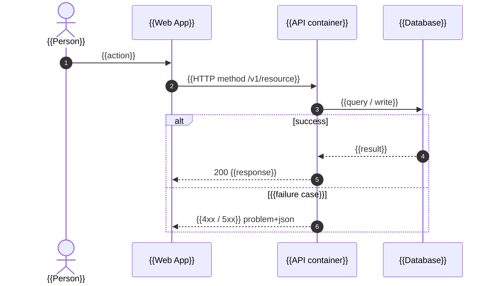

<!--
TEMPLATE: arc42 §6 Runtime View
Copy to: docs/02-architecture/arc42/06-runtime-view.md
Purpose: the few architecturally important scenarios that cross several containers
(e.g. end-to-end main flow, authentication, async processing with retries, failover).
Feature-level flows belong in docs/03-features/ — link them, do not copy them here.
Diagrams: Mermaid sequenceDiagram with autonumber; participants = C4 container names; ≤ 12 participants;
show error paths with alt/opt.
Delete all guidance comments and {{placeholders}} before setting status: in-review.
-->

# §6 Runtime View

## 6.1 Scenario Index
| # | Scenario | Use cases | Feature specs |
|---|---|---|---|
| 6.2 | {{scenario name}} | {{UC-NN}} | {{[KEY-NN](../../03-features/KEY-NN-title.md) / —}} |

## 6.2 {{Scenario name}}
<!-- Copy this subsection for each scenario. -->
**Trigger:** {{what starts the scenario}}
**Preconditions:** {{state required before it starts}}

**Notes:**
- {{error handling, retries, idempotency, timeouts}}

**Related:** {{UC-NN, NFR-*, ADR-NNNN}}
