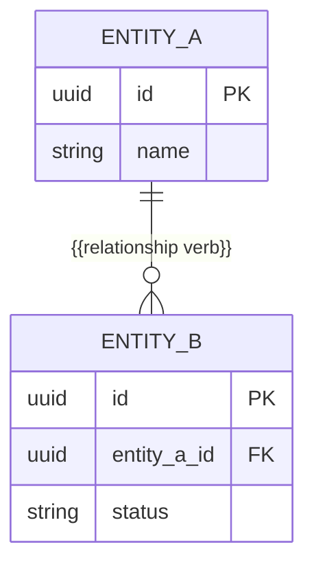
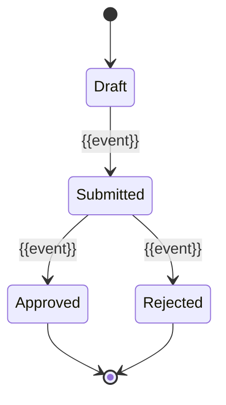

<!--
TEMPLATE: Data Model
Copy to: docs/02-architecture/data-model.md   (one file per project)
Purpose: single source of truth for entities, their attributes, relationships, classification and retention.
Entity names MUST match the glossary (§12) and API schemas. One "### <EntityName>" block per entity
(PascalCase, singular) → stable anchors such as #invoice.
Physical schema (DDL) lives in code as migrations; this document describes intent, not every index.
Delete all guidance comments and {{placeholders}} before setting status: in-review.
-->

# Data Model

## 1. Overview
<!-- Which data stores exist and which container owns each. A container owns its data; others access it via APIs/events. -->
| Data store | Technology | Owning container | Entities | ADR |
|---|---|---|---|---|
| {{store name}} | {{e.g. Amazon RDS PostgreSQL 16 / Azure SQL / DynamoDB / S3}} | {{container}} | {{entities}} | {{ADR link}} |

## 2. Entity Relationship Diagram
<!-- Mermaid erDiagram. Show entities, keys and cardinality; keep attributes to keys and the most important fields.
     Split into one diagram per data store if it grows beyond ~15 entities. -->

## 3. Data Classification
<!-- Company levels; adjust if the customer has its own scheme. Used in the "Class." column below. -->
| Level | Meaning | Handling |
|---|---|---|
| Public | Can be published | No restriction |
| Internal | Business data, not sensitive | Authenticated access only |
| Confidential | Financial or commercial data | Role-based access, encrypted at rest, audit reads of bulk exports |
| Restricted | Personal data (PII), credentials, bank details | Need-to-know access, masked in logs and non-prod, encrypted, access audited |

## 4. Entities

<!-- Copy this block per entity. Types are logical (uuid, string(n), decimal(p,s), date, timestamp UTC, boolean, enum, json).
     Key: PK | FK → Entity | UK.  Class.: Public | Internal | Confidential | Restricted. -->

### {{EntityName}}
{{What the entity represents, one or two sentences.}}

| Property | Value |
|---|---|
| Data store / table | {{store}} / `{{table_name}}` |
| Owning container | {{container}} |
| Lifecycle | {{see §5 / simple CRUD}} |
| Retention | {{period and rule, e.g. 10 years after fiscal year end}} — {{[NFR-COMP-NNN](../01-requirements/nfr.md#nfr-comp-nnn)}} |
| Expected volume | {{rows at go-live, growth per year}} |

| Attribute | Type | Null | Key | Class. | Description |
|---|---|---|---|---|---|
| id | uuid | No | PK | Internal | Surrogate key |
| {{attribute}} | {{type}} | {{Yes / No}} | {{FK → Entity / UK / —}} | {{class}} | {{description, allowed values}} |
| created_at | timestamp UTC | No | — | Internal | Creation time |
| created_by | string(100) | No | — | Internal | User or service that created the row |
| updated_at | timestamp UTC | No | — | Internal | Last update time |
| updated_by | string(100) | No | — | Internal | User or service of the last update |

## 5. Entity Lifecycles
<!-- optional — one stateDiagram-v2 per entity with a non-trivial status field. States must match the enum values. -->
### {{EntityName}} lifecycle

## 6. Retention & Archival
<!-- Summary per data category: hot retention, archive tier (S3 Glacier / Archive Storage), deletion, legal hold. -->
| Data category | Online retention | Archive | Deletion | Requirement |
|---|---|---|---|---|
| {{category}} | {{period}} | {{where, how long}} | {{rule}} | {{NFR-COMP link}} |

## 7. Schema Migration Approach
<!-- Tool (Flyway / Liquibase / EF Core migrations / Prisma …), where migrations live, naming,
     backward-compatible change rules (expand → migrate → contract), who runs them in each environment. -->
- Tool: {{tool}}
- Location: {{repo / path}}
- Rules: {{e.g. migrations are forward-only and backward compatible with the previous release}}

## 8. Open Questions
| # | Question | Asked to | Due | Status |
|---|---|---|---|---|
| Q1 | {{question}} | {{name}} | YYYY-MM-DD | {{open}} |
