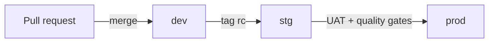

<!--
TEMPLATE: Deployment Guide
Copy to: docs/06-release/deployment-guide.md   (one file per project)
Purpose: how code and infrastructure get from a commit to each environment, and how to roll back.
Where things run and how they are sized lives in arc42 §7 — link it, do not repeat it.
Rules:
- Steps must be executable by another team member without asking the author: exact pipeline names, commands, links.
- Use {{placeholders}} for values; NEVER write secrets, passwords, keys or tokens in this document.
- Keep it in sync with the pipelines: change a pipeline → update this guide in the same pull request.
Delete all guidance comments and {{placeholders}} before setting status: in-review.
-->

# Deployment Guide

## 1. Overview
| Item | Value |
|---|---|
| Cloud | {{AWS / Azure}} — see [arc42 §7 Deployment View](../02-architecture/arc42/07-deployment-view.md) |
| CI/CD | {{GitHub Actions / Azure DevOps Pipelines / GitLab CI / AWS CodePipeline}} |
| Infrastructure as Code | {{Terraform / Bicep / AWS CDK / CloudFormation}} |
| Artifact registry | {{Amazon ECR / Azure Container Registry / npm / NuGet}} |
| Release versioning | SemVer `vX.Y.Z` git tags; images tagged with {{version and commit SHA}} |

## 2. Environments & Promotion
<!-- Trigger: e.g. merge to main, tag vX.Y.Z, manual. Approval: who must approve before the deploy runs. -->
| Environment | Trigger | Approval | Pipeline | URL |
|---|---|---|---|---|
| dev | {{merge to main}} | {{none}} | {{pipeline name}} | {{url}} |
| stg | {{tag vX.Y.Z-rc.N}} | {{Tech Lead}} | {{pipeline name}} | {{url}} |
| prod | {{tag vX.Y.Z}} | {{PM + customer change approval}} | {{pipeline name}} | {{url}} |

## 3. Repositories & Artifacts
| Repository | Produces | Artifact location | Deployed to |
|---|---|---|---|
| {{repo}} | {{container image / static site / function package / IaC}} | {{registry / bucket}} | {{container / service}} |

## 4. CI/CD Pipelines
<!-- Quality gates come from the test strategy §5 — reference them, don't redefine. -->
| Pipeline | Trigger | Stages | Quality gates | Definition |
|---|---|---|---|---|
| {{name}} | {{trigger}} | {{build → test → scan → publish → deploy}} | [Test Strategy §5](../05-testing/test-strategy.md#5-quality-gates) | {{path to pipeline file}} |

## 5. Deployment Strategy
<!-- Per container: rolling | blue-green | canary | recreate; zero-downtime expectation; health checks. -->
| Container | Strategy | Health check | Zero downtime |
|---|---|---|---|
| {{container}} | {{rolling}} | {{/health/ready}} | {{Yes / No — maintenance window}} |

## 6. Infrastructure as Code
- Location: {{repo / path}}
- State: {{S3 + DynamoDB lock / Azure Storage blob / managed by CDK}}
- Structure: {{modules / stacks per environment}}
- Apply process: {{plan on PR, apply via pipeline after approval; no manual console changes}}
- Drift detection: {{scheduled plan / AWS Config / Azure Policy}}

## 7. Configuration & Secrets
<!-- Where configuration and secrets live per environment and how to change them. No values here. -->
| Type | Store | How to change | Rotation |
|---|---|---|---|
| App configuration | {{SSM Parameter Store / Azure App Configuration / env vars in IaC}} | {{via IaC PR}} | — |
| Secrets | {{AWS Secrets Manager / Azure Key Vault}} | {{procedure}} | {{automatic every n days / manual — RB-NNN}} |

## 8. Access & Permissions
| Action | Who | How access is granted |
|---|---|---|
| Deploy to dev / stg | {{team}} | {{pipeline}} |
| Approve prod deployment | {{roles}} | {{environment protection rule}} |
| Production console access | {{roles}} | {{SSO role, just-in-time / PIM}} |
| Break-glass access | {{roles}} | {{procedure, audit}} |

## 9. Production Release Procedure

### 9.1 Before Deployment
- [ ] Release notes ready: `release-notes/vX.Y.Z.md`
- [ ] All quality gates for prod passed (regression, PSR if required, UAT sign-off)
- [ ] Database migrations reviewed for backward compatibility
- [ ] Change approved by {{customer change process}}; deployment window agreed: {{window}}
- [ ] Stakeholders notified: {{channel}}
- [ ] Rollback plan confirmed (§10)

### 9.2 Deployment Steps
<!-- Numbered, exact steps. Include expected duration and who does each step. -->
1. {{Create tag vX.Y.Z on commit … }}
2. {{Approve the prod stage in pipeline …}}
3. {{Database migration runs as step … ; expected duration …}}
4. {{Application deploy …}}

### 9.3 Post-deployment Verification
- [ ] Smoke tests passed: {{suite / link}}
- [ ] Dashboards normal for {{n}} minutes: {{dashboard link}}
- [ ] No new alerts firing
- [ ] Release announced: {{channel}}

## 10. Rollback Procedure
<!-- When to roll back, and how. Database changes are expand/contract, so the previous app version works
     against the migrated schema; prefer roll-forward for data fixes. -->
**Roll back when:** {{e.g. smoke tests fail, error rate > n % for 10 min, critical defect without a quick fix}}

1. {{Redeploy previous tag vX.Y.(Z-1) via pipeline …}}
2. {{Disable feature flag …}}
3. {{Database: no schema rollback; apply forward fix if needed}}
4. Verify as in §9.3 and notify stakeholders.

## 11. Hotfix Procedure
1. {{Branch from tag vX.Y.Z as hotfix/vX.Y.(Z+1)}}
2. {{Fix, PR with review, same quality gates — or the reduced set: …}}
3. {{Deploy to stg, verify, deploy to prod with the §9 checklist}}
4. {{Merge the fix back to main}}

## 12. New Environment Setup
<!-- optional — bootstrap steps for a new environment or account/subscription. -->
1. {{step}}

## 13. Troubleshooting
| Symptom | Likely cause | Action |
|---|---|---|
| {{pipeline fails at …}} | {{cause}} | {{action / [RB-NNN](../07-operations/runbook.md#rb-nnn)}} |
