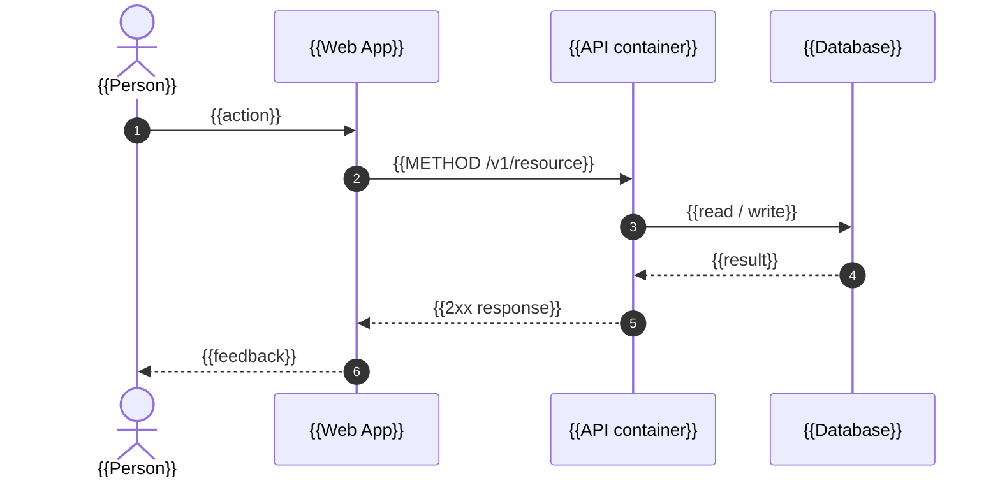

<!--
TEMPLATE: Feature Tech Spec
Copy to: docs/03-features/<JIRA-KEY>-<kebab-title>.md   (one file per non-trivial feature / epic)
Write it when: the feature touches more than one container, changes an API/event/schema, has non-obvious
business rules, or carries NFR/security impact. Small changes only need the Jira ticket.
Rules:
- User stories and acceptance criteria live in Jira — link them, do not copy them.
- Names (containers, entities, operations) MUST match the glossary (arc42 §12), C4 diagrams and API specs.
- Contract first: update api/*.yaml and data-model.md in the same pull request as this spec, then link them.
- Local IDs (BR-NN business rules, EC-NN edge cases, TS-NN test scenarios) are scoped to this spec.
- Keep it short: 1–3 pages. Delete sections that do not apply (marked optional).
Delete all guidance comments and {{placeholders}} before setting status: in-review.
-->

# {{JIRA-KEY}} — {{Feature title}}

## 1. Summary
<!-- 2–4 sentences: what the feature does, for whom, and why now. -->
{{summary}}

| Item | Value |
|---|---|
| Jira | [{{JIRA-KEY}}]({{tracker base URL}}{{JIRA-KEY}}) |
| Use cases | {{[UC-NN](../02-architecture/arc42/01-introduction-and-goals.md)}} |
| Scope items | {{[SCP-IN-NN](../01-requirements/scope.md)}} |
| Target release | {{vX.Y.Z / sprint}} |

## 2. Requirements

### 2.1 Business Rules
<!-- Rules the implementation must enforce that are not obvious from the acceptance criteria.
     Example row:
| BR-01 | An invoice above 50,000,000 VND requires a second approver from Finance | [MTG-20261121](../01-requirements/meetings/2026-11-21-approval-workflow.md) R2 |
-->
| ID | Rule | Source |
|---|---|---|
| BR-01 | {{rule}} | {{Jira AC / MTG / DEC link}} |

### 2.2 Affected NFRs
| NFR | How this feature is affected |
|---|---|
| {{[NFR-CAT-NNN](../01-requirements/nfr.md#nfr-cat-nnn)}} | {{e.g. adds a new search endpoint that must meet the latency target}} |

### 2.3 Out of Scope
- {{what this feature deliberately does not do}}

## 3. Design

### 3.1 Affected Building Blocks
| Container | Change | Description |
|---|---|---|
| {{container}} | {{new / modified}} | {{what changes}} |

### 3.2 Main Flow
<!-- Mermaid sequence: autonumber, participants = C4 container names, ≤ 12 participants. -->

### 3.3 Edge Cases & Error Handling
| ID | Case | Expected behavior | Response / signal |
|---|---|---|---|
| EC-01 | {{e.g. duplicate submission}} | {{behavior}} | {{409 problem+json / DLQ / user message}} |

### 3.4 API Changes
<!-- optional — every new or changed operation. Breaking = incompatible for existing clients → needs /v2 + ADR. -->
| operationId | Method & path | Change | Breaking | Spec |
|---|---|---|---|---|
| {{operationId}} | {{GET /v1/…}} | {{new / modified / deprecated}} | {{No / Yes}} | {{[service.openapi.yaml](../02-architecture/api/service.openapi.yaml)}} |

### 3.5 Event Changes
<!-- optional — published or consumed events. -->
| Event | Channel | Change | Producer → Consumers | Spec |
|---|---|---|---|---|
| {{EventName}} | {{domain.entity.event.v1}} | {{new / modified}} | {{container → containers}} | {{asyncapi link}} |

### 3.6 Data Model Changes
<!-- optional — link the entity in data-model.md. Backward compatible = previous release still works after migration. -->
| Entity | Change | Migration | Backward compatible |
|---|---|---|---|
| {{[EntityName](../02-architecture/data-model.md#entityname)}} | {{new attribute / new entity / index}} | {{migration script name}} | {{Yes / No — plan in §4}} |

### 3.7 Security & Permissions
<!-- Roles allowed, authorization checks and where they run, data classification touched (Confidential / Restricted),
     audit events written. Follow arc42 §8.2. -->
- Roles: {{roles and what each may do}}
- Authorization check: {{where and how}}
- Sensitive data: {{classification, masking}}
- Audit: {{events logged}}

### 3.8 Configuration & Feature Flags
<!-- optional -->
| Key | Purpose | Default | Per environment |
|---|---|---|---|
| {{config key / flag}} | {{purpose}} | {{value}} | {{dev / stg / prod differences}} |

### 3.9 Observability
<!-- New logs, metrics, dashboards, alerts. New alerts need an ALR-* in monitoring-alerting.md and an RB-* in runbook.md. -->
- Metrics: {{metric names}}
- Alerts: {{[ALR-NNN](../07-operations/monitoring-alerting.md#alr-nnn) / none}}

## 4. Rollout & Rollback
<!-- Deployment order across containers, migration steps, feature-flag rollout, data backfill,
     and how to roll back safely (including data). -->
1. {{step}}

**Rollback:** {{how to revert; what happens to data written by the new version}}

## 5. Test Scenarios
<!-- Key scenarios QA and developers must cover; detailed test cases live in the test tool.
     Level: Unit | Integration | Contract | E2E | Performance | Security. Covers: BR / EC / Jira AC. -->
| ID | Scenario | Level | Covers |
|---|---|---|---|
| TS-01 | {{scenario}} | {{level}} | {{BR-01, EC-01, AC-2}} |

## 6. Decisions
<!-- Small, local design choices with one-line rationale. Architecturally significant ones → write an ADR and link it. -->
| Decision | Rationale | ADR |
|---|---|---|
| {{decision}} | {{why}} | {{[ADR-NNNN](../02-architecture/adr/NNNN-title.md) / —}} |

## 7. Open Questions
| # | Question | Asked to | Due | Status |
|---|---|---|---|---|
| Q1 | {{question}} | {{name}} | YYYY-MM-DD | {{open}} |

## 8. Documentation Checklist
<!-- Tick before merging the feature. Remove lines that do not apply. -->
- [ ] API spec updated (`api/*.yaml`)
- [ ] Data model updated (`data-model.md`)
- [ ] Glossary updated for new terms (arc42 §12)
- [ ] arc42 §6 updated if this flow is architecturally significant
- [ ] Monitoring alert (`ALR-*`) and runbook entry (`RB-*`) added for new failure modes
- [ ] Release notes entry prepared
